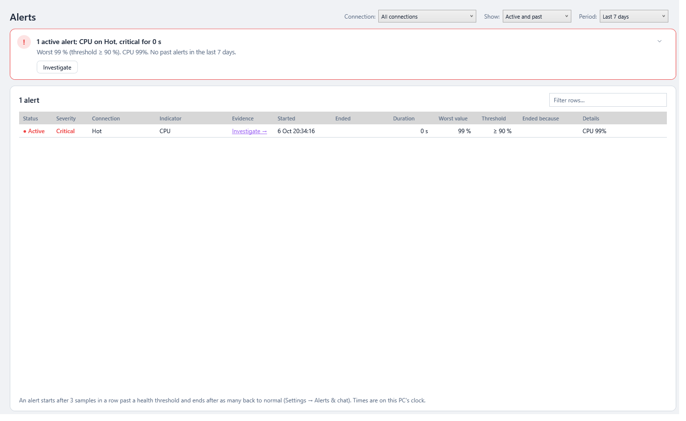

# Alerts

The health dot tells you what's wrong **now**. **Alerts** tell you what went wrong **and when**: every time a monitored server stays past one of its [health thresholds](Health-Dot-and-Background-Monitoring.md#what-is-checked), SqlVitals records an alert with its start time, end time and worst value. You can look back at the timeline after a busy night.

> **Where:** sidebar → **Alerts** (with the number active), or the tray menu's **Alerts** · **Configure:** ⚙️ Settings → *Alerts & chat* (and *Health thresholds*) · **Since:** 0.34.0 (notifications 0.35.0)

## How an alert starts and ends

Every sample a monitored connection collects (every 10 seconds by default) is checked against its thresholds, one indicator at a time.

| | When | Recorded time |
|---|---|---|
| **Starts** | The indicator has been past its **warning** (or critical) threshold for **3 samples in a row** | The **first** of those samples, when the problem actually began |
| **Becomes critical** | A warning alert's indicator has been past its **critical** threshold for 3 samples in a row | It stays critical from then on |
| **Ends** | The indicator has been back within its thresholds for **3 samples in a row** | The **first** of those samples, when the problem actually stopped |

Needing a run of samples **to end** as well as to start is what stops a value hovering around a threshold from raising a new alert every few seconds. A CPU bouncing between 74 % and 76 % either never raises an alert or raises **one** that stays open, never a stream of them.

**Example** (warning at 75 %, 3 samples, 10-second interval):

| Sample | 1 | 2 | 3 | 4 | 5 | 6 | 7 | 8 | 9 | 10 |
|---|---|---|---|---|---|---|---|---|---|---|
| CPU % | 70 | **78** | **80** | **77** | 73 | **79** | **81** | 70 | 71 | 69 |
| Alert | | | | starts, dated sample 2 | | | | | | ends, dated sample 8 |

The single 73 at sample 5 doesn't end it, because the samples after it are past the threshold again. The worst value recorded is 81 %.

## The Alerts page

**The verdict** (from 0.66.0) names the active alerts, the critical and longest-running first: *2 active alerts, 1 critical; Blocking on PROD-SQL02, critical for 12 min*, red when one is critical, with its worst value, the threshold and what the health dot said. **Investigate** opens [its evidence](#from-an-alert-to-its-evidence); **Active only** hides the past ones. With none active it says when the last one ended, and it says when alerts can't be raised at all (*No alerts are being raised: monitoring is off*) or not for some connections (it names them): this replaced the banner above the list. **Connection**, **Show** and **Period** are beside the page title. Select an alert to see all of its figures in the [details drawer](Working-with-Grids.md#details-beside-the-grid), the **Details** text in full. See [The page template](Getting-Started.md#verdict-first-then-the-detail).

| Column | What it shows |
|---|---|
| **Status** | **● Active**: still past its threshold. **Ended**: finished. |
| **Severity** | 🟠 **Warning** or 🔴 **Critical**: the worst level it held for long enough |
| **Connection**, **Indicator** | Which server, and which of the six health indicators |
| **Evidence** | **Investigate →**: the page that shows why, filtered and set to the alert's time (see [below](#from-an-alert-to-its-evidence)). Double-click a row or press **Enter** on it to do the same. |
| **Started**, **Ended**, **Duration** | On this PC's clock. Duration keeps counting while it's active. |
| **Worst value** | The highest figure seen, or the **lowest** for page life expectancy |
| **Threshold** | The threshold it crossed, e.g. `≥ 90 %` or `< 300 s` |
| **Ended because** | *Back to normal*, or *Monitoring stopped* (see below) |
| **Details** | What the health dot said at the worst value, e.g. *Log 93% full (Sales)* or *Blocking 3.5 min (4 blocked)* |

- **Filters:** **Connection** (all, or one), **Show** (active and past, active only, past only) and **Period** (last 24 hours, 7 days, 30 days, or all the history kept). The [filter box](Working-with-Grids.md) and column sorting work as on every grid.
- Active alerts are listed first, then the rest, newest first.
- The page **updates by itself** when an alert starts, changes or ends, so you can leave it open.
- The sidebar button shows how many alerts are active, e.g. **🔔 Alerts (2)**.
- Alerts of a **deleted connection** stay in the history and show under *All connections* with the name it had.

## From an alert to its evidence

From 0.61.0 every alert has an **evidence route**: the page that shows why, already **filtered to the problem** and **set to the alert's time**, so the first minutes go on fixing it rather than looking for it.

| Alert or check | Opens | Filtered to | A past alert's history |
|---|---|---|---|
| Blocking | 🔗 Processes | the head blocker's chain: the one whose blocked session has waited longest | Live charts (lock waits) |
| CPU | 🔥 Resource Queries, **By CPU** tab | the queries last run since 15 min before the alert started | Live charts (CPU) |
| Page life expectancy | 🧠 Memory Grants | (the whole page: memory clerks and grants) | Live charts (memory) |
| Memory grants pending | 🧠 Memory Grants | the grants still waiting for memory | Live charts (memory) |
| Log space used | 📦 DB Storage | the files of the database whose log was fullest | none kept |
| TempDB space used | 🗄️ TempDB | (the whole page) | none kept |

**Where to start from:**

- **Investigate** on an active alert on the server's [Overview](Your-Servers.md#active-alerts), and on a tile of **All servers** whose server has an active alert (the worst one);
- **Investigate →** in the **Evidence** column of the Alerts page, or double-click the row, or press **Enter** on it;
- a click on the **Windows notification** about one alert. A notification about several opens the server's Overview, which lists them all.

The links under *What is costing points* on the Overview open the same pages filtered the same way, as the server is now.

### The "Opened from alert" banner

The page opens with a banner above it naming the alert and its time, and what the page is showing: *Opened from alert · Blocking · critical · since 13:58 — showing the blocking chain of session 87 only*.

- **Show all** (*Show all 214 sessions*) clears the filter and shows the page as the sidebar opens it. **×** hides the banner and leaves the filter.
- **← Back** returns to where you clicked: the Overview, Alerts, All servers.
- While the alert is active, a refresh keeps the same chain on screen; when it ends, the page moves to the chain waiting longest, or says *nothing is blocked now*.

### An alert that has ended

Its window is **15 minutes before it started to 15 minutes after it ended**.

- Processes, Memory Grants, Resource Queries, DB Storage and TempDB only show the server **now**. The banner says so (*It ended at 14:05; this page shows the server now.*) and offers **Open Live charts for 13:43–14:20**, which charts that window from the monitoring history. A filter that only means something while the alert lasts (a blocking chain, a waiting grant) isn't applied.
- SqlVitals keeps no history of log space or TempDB space, so for those the banner says so.

### Links that carry their filter

- **Processes** → a session in the [details drawer](Working-with-Grids.md#details-beside-the-grid) → **Active waits →** opens Active Waits filtered to that session and the sessions it blocks.
- **Query Regressions** → a query ID (when Query Store is the source) opens **Query Store** on that query: the Top queries tab shows only it, and its details open in their own window.

Both show the same banner, *Opened from Processes · session 87*, with Show all, and Back returns to the page the link was on.

## Change when alerts fire

**⚙️ Settings → Alerts & chat → Raise an alert after**: **1, 2, 3 (default), 5 or 10 samples** in a row. The same number of normal samples ends an alert. It takes effect from the next sample, with no restart.

- It's counted in **samples**, so the time depends on each connection's sample interval (set on Live charts). At the default 10 seconds, 3 samples is 30 seconds; 10 samples is 100 seconds.
- **1** alerts on every single breach. Use it only with thresholds you're sure about.
- To change **what** raises an alert, change the [health thresholds](Health-Dot-and-Background-Monitoring.md#change-the-thresholds), for every connection or [just one](Health-Dot-and-Background-Monitoring.md#per-connection-thresholds). A level left blank there raises no alerts either.

## When monitoring stops

An alert needs someone watching. When nothing is, active alerts end with **Ended because: Monitoring stopped**, dated at the **last sample taken**:

- you stopped monitoring that connection: **Pause monitoring** on its Overview, **■** on Live charts, in the sidebar's server header or a tile's **⋯** menu, or **Stop monitoring all** in the tray menu;
- you turned off **Settings → Monitoring & history → Start monitoring automatically** (every connection stops);
- you edited or removed the connection;
- you exited SqlVitals (**Exit** in its notification-area menu, or closing the window when [running in the notification area](Notifications-and-Tray.md#running-in-the-notification-area) is off). Just closing or minimizing the window, by default, keeps monitoring running;
- SqlVitals was killed or the PC turned off. Those alerts are ended the next time SqlVitals starts, at the last sample it had saved for that connection.

If the problem is still there when monitoring resumes, a **new** alert starts after the usual run of samples.

**Your alerts stop when this PC sleeps, shuts down or SqlVitals closes**: nothing raises one while nobody is watching. [Chat channels](Chat-Notifications.md#stopped-watching-and-watching-again) are told *SqlVitals stopped watching* with why, naming the alerts still active instead of posting their *Back to normal*, and *watching again* with how long the gap was (since 0.70.0, [#170](https://github.com/aselasampath/sqlvitals/issues/170)). Going to sleep counts too, though the alerts stay active through it. When SqlVitals was killed or the PC lost power, there's no *stopped watching*, and nothing is posted for the alerts ended at the next start; *watching again* still says how long the gap was. Editing a connection restarts it without a message. A channel's [heartbeat](Chat-Notifications.md#heartbeat) (0.71.0) lets you be alerted when even that message can't be sent. Home and the Overview show how much of the last day was [monitored](Your-Servers.md#how-much-was-monitored) (0.72.0), so a quiet Alerts page can be read for what it is.

A **failed collection** (the server can't be reached) counts neither way, so an active alert stays active while the server is unreachable. The health dot shows 🔴 for that.

## Good to know

- **Which connections:** only saved connections that are **monitored**. From 0.46.0 nothing is monitored until you press Start or turn on **Start monitoring automatically**; see [Starting and stopping monitoring](Health-Dot-and-Background-Monitoring.md#starting-and-stopping-monitoring). While nothing is monitored the page's verdict says **No alerts are being raised: monitoring is off**, and while some connections aren't, it names them (*Monitoring is off for Sales-Prod, HR-DB, so no alerts are raised for them*). Windows notifications say nothing then either, because there are no alerts. If you pick a connection that isn't monitored, the page says why.
- **No extra load on the server:** alerts are worked out from the samples SqlVitals already collects.
- **How long they're kept:** as long as the rest of the [history](Settings.md#monitoring--history), counted from when the alert ended. An active alert is never deleted. **Clear history** deletes alerts too.
- **Notifications:** from 0.35.0 a Windows notification appears when an alert starts or turns critical; clicking it opened this page filtered to that connection until 0.57.0, the server's Summary from 0.57.0, and its [Overview](Your-Servers.md#active-alerts) from 0.59.0. From 0.61.0 a notification about one alert opens [its evidence](#from-an-alert-to-its-evidence); one about several still opens the Overview. Mute a connection on its **Monitoring & alerts** tab in **Settings → Connections**, or every connection with **Settings → Alerts & chat → Windows notifications**. See [Notifications and Tray](Notifications-and-Tray.md).
- **Chat channels:** from 0.52.0 an alert that starts, turns critical or ends is also posted to the Slack and Microsoft Teams channels in **Settings → Alerts & chat → Chat channels**, so the whole team sees it, in the same words as this page. Each channel can take all monitored connections or chosen ones, warnings and critical or critical only, and whether to post ends. When monitoring stops with alerts active, a channel is told once that no more updates will come. See [Chat Notifications](Chat-Notifications.md).
- **One SqlVitals at a time:** from 0.35.0, starting SqlVitals again brings the running copy to the front instead of opening a second one. (Before that, a second copy shared the history file and ended the first one's active alerts when it started.)

---

### Under the hood

- **Pure logic:** `SqlVitals/Engine/Alerts/AlertTracker.cs`, one per monitored connection. `HealthRules.Grade(sample, thresholds)` gives one `HealthReading` per indicator; the tracker turns them into `AlertChange`s (*Started*, *Escalated*, *Worsened*, *Ended*). An indicator with no figure (nothing blocked, a counter not reported) counts as normal. Unit tested in `Engine.Tests/Alerts/`.
- **Wiring:** `MonitoringSession` runs the tracker after every successful collection while it's running, and stops it on Pause and Dispose (a Stop ends the session). `MonitoringManager` raises `AlertsChanged` for the page, the sidebar count and the [Windows notification](Notifications-and-Tray.md#under-the-hood), and `AlertsRaised` for the [chat channels](Chat-Notifications.md#under-the-hood), each subscriber in its own try/catch; and it applies the Settings value (`AlertSamples` in `settings.dat`).
- **Storage:** each change is queued to the history writer as an `AlertRecord` and saved to the `alerts` table by its id (insert or update), so a lost record is corrected by the next one. At startup, `HistoryWriter.EndAlertsLeftOpen()` ends alerts a previous run left active. See [Monitoring History Database](Monitoring-History-Database.md#alerts).
- **Reading:** `HistoryReader.ReadAlerts(connectionId, from, to)`. The page merges in the running sessions' active alerts, so a new alert shows before it has been written.
