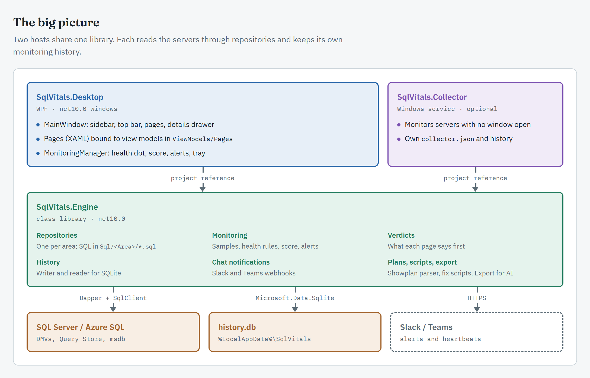
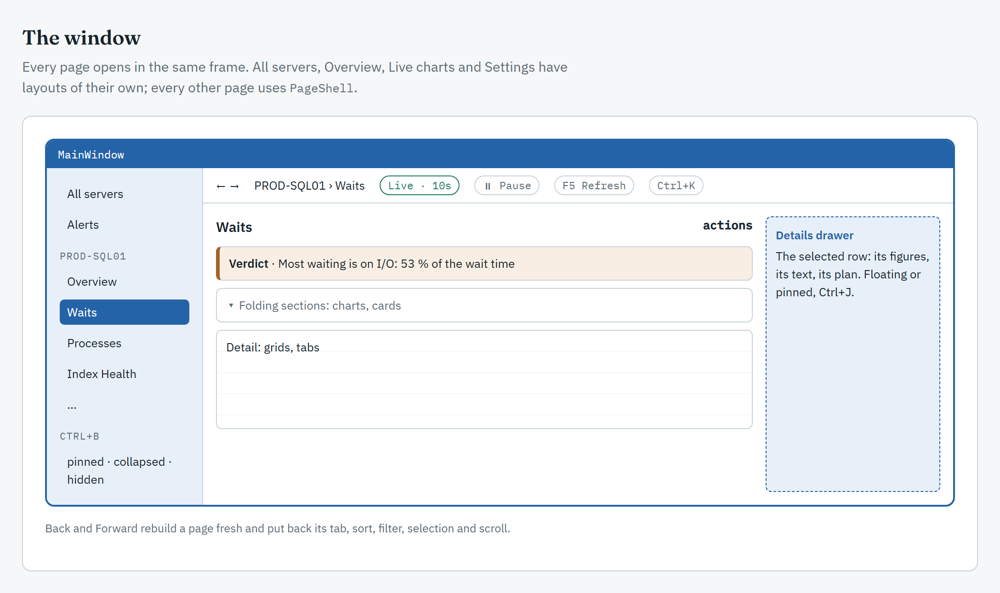
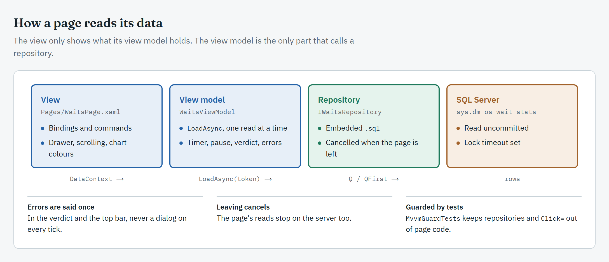

# Architecture

*For developers and contributors.* How SqlVitals is put together.

## The big picture

SqlVitals is a **WPF desktop app (.NET 10)** that queries SQL Server's DMVs **directly**. There is no web server or HTTP hop: the app references the Engine library and calls it in-process.



## Projects

| Project | Role |
|---|---|
| `SqlVitals.Desktop` | The app users run (`net10.0-windows`, WPF). Its `<Version>` is the release number. |
| `SqlVitals.Engine` | Models, repositories, monitoring, verdicts, history, scripting, export (`net10.0` class library). |
| `SqlVitals.Collector` | The optional [collector service](Collector-Service.md): Engine's monitoring as a Windows service. |
| `SqlVitals.Installer` | The Setup wizard (`net472`, so it runs on a clean Windows). |
| `*.Tests` | xUnit tests for each project. `Engine.IntegrationTests` runs every query against real SQL Servers in CI; see [Building and Contributing](Building-and-Contributing.md#against-a-real-sql-server). |

## The window



- **Opening a page:** every route goes through `MainWindow.OpenAsync(route)`. `Services/PageFactory` builds the page fresh with its view model; Back and Forward come from `NavigationHistory`, and `Helpers/ViewState` puts back the tab, sort, filter, selection and scroll.
- **The top bar** shows what the page reports through `IPageContext` (its kind, interval, pause) and `IShellStatus` (read times, errors).
- **Every page** but All servers, Overview, Live charts and Settings uses `Controls/PageShell`: a verdict first (a pure function in `Engine/Verdicts`), then sections that fold, then the detail.
- **The details drawer** shows the selected row of a page that implements `IDetailsSource`.

## Main flows

- **Reading a page:** the page's view model calls a repository in `LoadAsync`; results are records from `Engine/Models`, bound to grids and charts. A failure is reported once, in the verdict and the top bar.
- **Switching connections:** `IRepositoryFactory` builds the connection's repositories from its `SqlTarget` (connection string, timeout, settings), and the window reopens the current page with them.
- **Monitoring:** `MonitoringManager` runs one Engine `Collector` per monitored connection, off the UI thread. Each sample is graded (`HealthRules`), scored (`HealthScore`), checked for alerts (`AlertTracker`) and written to the history (`HistoryWriter` → SQLite). See [Health Dot and Background Monitoring](Health-Dot-and-Background-Monitoring.md).
- **Notifications:** alerts go to Windows notifications (`TrayIcon`) and to Slack or Teams (`ChatNotificationService`).
- **History:** pages read past ranges through `IHistoryReader`; see [Monitoring History Database](Monitoring-History-Database.md).

## Data access conventions

- Every repository derives from `BaseRepository` and runs SQL only through its `Q`, `QFirst` and `Exec` helpers, never `conn.QueryAsync` directly. They apply the timeout, the isolation level and `LOCK_TIMEOUT`, and wrap failures in `WaitStatsException`, which says what failed and the `GRANT` that fixes a missing permission.
- Every repository method takes a `CancellationToken` and passes it on. A page's reads are cancelled when the page is left.
- `IWaitStatsRepository` is the sum of the area interfaces (`IWaitsRepository`, `IMemoryRepository`, …). A view model takes only the area interface it needs.

### Where the SQL lives

Every query is a `.sql` file under `Engine/Sql/<Area>/`, embedded in the assembly and read with `SqlScripts.Get("Waits/ActiveWaits")`. Open the file in SSMS to try it by hand.

- A query that changes with the server's version or edition has `/*NAME*/` markers the repository fills in.
- `SqlScriptsTests` fails for a missing or unused file; `SqlParseTests` parses every file (and every marker combination) with ScriptDom.

### DBNull-safe mapping

Dapper `dynamic` rows return `DBNull.Value` for SQL `NULL`, which `??` doesn't catch:

```csharp
Convert.ToDecimal(r.FileSizeMB)                          // ✅ 0m on DBNull
r.PhysicalPath is DBNull ? "" : (string)r.PhysicalPath   // ✅ nullable strings

(decimal)r.FileSizeMB                                    // ❌ InvalidCastException on DBNull
r.FileSizeMB ?? 0m                                       // ❌
```

### Azure SQL Database branching

Server-level views (`sys.master_files`, `sys.configurations`, …) don't exist on Azure SQL Database. Ask the connection's capabilities, read once per connection, and switch queries:

```csharp
var capabilities = await CapabilitiesAsync(cancellationToken);
var sql = capabilities.IsAzureSqlDatabase ? AzureSql : OnPremSql;
```

Pages with nothing to show there are listed in `MainWindow.PagesAzureSqlLacks` and disabled in the sidebar.

## UI conventions

- **Themes:** `Styles/LightTheme.xaml` and `DarkTheme.xaml`. Use **brush keys**, never hex colours (`BgCard`, `Accent`, `TextPrimary`, `Success`, `Warning`, `Danger`, …). A new colour goes in **both** themes.
- In code, take a brush with `SetResourceReference` so it follows a theme switch. `ColourGuardTests` fails on a hex colour in code or a key missing from a theme.
- Charts take their colours from `Helpers/ChartTheme`.

## MVVM

Each page is a XAML view with a view model that reads its data, decides what it shows and owns its refresh. `MvvmGuardTests` checks the rules below.



- **View:** `Pages/XPage.xaml` + code-behind with view code only: focus, keyboard, scrolling, the details drawer, drawing charts in theme colours.
- **View model:** `ViewModels/Pages/XViewModel.cs`, derived from `PageViewModel` (CommunityToolkit.Mvvm). It may use Engine, the service interfaces in `Services/`, and LiveChartsCore types, but not WPF controls, `MessageBox`, `Application` or a `Dispatcher`.
- **Buttons** bind `Command=` to `[RelayCommand]` methods. `Click=` is only for view-only actions, and `async void` only for event handlers.
- **Services** a view model asks for instead of WPF: `IDialogService`, `IClipboard`, `IFileDialogs`, `INavigator`, `IThemeService`, `IShellStatus`, `IRefreshScheduler`, with WPF implementations in `Services/Wpf/` and fakes in `Desktop.Tests/Fakes/`.
- A few pages (Home, Overview, Live charts, Query Store) still read in their code-behind; the guard tests list them and the list only shrinks.

### The composition root

`Services/CompositionRoot` builds one dependency-injection container (singletons) at startup: logging, the UI services, the app services (settings, repositories factory, monitoring, history, chat) and the pages. A new service is an interface in `Services/`, a line in the matching `Add…` method, and a fake for tests.

### The page lifecycle

`PageViewModel` runs every page the same way:

| Member | What it does |
|---|---|
| `LoadAsync(CancellationToken)` | Reads what the page shows; cancelled when the page is left |
| `OnNavigatedToAsync()` / `OnNavigatedFrom()` | The window calls them when the page is shown and left |
| `RefreshCommand`, `RereadAsync()` | Read again; never two reads at once |
| `RefreshInterval`, `SetPaused(bool)`, `Countdown` | The page's own timer, the top bar's Pause / Resume, and when it reads next |
| `Verdict`, `ShowError` | What the page says; a failed read says what couldn't be read |

### Adding a page

1. **View:** `Pages/XPage.xaml(.cs)`, implementing `IPageContext`. The constructor takes the view model, sets it as `DataContext` before `InitializeComponent`, then calls `ViewModel.Attach(Shell)`.
2. **View model:** `ViewModels/Pages/XViewModel.cs`, overriding `LoadAsync`, taking the narrowest repository interface it needs.
3. **Catalog:** the tag in `Services/PageCatalog` and `Services/NavMenu`.
4. **Registration:** a line in `Services/PageRegistrations.AddPages`.

### Grids

- A grid binds `ItemsSource` to a `ViewModels/GridRows<T>` that the view model refills with `Replace(rows)`, so the user's sort and filter survive a refresh.
- The view model owns the selection (`SelectedItem` bound two way) and keeps it across a refresh by the row's key.

### Testing a page

- **The view model:** a plain xUnit test with `Fakes/FakeRepository`, no UI thread: loaded, empty, error, cancelled on leave, selection kept.
- **The page:** rendered off screen in both themes inside `BindingErrors.Watch()`, which fails on any broken binding.

## Tech stack

| Package | Used for |
|---|---|
| Dapper, Microsoft.Data.SqlClient | Querying SQL Server and Azure SQL (Entra MFA through `Microsoft.Data.SqlClient.Extensions.Azure`) |
| Microsoft.Data.Sqlite | The history file |
| LiveChartsCore.SkiaSharpView.WPF | Charts |
| CommunityToolkit.Mvvm | View models |
| Microsoft.Extensions.DependencyInjection, .Configuration, .Logging | The composition root, `appsettings.json`, the log file |
| Microsoft.SqlServer.TransactSql.ScriptDom | Removing literals from query text; parsing every query in tests |
| xunit | Tests |
