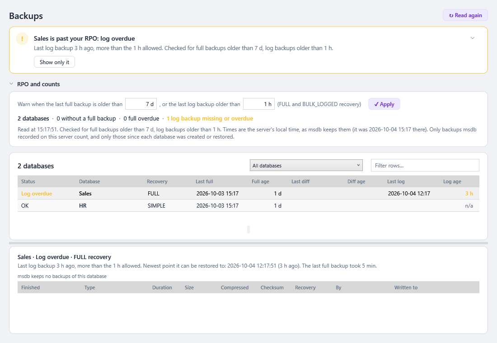
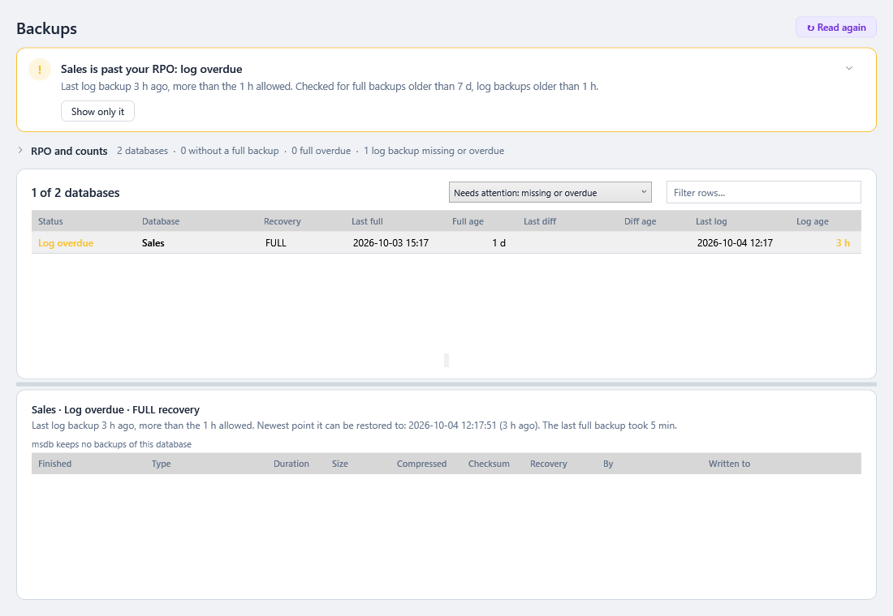

# Backups

> **Where:** sidebar → 💾 Backups · **Use it when:** you need to know that every database can be restored, and how much work would be lost if it had to be · **Needs:** read access to the backup history in `msdb` (sysadmin, or `SELECT` on `backupset` and `backupmediafamily`: see [Server Impact and Permissions](Server-Impact-and-Permissions.md#backups)) · **Not on:** Azure SQL Database, which backs up every database itself · **New in 0.40.0**

A backup job can fail quietly, skip a database that was added last month, or stop taking log backups after someone switched a database to SIMPLE and back. None of that shows until a restore is needed. This page lists every database with its **last full, differential and log backup**, and warns when one is missing or older than your **recovery point objective (RPO)**: how much work you can afford to lose.

Everything is read from `msdb.dbo.backupset`, where SQL Server records each backup it takes. SqlVitals changes nothing and never takes a backup.

---

## How to use it

1. Open **💾 Backups**. **The verdict** at the top says it in one line (from 0.62.0): *Every database is within your RPO*, *Sales is past your RPO: log overdue*, or *4 databases are past your RPO*, red when one has nothing (or no log) to restore, amber when a backup is only older than your ages, with which ones and why. **Show only these** picks the *Needs attention* filter.
2. The databases that need you come first: the **red** ones (nothing, or no log, to restore), then the **amber** ones (a backup older than the ages you set), then the rest by name. **RPO and counts** counts them: *31 databases · 1 without a full backup · 2 full overdue · 3 log backups missing or overdue · 1 not online*. Click its header to fold it to that one line; the page remembers it.
3. **Set your RPO** in the two boxes: *Warn when the last full backup is older than* **7 d**, *or the last log backup older than* **1 h**. Type a number (days in the first box, minutes in the second) or a number with a unit: `26h`, `1d 12h`, `90 min`, `2h`. Press **✓ Apply** or **Enter**. The ages are saved and apply to every server. From 0.76.0 they are also what the [Backups past RPO](Health-Dot-and-Background-Monitoring.md#what-is-checked) health check counts against on every monitored server, every 5 minutes: a database this page flags turns the server's dot red and raises an alert, whose evidence opens this page.
4. The box above the list narrows it: *Needs attention: missing or overdue*, *FULL or BULK_LOGGED recovery*, *SIMPLE recovery*, or *Not online*. **↻ Read again** at the top right (or **Refresh** in the top bar, **F5**) reads msdb again.
5. Each row is one database:

   | Column | Meaning |
   |---|---|
   | **Status** | **No full backup**, **No log backup**, **Log chain broken** (red), **Full overdue**, **Log overdue** (amber), **OK**, or the state of a database that isn't online (*Restoring*, *Offline*, …). Hover for the details |
   | **Database** | Its name. Greyed when it isn't online |
   | **Recovery** | Its recovery model: SIMPLE, FULL or BULK_LOGGED |
   | **Last full** / **Full age** | When the newest full backup finished, and how long ago. Amber when older than the age you set |
   | **Last diff** / **Diff age** | The same for the newest differential backup. Not checked against the RPO |
   | **Last log** / **Log age** | The same for the newest log backup. Amber when older than the age you set. *n/a* in SIMPLE recovery, which has no log backups |
   | **Data at risk** | The work that would be lost if the database were lost now: the time since the newest backup it could be restored to. That's the last log backup in FULL recovery, and the last full or differential in SIMPLE. It's the RPO you actually have right now |
   | **Full size** | The size of the last full backup, compressed if it was |
   | **Warnings** | Every problem found, in a sentence |

6. **Select a database** to see its backups below, newest first (up to 500): type, duration, size, compressed size, whether it was taken **WITH CHECKSUM**, the recovery model at the time, who took it, and where it was written. Above them: the newest point it can be restored to, and where the last full backup went.

The grids have the usual filter box and right-click menu (copy, export to CSV). See [Working with Grids](Working-with-Grids.md).

---

## Choosing the ages

| Your backup schedule | Full backup age | Log backup age |
|---|---|---|
| Full every night | `26h` (a day plus a little for a slow night) | A bit above your log backup interval |
| Full weekly, differentials daily | `7d` (the default) | A bit above your log backup interval |
| Log backups every 15 minutes | | `1h` (the default) gives room for a couple of late ones; `30 min` is tighter |
| Log backups every hour | | `2h`, so a backup that's a minute late doesn't warn |

The log backup age is the RPO for databases in FULL recovery: if the server were lost now, at most that much work would be gone (less, if a tail-log backup can still be taken). A database in SIMPLE recovery can only be restored to its last full or differential backup, so its RPO is the time between those. Its **Data at risk** column shows it.

---

## Reading it

| What you see | Usually means | Try |
|---|---|---|
| **No full backup** on a new database | It was created after the backup job was set up, and the job lists databases by name | Add it to the job, or use a job that backs up all user databases (for example Ola Hallengren's `USER_DATABASES`) |
| **No full backup** on a database that was just restored | Restoring sets its creation date, so earlier backups don't count | Take a full backup now, so it can be restored to a point after the restore |
| **Log chain broken** | It's in FULL recovery, but was switched from SIMPLE after its last full backup (or never had one since): log backups fail and the log is truncated as in SIMPLE | Take a full (or differential) backup to start the log chain; then log backups work again |
| **No log backup** in FULL recovery | No log backup job, or the job skips it. The log grows until the disk is full, and point-in-time restore isn't possible | Schedule log backups, or switch the database to SIMPLE if losing a day's work is acceptable |
| **Full overdue** / **Log overdue** | The backup job failed, is disabled, or is running long | Open [Agent Jobs](Agent-Jobs.md): a failed or long-running backup job is at the top |
| Everything is overdue at once | The backup job, the backup disk or SQL Server Agent is down | Check [Agent Jobs](Agent-Jobs.md) for an amber *Agent isn't running* line, and the backup disk's free space |
| **Checksum**: *No* on the full backups | They're taken without `WITH CHECKSUM` | Add `CHECKSUM` to the backup job, so damaged pages are caught when backing up, not when restoring |
| **Checksum**: *Damaged* | SQL Server found damage while backing up and carried on (`CONTINUE_AFTER_ERROR`) | Run `DBCC CHECKDB` on the database now |

A backup that exists isn't yet a backup that restores. Test a restore now and then, on another server.

---

## What counts

- **Copy-only full backups** count as full backups: they can be restored. (A differential is still based on the last *normal* full backup.)
- **Only backups finished since the database was created or restored** count. `backupset` records the database by name, so an older backup belongs to an earlier database with the same name, or to this one before it was restored. The history still lists them, in grey.
- **Only backups recorded on this server** count: a backup taken on another server (or by a tool that doesn't go through SQL Server) isn't in this server's msdb. Snapshot backups taken through SQL Server's VSS or VDI interfaces are recorded and count.
- **Not checked:** databases that aren't online (a log-shipping or mirroring target restoring, an offline database), the log of **model** (its FULL recovery is only what new databases start with), and the log of **read-only** databases, which doesn't change. **tempdb** and database snapshots can't be backed up and aren't listed.
- **BULK_LOGGED** is checked like FULL: it needs log backups too.

### Availability groups

A backup taken on a **secondary replica** is recorded in *that replica's* msdb, not the primary's. When any database is in an availability group, an amber line says so. Look at the replica that takes the backups (the group's backup preference) as well, before acting on a missing backup.

---

## Times

All times are the **server's local time**, as msdb keeps them. The ages are worked out on the server's clock too, so they're right even when this PC is in another time zone. The status line says what time it was on the server when the backups were read.

msdb keeps its backup history until something deletes it (`sp_delete_backuphistory`, often a maintenance job). Very old backups may therefore be gone from the history, but the newest of each type is what the list needs.

---

## When it shows nothing

| Message | Why | What to do |
|---|---|---|
| *This login can't read the backup history in msdb* | The login isn't sysadmin and has no read access to `backupset` | Grant `SELECT` to its msdb user (script in [Server Impact and Permissions](Server-Impact-and-Permissions.md#backups)) |
| *Azure SQL Database backs up every database itself* | Azure SQL Database records no backups in msdb; the **💾 Backups** button is disabled (dimmed and marked **N/A**) for such a connection | The Azure portal shows the restore points under the database's **Backups**. **Azure SQL Managed Instance** works here |
| *There are no databases to show* | The login can see no database | Check the login's `VIEW ANY DATABASE` permission |

---

### Under the hood

- `BackupRepository.GetBackupStatusAsync` first checks `SERVERPROPERTY('EngineEdition')` (5 = Azure SQL Database: stop there with a message). It then reads, in one query, one row per database in `sys.databases` except tempdb and snapshots, with:
  - the newest full (`type = 'D'`), differential (`'I'`) and log (`'L'`) backup in `msdb.dbo.backupset` finished since the database's `create_date`, matched by name. `backupset` is read **once**: ranked per database and type with `ROW_NUMBER()`, the newest of each kept, then pivoted into columns;
  - the first file of each one's media set from `backupmediafamily`;
  - `sys.database_recovery_status.last_log_backup_lsn`, which is empty while no log backup can be taken (SIMPLE, or no full backup since the log chain was broken).
- `Engine/Backups/DatabaseBackup.From` (pure, unit tested) turns each row into the warnings against the `BackupRpo`, the status, the ages and the recovery point. `BackupRpo` reads and writes the boxes' `7 d` / `90 min` format.
- Selecting a database reads up to 500 of its `backupset` rows, newest first.
- Missing msdb permission (errors 229 and 916) becomes the message above, not an error box.
- It runs when the page is opened or refreshed, never in the background. See [Server Impact and Permissions](Server-Impact-and-Permissions.md).
