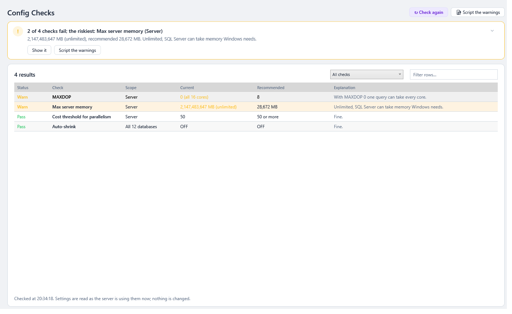

# Configuration Checks

> **Where:** sidebar → ✅ Config Checks · **Use it when:** you take over a server, after an install or upgrade, or before an audit, to catch the settings that are commonly left wrong · **Needs:** `VIEW SERVER STATE` to check MAXDOP, max server memory and the TempDB file count in full; the rest needs no extra permission (see [Server Impact and Permissions](Server-Impact-and-Permissions.md)) · **New in 0.42.0**

SQL Server installs with defaults that were chosen decades ago, and databases keep the options they were created or upgraded with. A few of those settings are behind a lot of slow or fragile servers: unlimited memory, parallelism set for a single-core machine, one TempDB file, auto-shrink. This page checks each of them against best practice and says, for every one, **Pass** or **Warn**, the **current** value, the **recommended** value for *this* server, and **why** it matters.

Everything is read from the catalog views. SqlVitals changes nothing: for a warning it shows the T-SQL that would fix it, for you to review and run yourself.

---

## How to use it

1. Open **✅ Config Checks**. Warnings come first, tinted amber, then the checks that pass, in the order of the table below.
2. **The verdict** at the top says how many checks fail and names the riskiest (from 0.66.0; a count line under the toolbar before): *2 of 14 checks fail; the riskiest: Max server memory (Server)*, with its value, the recommendation and why. The riskiest comes in this order: max server memory, page verify, auto-shrink, MAXDOP, the TempDB file count, cost threshold, compatibility level, TempDB file sizes. **Show it** selects it, with its fix in the drawer; **Script the warnings** writes them all. With nothing failing it says so, and how many couldn't be checked. An amber line under the grid says when something couldn't be checked in full (a missing permission, or Azure SQL Database). See [The page template](Getting-Started.md#verdict-first-then-the-detail).

   

3. The list beside the **Checks** title narrows it: *Warnings*, *Server settings*, *Database settings* or *Not checked*. **↻ Check again**, beside the page title (or **Refresh** in the top bar, **F5**), reads the settings again, after you've changed one, say.
4. Each row is one check:

   | Column | Meaning |
   |---|---|
   | **Status** | **Warn** (amber), **Pass** (green), or **Not checked** (grey) when a permission is missing or Azure manages the setting |
   | **Check** | What is checked: see the table below |
   | **Scope** | **Server** for a server-wide setting; for a database setting, the database that warns. The databases that pass are one row: *All 24 databases*, or *21 other databases* |
   | **Current** | The value the server is using now |
   | **Recommended** | The value best practice recommends here, worked out from the server's processors and memory where it depends on them |
   | **Explanation** | Why it matters, and how the recommendation was worked out |

5. **Select a check** to read in the [details drawer](Working-with-Grids.md#details-beside-the-grid) its value, the recommendation, the full explanation and, for a warning, the **script to fix it**. **Copy** copies it (from 0.66.0; a panel under the grid before).
6. **📝 Script the warnings** puts the fix for every warning into one script, to review, save and run yourself at a quiet time.

The grid has the usual filter box and right-click menu (copy, export to CSV). See [Working with Grids](Working-with-Grids.md).

---

## What is checked

| Check | Warns when | Recommended |
|---|---|---|
| **MAXDOP** | One query could use more processors than Microsoft recommends for this server (0, meaning all of them, on more than 8 processors, say) | One NUMA node: the number of processors, at most 8. Several NUMA nodes: the processors per node when that's 16 or fewer, otherwise half of them, at most 16 |
| **Cost threshold for parallelism** | Under 25 (the default is 5). Not when nothing can run in parallel anyway: MAXDOP 1, or one processor | 50 to start, then tuned from the plan cache |
| **Max server memory** | Not set (the default, 2,147,483,647 MB: no limit), or more than the server's memory less what Windows needs | Physical memory less 1 GB, less 1 GB for every 4 GB from 4 to 16 GB, less 1 GB for every 8 GB above 16 GB |
| **TempDB data files** | Fewer than the number of processors, up to 8 | One per processor up to 8. Above 8 processors, start with 8 and add four at a time only while allocation contention remains |
| **TempDB file sizes** | The data files' sizes differ by more than 5%, they grow by different amounts, or one grows by a percentage | All the same size and the same growth in MB |
| **Auto-shrink** | It's ON, for each database | OFF |
| **Page verify** | `NONE` or `TORN_PAGE_DETECTION`, for each database | `CHECKSUM` |
| **Compatibility level** | Below the server's own level, for each database | The server's level (160 on SQL Server 2022), after turning Query Store on |

### Worked examples

| Server | MAXDOP | Max server memory | TempDB data files |
|---|---|---|---|
| 4 processors, 16 GB | 0, or 1 to 4 | 12,288 MB | 4 |
| 16 processors in one NUMA node, 64 GB | 8 or lower | 55,296 MB | 8 |
| 32 processors in 2 NUMA nodes of 16, 256 GB | 16 or lower | 227,328 MB | 8 |
| 80 processors in 2 NUMA nodes of 40, 512 GB | 16 or lower | 456,704 MB | 8 |

The processors are the ones **SQL Server can use**: its visible online schedulers, after CPU affinity and the edition's limits (Express uses at most 4 cores, Standard at most 24). NUMA nodes include soft-NUMA, which SQL Server 2016 and later sets up by itself on large nodes.

---

## Reading it

| What you see | Usually means | Try |
|---|---|---|
| **MAXDOP** and **Cost threshold** both warn, with `CXPACKET` / `CXCONSUMER` high in [Waits](Wait-Statistics.md#waits) | The install defaults (0 and 5): small queries go parallel and big ones take every processor | Set both, then watch the waits for a day. Raise the cost threshold further if small queries still go parallel |
| **MAXDOP 1** passes, but reports and index rebuilds are slow | Nothing runs in parallel. Some applications (SharePoint) require it | Leave it if the application requires it; otherwise set the recommended value and a cost threshold of 50 |
| **Max server memory** not set, and the server pages or Windows feels slow | SQL Server took nearly all the memory | Set it. The change takes effect straight away; SQL Server gives memory back gradually |
| **Max server memory** passes, but other software runs on the server | The recommendation only leaves room for Windows | Take off what SSIS, SSAS, SSRS, another instance or an application needs |
| **TempDB data files**: *1 data file* | The installer's default before SQL Server 2016 | Add files the same size as the first (the script does) and watch `PAGELATCH_*` waits on `2:1:*` pages go |
| **TempDB file sizes** differ | A file was added later, or one grew on its own | Grow the smaller ones to the largest (the script does). A file bigger than the rest has to be shrunk instead: `DBCC SHRINKFILE` |
| **Auto-shrink ON** | Someone turned it on to save space, or the database came from a tool that did | Turn it off. Leave the free space: the database will need it again |
| **Page verify** `TORN_PAGE_DETECTION` or `NONE` | The database was created on SQL Server 2000 or earlier and upgraded | Set `CHECKSUM`. Pages get a checksum as they're next written; rebuilding the indexes writes them all |
| **Compatibility level** below the server's | The database was upgraded or restored from an older version and left at its old level | Turn Query Store on, run for a while, change the level at a quiet time, and force the old plan for any query that gets slower. See [Query Regressions](Query-Regressions.md) |
| **Compatibility level** of **model** warns | New databases get model's level | Raise it, so new databases start at the server's level |

### Things to know

- **What's in use counts.** A setting changed with `sp_configure` but not yet `RECONFIGURE`d is checked at the value in use, and its explanation says what it has been set to.
- **A database can override MAXDOP** with `ALTER DATABASE SCOPED CONFIGURATION SET MAXDOP`. The check is of the server's setting.
- **Database checks** cover every database except snapshots, which take their options from their source, including databases that aren't online and read-only ones.
- **The scripts** use `sp_configure` with `RECONFIGURE`, `ALTER DATABASE … SET … WITH NO_WAIT`, and for TempDB `ADD FILE` (named `tempdev2`, `tempdev3`, … in the first file's folder, the size and growth of the largest) or `MODIFY FILE`. Check the drive has room before adding TempDB files: TempDB is recreated at their size whenever SQL Server starts.

---

## Azure SQL

| | SQL Server | Azure SQL Managed Instance | Azure SQL Database |
|---|---|---|---|
| MAXDOP | ✅ The server's | ✅ The server's | ✅ The database's (`MAXDOP` database scoped configuration): 8 or lower, Azure's default for new databases |
| Cost threshold, max server memory, TempDB | ✅ | ✅ | ➖ Not checked: Azure manages them |
| Auto-shrink, page verify | ✅ Every database | ✅ Every database | ✅ This database |
| Compatibility level | ✅ Against the server's version | ⚠️ Against the highest level any database there uses: Managed Instance reports no version | ⚠️ This database, against the highest level it can see (usually `master`'s) |

---

## When it can't check everything

| Message | Why | What to do |
|---|---|---|
| *This login can't see the server's processors and memory* | The login lacks `VIEW SERVER STATE`, which `sys.dm_os_schedulers`, `sys.dm_os_nodes` and `sys.dm_os_sys_info` need | Grant it (see [Server Impact and Permissions](Server-Impact-and-Permissions.md)). Meanwhile an unlimited max server memory still warns, MAXDOP 1 and 8 or more TempDB files still pass, and the rest of those checks show *Not checked* |
| *TempDB's files couldn't be read* | Reading `tempdb.sys.database_files` failed | Check the login can connect to tempdb (every login can, unless `guest` was disabled there) |
| *Azure SQL Database manages the server's memory…* | An Azure SQL Database connection | Only the database's own settings are checked |

---

### Under the hood

- `ConfigurationRepository.GetConfigurationChecksAsync` reads `SERVERPROPERTY('EngineEdition')` and `ProductVersion`, `sys.databases` (compatibility level, `is_auto_shrink_on`, `page_verify_option_desc`; snapshots left out), and then:
  - on SQL Server and Managed Instance: `sys.configurations` (`value` and `value_in_use` of *max degree of parallelism*, *cost threshold for parallelism* and *max server memory (MB)*); the visible online schedulers in `sys.dm_os_schedulers`, the NUMA nodes in `sys.dm_os_nodes` (not the DAC's) and `physical_memory_kb` from `sys.dm_os_sys_info`; and TempDB's data files from `tempdb.sys.database_files` (current sizes and growth);
  - on Azure SQL Database: the `MAXDOP` row of `sys.database_scoped_configurations`.
- Missing `VIEW SERVER STATE` (errors 297 and 300) leaves the processors and memory out rather than failing; a TempDB that can't be read leaves out its two checks.
- `Engine/ConfigChecks/ConfigurationChecks.Run` (pure, unit tested) turns what was read into the rows: the recommendations (`RecommendedMaxDop`, `RecommendedMaxServerMemoryMb`, `RecommendedTempDbFiles`, `NewestCompatibilityLevel`), the explanations and the fix scripts.
- It runs when the page is opened or refreshed: a handful of light catalog queries, never in the background. See [Server Impact and Permissions](Server-Impact-and-Permissions.md).
