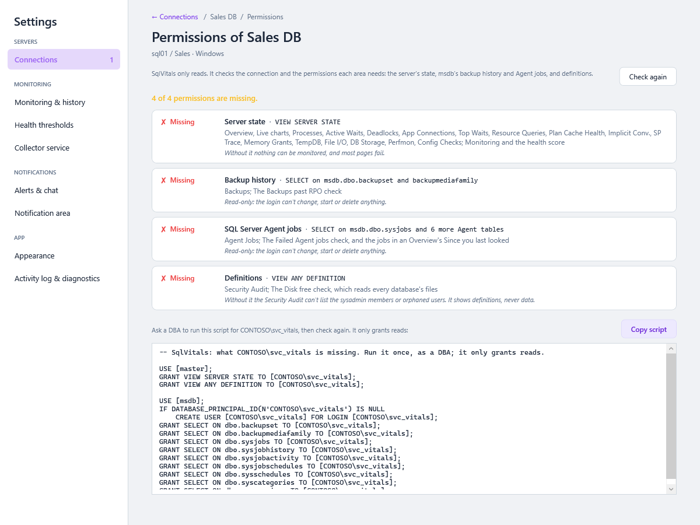

# Connections

A **connection** is a saved server and database that SqlVitals monitors. You can save as many as you like (for example *Production*, *UAT* and *Dev*) and switch between them from the sidebar.

> **Where:** ⚙️ Settings → *Connections* (a card per connection, and a page per connection with tabs, from 0.54.0) · **Switch:** open a server from **All servers**, or pick one in the breadcrumb's server menu (from 0.57.0)

## Add or edit a connection

1. In **⚙️ Settings → Connections**, click **+ New connection**, or **Edit** on a connection's card. See [Settings → Connections](Settings.md#connections) for the cards.
2. Fill in the page. Its fields are on four tabs, and moving between them keeps what you've typed:

| Field | Tab | What to enter |
|---|---|---|
| **Connection name** | Connection | The name shown on its tile, in the sidebar and in the breadcrumb. Blank uses *server / database*. |
| **Server name** | Connection | `myserver.database.windows.net`, `localhost\SQLEXPRESS`, `10.0.0.5`, or `host,1433` for a custom port. |
| **Authentication** | Connection | See [Authentication types](#authentication-types). |
| **Login / Password** | Connection | For SQL Server Authentication. For Entra MFA, *Login* is optional and only pre-fills the sign-in window. |
| **Remember password** | Connection | Tick to save the password (encrypted). Untick to be asked once each time you start the app. |
| **Database name** | Connection | Blank for the login's default database. Open the list to browse the databases on the server. |
| **Encrypt** | Connection | *Mandatory* (default and recommended), *Optional*, or *Strict* (SQL Server 2022 and Azure SQL only). |
| **Trust server certificate** | Connection | Tick for servers with a self-signed certificate, which is common on-premises. Leave it unticked for Azure SQL. |
| **Monitor in background** | Monitoring & alerts | With **Start monitoring automatically** on, keep monitoring this connection while another one is active. **Off** for a new connection from 0.46.0; saved connections keep their value. Any connection can also be started by hand with ▶ in the sidebar's server header, or on its tile on All servers. See [Starting and stopping monitoring](Health-Dot-and-Background-Monitoring.md#starting-and-stopping-monitoring). |
| **Windows notifications** | Monitoring & alerts | Off mutes this connection's Windows notifications; its alerts are still listed and posted to its chat channels. Saved without contacting the server, so a server that's down can be muted. The same tab lists the chat channels that post its alerts. |
| **Use its own health thresholds** | Health thresholds | Grade this connection's health dot on its own limits, with a preview of its latest sample. See [Settings → A connection's own thresholds](Settings.md#a-connections-own-thresholds). |
| **Connection timeout (s)** | Advanced | How long to wait when opening a connection. |
| **Additional parameters** | Advanced | Extra connection-string keywords, e.g. `MultipleActiveResultSets=True;HostNameInCertificate=*.contoso.com`. Passwords and user IDs are not allowed here. |

3. Choose a button. **Save** and **Save & make active** are in the bar along the bottom and save every tab at once:

| Button | Checks the connection | Saves it | Makes it active |
|---|---|---|---|
| **Test connection** (top of the page) | ✅ | | |
| **Save** | ✅ when how it connects changed | ✅ | |
| **Save & make active** (before 0.54.0 *Save & Connect*) | ✅ when how it connects changed | ✅ | ✅ |

A new connection, or a change to how it connects (server, sign-in, database, encryption, timeout, parameters), is checked against the server first and never saved if the check fails, so you can't end up with a broken entry. A new name, the Monitoring & alerts settings or thresholds save without the check. **Discard** puts back what's saved, and leaving the page with unsaved changes asks first.

To delete a connection, open it and choose **⋯ → Remove connection…**. Its monitoring history stays in the history file until it ages out. See [Monitoring History Database](Monitoring-History-Database.md).

## Check permissions

From 0.78.0, **Check permissions** on a connection's card (and the first-run flow's *Check* step) signs in with the saved details and reads which permissions the login holds, without waiting for a page to fail. It asks the server for nothing else and changes nothing.



| Area | It needs | Without it |
|---|---|---|
| **Server state** | `VIEW SERVER STATE`; on Azure SQL Database, `VIEW DATABASE STATE` in the connection's database | Monitoring and the health score, and the pages that read DMVs: Overview, Live charts, Processes, Deadlocks, App Connections, Waits, Resource Queries, Plan Cache Health, SP Trace, Memory, TempDB, File I/O, DB Storage, Perfmon, Config Checks |
| **Backup history** | `SELECT` on `msdb.dbo.backupset` and `backupmediafamily` | Backups, and the *Backups past RPO* check. *Not needed* on Azure SQL Database |
| **SQL Server Agent jobs** | `SELECT` on msdb's job tables (`sysjobs`, `sysjobhistory`, `sysjobactivity`, `sysjobschedules`, `sysschedules`, `syscategories`, `syssessions`) | Agent Jobs, the *Failed Agent jobs* check, and the jobs in an Overview's *Since you last looked*. *Not needed* on Azure SQL Database or Express |
| **Definitions** | `VIEW ANY DEFINITION` | The Security Audit's sysadmin members and orphaned users, and the *Disk free* check's view of every database's files. *Not needed* on Azure SQL Database |

The line above the list says how many are missing (*2 of 4 permissions are missing.*). The permissions are the login's effective ones, so a server role, sysadmin or a Windows group counts.

For what's missing there is a **GRANT script**, for the login as the server knows it (`SUSER_SNAME()`). **Copy script** copies it; a DBA runs it once; **Check again** reads the permissions again. It only grants reads. For example:

```sql
-- SqlVitals: what CONTOSO\svc_vitals is missing. Run it once, as a DBA; it only grants reads.

USE [master];
GRANT VIEW SERVER STATE TO [CONTOSO\svc_vitals];

USE [msdb];
IF DATABASE_PRINCIPAL_ID(N'CONTOSO\svc_vitals') IS NULL
    CREATE USER [CONTOSO\svc_vitals] FOR LOGIN [CONTOSO\svc_vitals];
GRANT SELECT ON dbo.backupset TO [CONTOSO\svc_vitals];
GRANT SELECT ON dbo.backupmediafamily TO [CONTOSO\svc_vitals];
```

- **Azure SQL Database** has no `USE` and no server scope: the script is `GRANT VIEW DATABASE STATE TO [user];`, for the database user, to run in the connection's database.
- **Managed Instance** gets the same script as SQL Server.
- **A login through a Windows group**, with no login of its own: the script says so, and that the grant goes to the group's login (every member gets it), or to a login created for the user first.
- **It can't sign in:** the check says why, in the server's words (*Login failed for user …*).

**← Connections** goes back to the cards. See [Server Impact and Permissions](Server-Impact-and-Permissions.md#permissions) for what each permission is for.

## Authentication types

| Type | Use it when | Notes |
|---|---|---|
| **Windows Authentication** | Your Windows account has access (on-premises, domain-joined) | No password stored |
| **SQL Server Authentication** | You have a SQL login and password | Password stored only if *Remember password* is ticked |
| **Microsoft Entra MFA** | Azure SQL with your organisation's Microsoft account | A Windows sign-in window appears over SqlVitals (from 0.67.0; before, the browser opened), and can offer the account you're signed in to Windows with. Background monitoring for it starts only after you've switched to it once per session, so you never get surprise sign-in windows. |

## Switching connections

Open another server from its tile on **All servers**, or pick it in the breadcrumb's server menu (*Production ▾*): the screen you're on opens against the new server, or its Overview if it hasn't got that screen. Anything still loading from the previous server is thrown away, so you never see one server's data under another's name. Before 0.57.0 this was the *Active connection* selector at the top of the sidebar. See [The server workspace](Getting-Started.md#the-server-workspace).

## Common connection settings

| Server | Encrypt | Trust server certificate |
|---|---|---|
| Azure SQL Database / Managed Instance | Mandatory or Strict | Off |
| On-premises with a CA-issued certificate | Mandatory | Off |
| On-premises with a self-signed certificate (typical dev/test) | Mandatory | **On** |
| Old server without TLS configured | Optional | On |

---

### Under the hood

- Connections are saved per Windows user in `%AppData%\SqlVitals\settings.dat`, encrypted with **Windows DPAPI**. Only your Windows account on this PC can decrypt them. See [Security and Privacy](Security-and-Privacy.md).
- Credentials never appear in the connection list, the sidebar, the server menu or error messages. The *Additional parameters* field rejects `Password` and `User ID` so a password can't slip into it unencrypted.
- Without *Remember password*, the password is held in memory for the current session only.
- The saved connection string overrides the fallback `ConnectionStrings:SqlServer` in `appsettings.json`, which is only used when no connection is saved.
- **Command timeout** (Settings → Monitoring & history, default 30 s) limits how long any single diagnostic query may run. Raise it for very large servers where screens like Index Health time out.
- Settings files from very old versions (one connection) are migrated automatically.
- `Services/ConnectionSettingsService.cs` stores connections; `Services/RepositoryFactory.cs` builds the data access objects for the active one.
