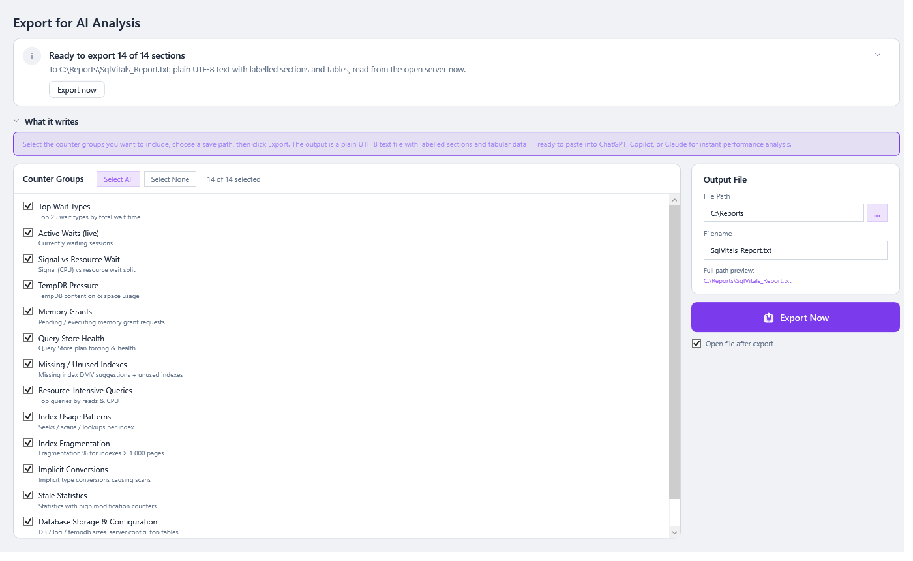

# Export for AI

**📤 Export / AI** collects diagnostic data from many screens into **one plain-text report**, laid out so you can paste it into an AI assistant (or send it to a colleague or consultant) and ask *"what's wrong with this server?"*

> **Where:** sidebar → 📤 Export / AI · **Use it when:** you want a second opinion, or a snapshot to compare later

## How to use it

1. Under **Counter Groups**, tick the data you want. **Select All** / **Select None** help.
2. Under **Output File**, choose a **File Path** and **Filename** (default `SqlVitals_Report.txt`). *Full path preview* shows where it will go.
3. Tick **Open file after export** if you want it opened straight away.
4. Click **📤 Export Now**, or **Export now** in the verdict. All selected groups are collected at the same time.

**The verdict** at the top (from 0.66.0) says what an export will write and where (*Ready to export 14 of 14 sections*, to the full path), or what is missing (*Nothing to export: no section is selected*, *Choose where to save the report*). After an export it says what was saved (*Exported 14 sections to SqlVitals_Report.txt*, its size and how long it took), with **Open the file** and **Export again**; this replaced the **✓ Last Export** box. If the export fails it says why. What the report is folds to one line. See [The page template](Getting-Started.md#verdict-first-then-the-detail).

Numbers and dates in the file are written the same way on every PC (`1,234.5`, `2026-10-07 14:30`), whatever the Windows region (from 0.67.1).

5. Open the file, copy it, and paste it into your AI assistant with a question, for example:

   > *"This is a diagnostic report from a SQL Server that users say is slow in the afternoons. What are the most likely causes, and what should I check first?"*

## What you can include

| Group | Contains |
|---|---|
| Top Wait Types | The top waits since the last restart |
| Wait Category Summary | Waits totalled by category |
| Active Waits (live) | Sessions waiting right now |
| Signal vs Resource Wait | The CPU-pressure indicator. See [Wait Statistics](Wait-Statistics.md#signal-vs-resource-waits). |
| TempDB Pressure | TempDB usage by session |
| Memory Grants | Queries holding or waiting for memory |
| Query Store Health | Query Store's state and settings, the settings checks' results, forced plans that fail, the top 5 wait categories of the last 24 hours (SQL Server 2017+), and the top 20 queries by CPU in the last 24 hours |
| Missing / Unused Indexes | Index suggestions and unused indexes |
| Resource-Intensive Queries | Top queries by reads and CPU |
| Index Usage Patterns | Seeks, scans, lookups and updates per index |
| Index Fragmentation | Fragmented indexes |
| Implicit Conversions | Plans with `CONVERT_IMPLICIT` |
| Stale Statistics | Statistics with pending modifications |
| Database Storage & Configuration | Files, sizes and key settings |
| Stored Procedure Activity | Procedure execution statistics |

## Before you share a report

> ⚠️ The report can contain **query text**, which may include **literal values from your data** (names, IDs, amounts), as well as database, table, login and host names. Read it before pasting it into an external service, and follow your organisation's data policy. Remove anything sensitive, or leave out the query groups.

---

### Under the hood

- `Desktop/Pages/ExportPage` + `Desktop/Services/ExportService`. `ExportAsync(selectedGroups, filePath)` builds one task per group and runs them with `Task.WhenAll`, so all groups are fetched **concurrently**.
- Results are written in the fixed order of `ExportService.AllGroups`, whatever order they finish in, so reports are comparable. The file is UTF-8 plain text with a Markdown-style heading per section.
- Each group reuses the same repository methods as the screens. Adding a group is covered in [Building and Contributing](Building-and-Contributing.md#7-add-it-to-export-optional).
