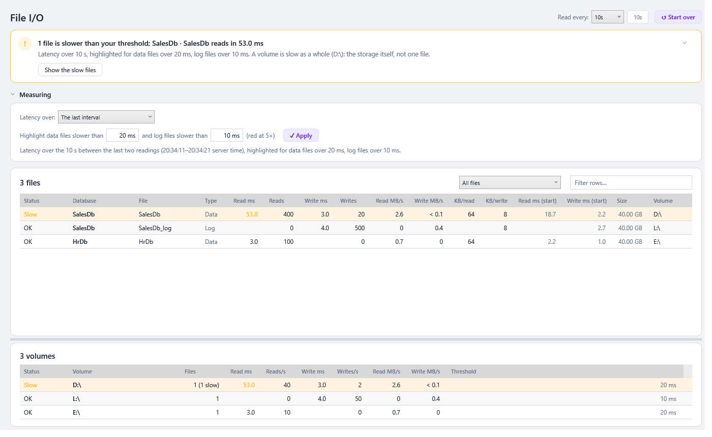

# File I/O

> **Where:** sidebar → 💽 File I/O · **Use it when:** waits point at I/O (`PAGEIOLATCH_*`, `WRITELOG`) and you need to know which files, and which disks, are slow · **Needs:** `VIEW SERVER STATE` (`VIEW DATABASE STATE` on Azure SQL Database), like every other page · **On Azure SQL Database:** the current database's files only · **New in 0.41.0**

When queries wait on the disk, the question is *which* disk. This page shows the **read and write latency of every database file in milliseconds**, highlights the files slower than a threshold you set, and adds the files up per **volume**, so a slow LUN stands out from one busy database.

Everything comes from `sys.dm_io_virtual_file_stats`. SqlVitals changes nothing.

---

## Why "now", not "since startup"

`sys.dm_io_virtual_file_stats` keeps **running totals** for each file since its database came online, usually since SQL Server started: how many reads and writes, and how long they took altogether (the *I/O stall*). Dividing one by the other gives an average over weeks. That average hides a problem that started an hour ago under weeks of normal I/O, and keeps last night's CHECKDB or backup in it for good.

So the page takes a **reading every few seconds** while it's open and works out latency from the **change between two readings**:

> read latency = (change in `io_stall_read_ms`) ÷ (change in `num_of_reads`), and the same for writes

That's the average time each read or write took **during that interval**. The average since startup is still shown, muted and never highlighted, for comparison.

---

## How to use it

1. Open **💽 File I/O**. The first reading is taken straight away and lists every file as *Measuring…*. The latency appears with the second reading, one interval later (10 s by default).
2. The files **over the threshold** come first: **red** at five times the threshold or more, **amber** over it, with the row tinted. Then the rest, then files with no I/O.
3. **The verdict** at the top says it first (from 0.66.0; a summary line under the toolbar before): *3 files are slower than your threshold; Sales · Sales_log writes in 38.2 ms*, amber, or red when one is at five times the threshold or more. It says how many are that slow, and whether a **volume is slow as a whole** (the storage itself) or only one file is. **Show the slow files** lists only those, with the slowest selected and its details in the drawer. With none over, it says so and names the slowest file anyway. While there is only one reading it says *Measuring*. See [The page template](Getting-Started.md#verdict-first-then-the-detail).
4. Under **Measuring**, which folds to one line (*The last interval · every 10 s · data files over 20 ms, log files over 10 ms*), **set the thresholds**: *Highlight data files slower than* **20 ms** *and log files slower than* **10 ms**. Type milliseconds (`20`, `2.5`, `15 ms`) and press **✓ Apply** or **Enter**. The readings already taken are graded again at once; nothing is read again. The thresholds are saved and apply to every server.
5. **Latency over:**
   - **The last interval**: between the two newest readings. What the storage is doing right now; it moves with every reading.
   - **Since the first reading**: since the page opened, or since you pressed **↺ Start over**. Steadier, and it covers a whole workload: press **Start over**, run the report or the batch, and read the result.
6. **Read every** 5, 10, 15, 30 or 60 seconds (saved), beside the title. **Pause** in the top bar stops reading while you look, and **Resume (▶)** starts it again (from 0.66.0; the page had its own **⏸ Pause** before); **Refresh** (F5) takes a reading at any time. Reading stops when you leave the page.
7. **Select a file** to see in the [details drawer](Working-with-Grids.md#details-beside-the-grid) why it's highlighted, how many I/Os that was based on, its figures since startup, its volume and its path (from 0.66.0; a line under the grid before).
8. The list beside the **Files** title narrows it: *Slower than threshold*, *With I/O*, *Data files*, *Log files*.

Each row is one file:

| Column | Meaning |
|---|---|
| **Status** | **Very slow** (red), **Slow** (amber), **OK**, **No I/O** (nothing read or written in the interval), **Counters reset** (see below) or **Measuring…** (only one reading so far). Hover for the reason |
| **Database** / **File** / **Type** | The file's database, logical name, and *Data*, *Log*, *FILESTREAM* or *Full-text* |
| **Read ms** / **Write ms** | Average latency of a read or write in the interval. Amber or red when over the threshold. Blank when there were none |
| **Reads** / **Writes** | How many in the interval. A slow average from a handful of I/Os is said to be one when you select the file |
| **Read MB/s** / **Write MB/s** | Throughput over the interval |
| **KB/read** / **KB/write** | Average size of each I/O. 8 KB is single pages; 64 KB and up is read-ahead or scans, which take longer each |
| **Read ms (start)** / **Write ms (start)** | The average over the totals since the database came online. For comparison only |
| **Size** / **Volume** | The file's size on disk, and the volume or mount point it's on |

### Volumes

The lower grid adds up every file on each volume: total stall over total reads or writes, so busy files count for more than quiet ones. It's held to the log threshold when only log files did any I/O there, otherwise to the data one.

- **Several slow files on one volume**: the storage (or the path to it) is the bottleneck.
- **One slow file on an otherwise fine volume**: that database's workload is asking too much (large scans, a missing index), or it has its own storage.

The volume comes from `sys.dm_os_volume_stats`, asked once per file. Where that isn't available it's worked out from the file's path: the drive (`D:\`), the share (`\\filer\sql\`), or the folder.

The grids have the usual filter box and right-click menu (copy, export to CSV). See [Working with Grids](Working-with-Grids.md).

---

## Choosing the thresholds

| Storage | Data files | Log files |
|---|---|---|
| Local NVMe or SSD, all-flash SAN | 5 – 10 ms | 1 – 2 ms |
| Typical SAN or cloud premium disks | **20 ms** (the default) | **10 ms** (the default) |
| Spinning disks | 20 – 30 ms | 10 ms |

A commit waits for its log write, so **log write latency** is felt by every transaction: keep its threshold lower. Reads are felt by queries whose pages aren't in memory; writes to data files happen in the background (checkpoint, lazy writer) and matter less unless they're very slow. Red starts at five times the threshold: 100 ms for data files and 50 ms for log files by default, slow by any measure.

---

## Reading it

| What you see | Usually means | Try |
|---|---|---|
| Every file on one volume slow at once | The storage, or the path to it, is saturated or failing: another server on the same SAN, a backup to the same disks, a failing drive or a throttled cloud disk | Check the volume's queue length and latency in Windows Performance Monitor; ask the storage team what else uses it |
| One data file slow on reads, **KB/read** large (64+) | Scans reading far more than they need | [Resource Queries](Query-Performance.md#resource-queries) by reads, [Missing Indexes](Index-and-Statistics-Maintenance.md#missing-indexes) |
| One data file slow on reads, **KB/read** 8 | Random single-page reads that miss the buffer pool: too little memory, or lookups | Page life expectancy on [Live Monitoring](Live-Monitoring.md); key lookups in the [execution plans](Execution-Plans.md) |
| **Log** file slow on writes | Commits wait for it (`WRITELOG` in [Wait Statistics](Wait-Statistics.md)) | Put the log on fast storage of its own; many tiny commits in a loop add up too |
| **tempdb** files slow | Spills from sorts and hashes, or version store | [TempDB](Server-Resources.md#tempdb); memory grants that are too small |
| Slow now, fine since startup | A problem that started recently | Keep the page open with *The last interval*, or look at [history](#history) for when it started |
| Fine now, slow since startup | Something slow happened earlier (backups, CHECKDB, an index rebuild at night) | Usually nothing to do; look at [history](#history) for when |
| A file slow on only a few I/Os | One slow I/O weighs heavily in a small sample | Watch whether it stays slow over *Since the first reading* |

---

## What the figures mean

- **Latency is SQL Server's view**: from when it issued the I/O to when Windows said it was done. It includes queueing in Windows and the storage stack, so it's what queries actually wait for.
- **Counters reset**: a file's totals went *down* between readings. Its database was taken offline and back, restored, or detached and attached again, which starts its totals from zero. It has no figure until the next reading.
- **A SQL Server restart** starts every file's totals from zero, so the readings start again, and a line under **Measuring** says so.
- **A file that appears between readings** (its database came online) is measured from zero: all its I/O happened in the interval.
- Files of the hidden, read-only resource database aren't listed.
- A login that can't see `sys.master_files` for some databases (it needs `VIEW ANY DEFINITION`, or to be able to see the database) gets them as *file n* with no type or path. They're held to the data threshold, and a line says so.

### History

The page only measures while it's open. SqlVitals also saves each file's reads, writes and stall with every [detail snapshot](Monitoring-History-Database.md) (every 5 minutes by default, for monitored connections), so latency for last night can be read from the history database. See [Monitoring History Database](Monitoring-History-Database.md) for a query.

---

## Azure

- **Azure SQL Database** shows the **current database's files only** (the view is per database there), on storage Azure manages: a slow file usually means the service tier's I/O limit. Compare with the *Data IO percentage* and *Log IO percentage* in the Azure portal. Volumes show as *Azure-managed storage*.
- **Azure SQL Managed Instance** works like SQL Server. On the General Purpose tier the files are on remote storage, so a few milliseconds more than local disks is normal.

---

## When it shows nothing

| Message | Why | What to do |
|---|---|---|
| *This login can't read file I/O statistics* | The login lacks `VIEW SERVER STATE` (`VIEW SERVER PERFORMANCE STATE` on SQL Server 2022; `VIEW DATABASE STATE` on Azure SQL Database). Reading pauses | Grant it (see [Server Impact and Permissions](Server-Impact-and-Permissions.md)), then press **↺ Start over** |
| An error in the top bar | The server couldn't be reached for one reading | The readings so far are kept; the next one that works is compared with the last that did |

---

### Under the hood

- Each reading (`FileIoRepository.ReadFileIoAsync`) is two light queries on one connection:
  - `SERVERPROPERTY('EngineEdition')` and `sys.dm_os_sys_info.sqlserver_start_time`, to know whether SQL Server restarted;
  - every file from `sys.dm_io_virtual_file_stats(NULL, NULL)` joined to `sys.master_files`, with `SYSDATETIME()` so the time between readings is the server's. On Azure SQL Database, `sys.dm_io_virtual_file_stats(DB_ID(), NULL)` joined to `sys.database_files`.
- `sys.dm_os_volume_stats` is asked only about files it hasn't been asked about, so usually once per page.
- `Engine/FileIo/FileIoTracker` (pure, unit tested) keeps the first, previous and last readings and starts again after a restart; `FileLatencyList.Between` works out each file's change, latency and status, and the volumes; `FileLatencyThresholds` reads and writes the boxes.
- Missing permission (errors 297 and 300) becomes the message above, not an error box.
- It reads only while the page is open, at the interval chosen, for the active connection. See [Server Impact and Permissions](Server-Impact-and-Permissions.md).
