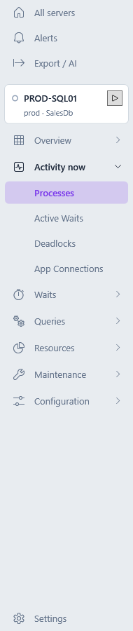
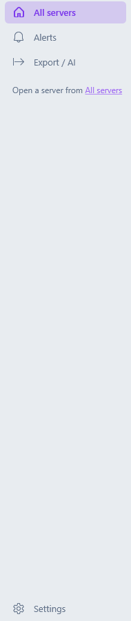
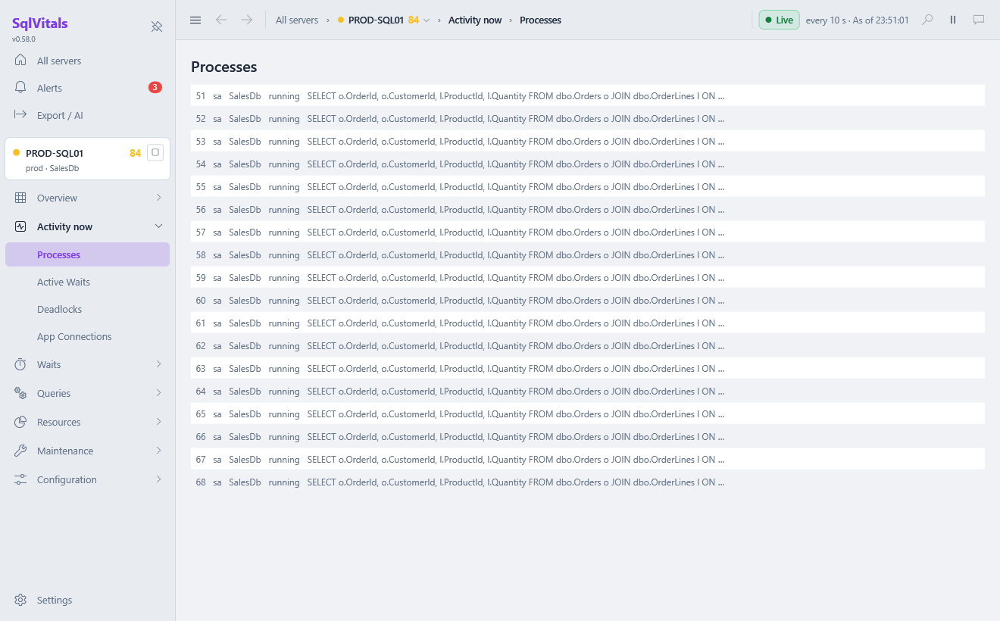
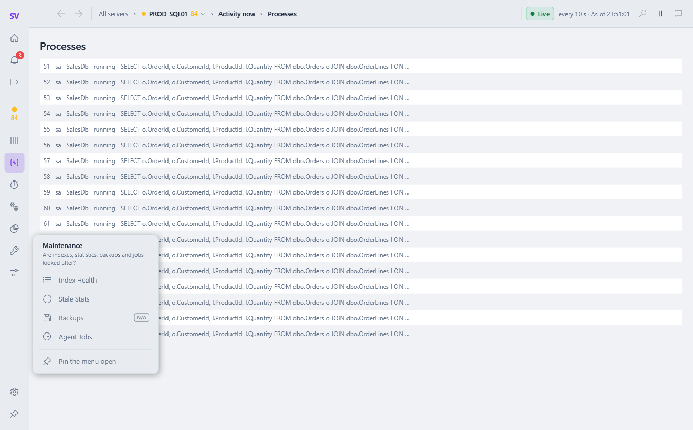
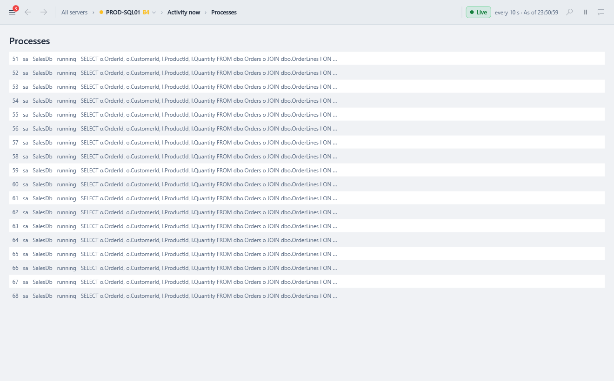
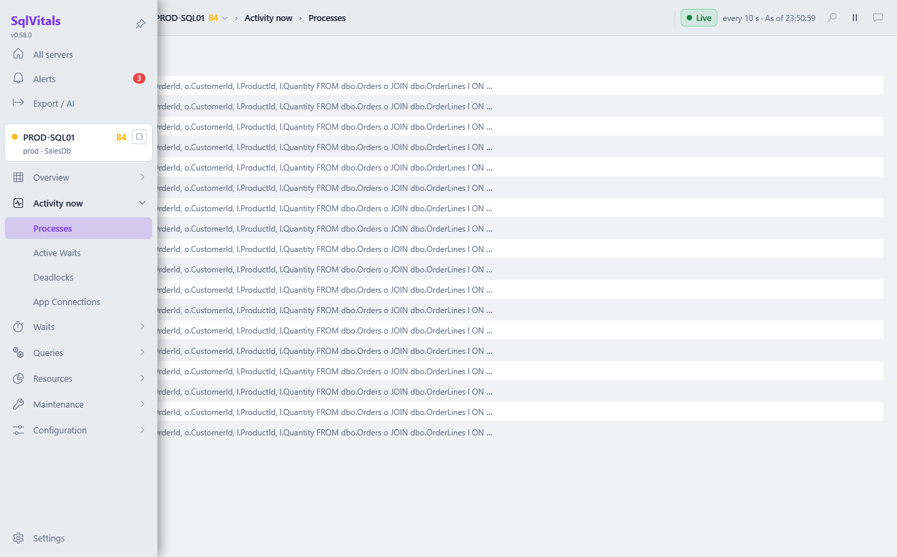
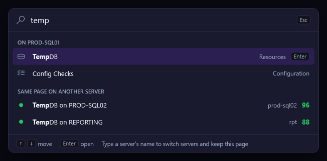

# Getting Started

This page takes you from a fresh install to your first look at a server in about five minutes.

## 1. Add your first connection

On first launch SqlVitals opens **⚙️ Settings → Connections**. Click **+ New connection**, then on the *Connection* tab:

1. **Connection name**: something you'll recognise, like *Production* or *UAT*. Leave it blank to use *server / database*.
2. **Server name**: for example `myserver.database.windows.net`, `localhost\SQLEXPRESS`, or `host,1433` for a custom port.
3. **Authentication**: *Windows Authentication*, *SQL Server Authentication* (login and password) or *Microsoft Entra MFA* (sign in with your Microsoft account).
4. **Database name**: leave it blank for your login's default database, or open the list to browse the server.
5. Click **Save & make active** in the bar at the bottom.

SqlVitals checks the connection before saving it. If the check fails, it tells you why and saves nothing. More options, such as encryption, certificates and timeouts, are explained in [Connections](Connections.md).

## 2. Find your way around

```
┌──────────────────────┬──────────────────────────────────────────────────────────┐
│ SqlVitals            │ ← → All servers › 🟢 Production › Activity › Processes   │
│ All servers          │             ● Live  every 5 s · As of 14:02:36  ⏸        │
│ Alerts             2 │──────────────────────────────────────────────────────────│
│ Export / AI          │        The screen you picked appears here                │
│┌────────────────────┐│                                                          │
││🟢 Production  96  ■││                                                          │
│└────────────────────┘│                                                          │
│ Overview           › │                                                          │
│ Activity now       ⌄ │                                                          │
│     Processes        │                                                          │
│ …                    │                                                          │
│ Settings             │                                                          │
└──────────────────────┴──────────────────────────────────────────────────────────┘
```

From 0.56.0 one **top bar** across the screen says which server, which database and what time you're looking at, and how fresh it is (in the window it is a single row; it's drawn on two lines here):


| Part | What it does |
|---|---|
| **The sidebar's global part** | From 0.57.0, at the top: **All servers** (every server at a glance, see [Your Servers](Your-Servers.md)), **Alerts** with the number of active alerts, and **Export / AI**. **Settings** is at the foot. |
| **The server part** | From 0.57.0, under it: the server you've opened, its **health dot**, **health score** and **▶ / ■** to start or stop monitoring it, then its screens in groups. Open a server from its tile on **All servers**, or switch with the breadcrumb's server menu. On All servers, Alerts and Settings it says *Open a server from All servers*. See [The server workspace](#the-server-workspace). |
| **Health dot** | 🟢 healthy, 🟠 warning, 🔴 critical or unreachable, ◯ not monitored. Hover it to see why. See [Health Dot](Health-Dot-and-Background-Monitoring.md). |
| **Health score** | The number beside the dot: 100 is healthy, lower needs attention, 0 is unreachable. Click it, or Tab to it and press Enter, to see which checks lowered it. See [Health score](Health-Dot-and-Background-Monitoring.md#health-score). |
| **Groups** | The server's screens, grouped by the question you're asking (see the table below). One group is open at a time: the one holding the screen you're on. Click another group's name, or Tab to it and press Enter or Space, to open it instead; hover it for the question it answers. A closed group holding the screen you're on is shown in the accent colour with a **●**. |
| **Buttons** | One per screen, with an icon in the global part. A dimmed button marked **N/A** is a screen the server doesn't have (on Azure SQL Database: TempDB, Agent Jobs, Backups and Security Audit); hover it to see why. |
| **☰ Menu** | From 0.58.0, at the far left of the top bar: collapses the sidebar to icons, then hides it, and while it is hidden shows it over the screen. **Ctrl+B** does the same from anywhere. With the sidebar hidden, ☰ carries the number of active alerts. See [Pin, collapse or hide the sidebar](#pin-collapse-or-hide-the-sidebar). |
| **← Back / → Forward** | From 0.55.0, at the left of the top bar: back to the screens you came from, and forward again, as in a browser. Also **Alt+←** / **Alt+→** and the mouse's back and forward buttons. Hover a button to see where it goes. Going back to another server's screen switches to that server. |
| **Breadcrumb** | From 0.56.0, where you are: *All servers › Production › Activity now › Processes*. The server's part has its health dot and score. Click a part to go there: **All servers** opens the server tiles, the group its first screen. From 0.57.0 the server's part is a menu of your saved servers: pick one to see the same screen on it. In a narrow window *All servers* and the group are left out first; the server's name always stays. |
| **Live / Snapshot / History** | From 0.56.0, what the screen is showing, as a badge with its time beside it. **Live** updates on its own: how often, and *As of* the last update; **⏸ Pause** stops it moving so you can read it, and **▶ Resume** starts it again. **Snapshot** was read once: *Taken 14:01:10 · 2 min ago*, in amber once it's 15 minutes old. **History** is a time window: the window, what it's compared with, and *Data to* where the data ends. See [below](#live-snapshot-or-history). |
| **Database** | From 0.56.0, on screens that read one database rather than the whole server (Query Store, Query Regressions, Index Health, Stale Stats, DB Storage): the connection's database. Click it to change it in the connection's settings. |
| **↻ Refresh** | At the right of the top bar (or **F5**): reloads the current screen. Most screens load once when you open them and again when you press Refresh. On a live screen it's beside **▶ Resume** while paused. |
| **Messages** | What's loading, and errors, appear in the top bar, after the time (before 0.56.0 they were at the foot of the sidebar). If a screen's automatic refresh fails, the error appears here, in red, instead of a pop-up. |
| **🔍 Jump to** | From 0.60.0, at the right of the top bar, or **Ctrl+K** from anywhere: type a few letters to go to any server, screen or setting. See [Jump to a server, screen or setting](#jump-to-a-server-screen-or-setting). In a narrow window the button gives way to the breadcrumb; Ctrl+K still works. |
| **✨ Ask AI** | A placeholder for asking AI about the screen. It is greyed out until the assistant comes. |

A server's groups (from 0.48.0; from 0.57.0 Alerts is in the global part; from 0.59.0 Overview starts with the server's Overview page):

| Group | Screens | The question it answers |
|---|---|---|
| **Overview** | Overview, Live charts | Is the server healthy, and if not, why? |
| **Activity now** | Processes, Active Waits, Deadlocks, App Connections | Who is connected, what is running, and who is blocking whom? |
| **Waits** | Top Waits, Wait Trend | What is the server waiting on, and how has that changed over time? |
| **Queries** | Resource Queries, Query Store, Query Regressions, Plan Cache Health, Implicit Conv., SP Trace | Which queries cost the most, which got slower, and why? |
| **Resources** | Memory Grants, TempDB, File I/O, DB Storage, Perfmon | Is memory, TempDB, disk or storage the bottleneck? |
| **Maintenance** | Index Health, Stale Stats, Backups, Agent Jobs | Are indexes, statistics, backups and jobs looked after? |
| **Configuration** | Config Checks, Security Audit | Is the server set up correctly and securely? |

### The server workspace

From 0.57.0 you open a server and work inside it, instead of picking one in a box at the top of the sidebar:

 

- **Open a server** from its tile on **All servers** (**Open**, or **⋯ → Open**). It opens on its **[Overview](Your-Servers.md#a-servers-overview)**: its active alerts with the evidence for each, what is costing its score points, its headline numbers, what happened since you last looked, and its charts. A Windows notification for an alert opens it too.
- **Its screens** are in the sidebar under its name. Opening one makes that server the one SqlVitals queries (the *active connection*); a server whose password isn't saved opens Settings to ask for it first.
- **Switch server** with the breadcrumb's server menu (*Production ▾*): the same screen opens on the other server, or its Overview if it hasn't got that screen (Azure SQL Database has no Agent Jobs, for one).
- **Start or stop monitoring** with **▶ / ■** in the server's header, or in its tile's **⋯** menu on All servers, which also has **Why this score…** and **Edit connection…** for every server.
- **Next time**, SqlVitals opens on the screen and server you were on when you closed it (not Settings). Until it has one, it opens on All servers with two or more connections, the server's Overview with one.

### Pin, collapse or hide the sidebar

From 0.58.0 the sidebar has three states, so a wide grid can have the screen and the menu is still one click away. **Ctrl+B**, or **☰** at the left of the top bar, goes from one to the next: *Pinned → Collapsed → Hidden → Pinned*.

| State | Width | What you see |
|---|---|---|
| **Pinned** (the default) | 232 px | The sidebar as above: names, the server's header, and the open group's screens. **Unpin** (the pin beside *SqlVitals*) collapses it. |
| **Collapsed** | 56 px | An icon for each global screen and each group, with its name as a tooltip, and the server's health dot and score. Point at a group's icon (for a moment) or click it to see its screens beside it, with the group's question and **Pin the menu open**. That closes on **Esc**, a click elsewhere, picking a screen, or, if pointing opened it, moving the pointer away. The pin at the foot pins it again. |
| **Hidden** | 0 px | Nothing: the screen has the whole width. Click **☰**, or rest the pointer on the window's left edge, and the sidebar slides in over the screen; it goes again when you pick a screen, click elsewhere or press **Esc**. Its pin (**Pin the menu open**) pins it, as does **Ctrl+B**. |





 

- **The alert count and the server's score** stay in sight: on the Alerts icon and under the server's dot when collapsed, on **☰** when hidden (the breadcrumb has the server's score).
- **In a window narrower than 1280 px** a pinned sidebar shows collapsed, and widening the window pins it again; your choice isn't changed. Pin it in the narrow window and it stays pinned.
- **The state is saved** and used at the next start. It isn't recorded in the [activity log](Settings.md#activity-log): it's a layout preference.
- **With the keyboard alone:** **Ctrl+B** changes the state. Collapsed, **Tab** or **↑ / ↓** reach the icons; **Enter** or **→** on a group opens its screens with the first (or the one you're on) selected, **↑ / ↓** move between them, and **Esc** or **←** goes back to the icon. Hidden, **Tab** to **☰** and press **Enter**: the sidebar slides in with *All servers* selected, **Tab** stays inside it until it closes, and **Esc** closes it and goes back to **☰**.

### Jump to a server, screen or setting

From 0.60.0, press **Ctrl+K** anywhere, or click **🔍** at the right of the top bar, and type. You don't need the sidebar, so it works with the sidebar hidden too.



- **What it finds:** screens by their name or by the words of their tooltip (*blocking* finds Processes, *lookups* finds Plan Cache Health), servers by their name or their server's name, and settings: Settings' categories, the open server's connection tabs, and each setting by name (*command timeout*, *encrypt*, *backup rpo*). Capitals don't matter. The letters you typed are in bold.
- **In groups:**

  | Group | What's in it |
  |---|---|
  | **On *server*** | The open server's screens, with their group. On All servers, Alerts or Settings, the active server's. |
  | **Same page on another server** | The best screen found, on each of your other servers. Type another server's name and it's the screen you're on, on that server. Each has the server's health dot and score. |
  | **Servers** | Your saved servers: opens the server's Overview. |
  | **Pages** | All servers, Alerts, Export / AI and Settings. |
  | **Settings** | Where each setting is changed: a category of Settings, the server's connection, or the screen it's on. |

  The group with the best match comes first, and its first result is selected, so typing and **Enter** is usually enough. On a tie, what you opened most recently comes first.
- **Before you type:** the last 8 screens you opened this session, most recent first (not the one you're on).
- **Keys:** **↑ / ↓** move (round from the last to the first), **Enter** opens, **Esc** (or **Ctrl+K** again) closes and puts the keyboard back where it was. **Tab** stays in the box. You can also click a result, or click outside the box to close it.
- **Screens a server doesn't have** (on Azure SQL Database: TempDB, Agent Jobs, Backups and Security Audit) are listed dimmed, with the reason, and can't be opened; **↑ / ↓** step over them.
- **Back returns:** a screen opened from here is an ordinary visit, so **← Back** goes back to where you were. Another server's screen makes that server the active connection, as from the sidebar; the [activity log](Settings.md#activity-log) gives the source as *user: quick switcher*.

### Focus mode

For a small screen, or a screen you're sharing in a call (from 0.64.0): **F11**, or the **⛶ Focus** button in the top bar, makes the window full screen and hides the sidebar. A floating [details drawer](Working-with-Grids.md#details-beside-the-grid) closes; a pinned one stays.

- The top bar stays, with **Exit focus (Esc)** at its right.
- **Ctrl+B** (or ☰) still slides the menu in over the screen, to go to another page; it goes again when you pick one.
- **Esc**, **F11** or **Exit focus** puts the window back exactly where and as big as it was, and the sidebar back as you had it: pinned, collapsed or hidden. Focus mode itself isn't saved.
- Pinning the menu from the slid-in menu also leaves focus mode.

Together with **Compact** [grid density](Working-with-Grids.md#grid-density) it shows the most rows a screen can.

### Keyboard shortcuts

| Keys | What they do |
|---|---|
| **Ctrl+K** | Jump to a server, screen or setting (from 0.60.0); again to close |
| **Ctrl+B** | Pin, collapse or hide the sidebar (from 0.58.0) |
| **Ctrl+J** | Open or close the [details drawer](Working-with-Grids.md#details-beside-the-grid): the selected row's details beside the grid (from 0.63.0) |
| **F11** | [Focus mode](#focus-mode) on or off: full screen, without the sidebar (from 0.64.0) |
| **F5** | Refresh the screen |
| **Alt+←** / **Alt+→** | Back and Forward; the mouse's back and forward buttons too |
| **Esc** | Close the quick switcher, a group's screens beside the collapsed sidebar, the sidebar slid in over the screen, or a floating details drawer; then leave focus mode |

### Verdict first, then the detail

From 0.62.0 a screen on the new page template (Processes, Query Store and Backups so far; the others follow) starts with a **verdict**: one line saying what is wrong, or that nothing is, so you know before reading a grid whether there is a problem.

- Its colour follows how bad it is (green, amber, red; grey when it can't tell), and the words say it too: *No blocking*, *Every database is within your RPO*, *4 databases are past your RPO*. A screen reader reads the level first: *Verdict, Warning: …*.
- A second line says why, and up to four buttons do the next step: *Go to session 87*, *Show only these*, *Open query 4183*.
- When the screen can't read its data, the verdict says that instead: *Couldn't read the sessions*, with the error.
- The verdict and the summary sections under it (cards, counts, charts) **fold to a one-line header**: the **⌄** at the verdict's right, or a click on a section's name. Folded, a section still says what it shows in brief. Each screen remembers what you folded.

### Live, Snapshot or History

Every screen says how its data relates to time, so you never act on old data without knowing:

| Badge | The screen | Examples | Beside it |
|---|---|---|---|
| **Live** | Updates on its own | A server's Overview, Live charts, Processes, Memory Grants, File I/O, Wait Trend, Perfmon, Home, Alerts | *every 5 s · As of 14:02:36*, and **⏸ Pause** |
| **Paused** | A live screen that isn't updating right now: paused, auto-refresh not started, or the server not monitored | Processes before you press Start | The time of the last update, and **▶ Resume** |
| **Snapshot** | Was read once, when you opened it or last pressed Refresh | Top Waits, Index Health, Backups, Config Checks, Security Audit | *Taken 14:01:10 · 2 min ago*, amber after 15 minutes |
| **History** | Shows a time window | Query Store, Query Regressions, and the Overview, Live charts, Wait Trend and Perfmon on a past range | The window, *compared with* where it compares, and *Data to 11:55* |


A screen reader reads the badge and its time out in words, *"Snapshot, taken at 13:48:36, 15 minutes ago, more than 15 minutes old"*, not only its colour. Settings and Export / AI have no badge: they aren't a view of a server's data.

## 3. Take a first look

A good first tour, in order:

1. **The server's Overview**: is it OK, and if not, why? It says the server isn't monitored at first: nothing is collected from a server until you ask. Press **Start monitoring**, then watch the score, the headline numbers and the charts for a minute. **💓 Live charts** has the charts full size.
2. **📊 Top Waits**: what SQL Server has spent most of its time waiting on since it last started. This is the single best clue to *why* a server is slow. See [Wait Statistics](Wait-Statistics.md).
3. **🔥 Resource Queries**: the queries using the most CPU and I/O.
4. **🔍 Index Health**: missing and unused indexes.

## 4. Add your other servers

Repeat step 1 for each server you look after. A connection you started keeps collecting while you look at another one, until SqlVitals exits; on **All servers**, press **▶ Start monitoring** on its tile, or **⋯ → Start monitoring**, to start one without opening it. That keeps its health dot and score current, fills its history and raises its alerts.

To have SqlVitals monitor your servers every time it starts, turn on **⚙️ Settings → Monitoring & history → Start monitoring automatically**, and **Monitor in background** on each connection's *Monitoring & alerts* tab to watch while another is active. See [Starting and stopping monitoring](Health-Dot-and-Background-Monitoring.md#starting-and-stopping-monitoring).

## Tips

- **Right-click any grid** to copy rows or export them to CSV. See [Working with Grids](Working-with-Grids.md).
- **Go back where you were.** From 0.55.0 a screen you return to opens on the tab, sort, filter, selected row and scroll position you left it with, by the sidebar or by **Back**, and with fresh data.
- **Hover** column headers, buttons and dots. Most have a tooltip explaining them.
- Prefer a dark screen? **Settings → Appearance → Theme**.
- Something not working? See [Troubleshooting and FAQ](Troubleshooting-and-FAQ.md). **Settings → Activity log & diagnostics → Open log folder** shows the app's log.

## Next

- [How-To Recipes](How-To-Recipes.md): step-by-step guides for common investigations.
- [Live Monitoring](Live-Monitoring.md): the live screens in detail.
