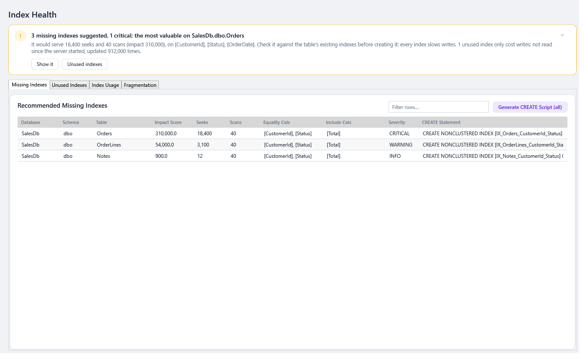
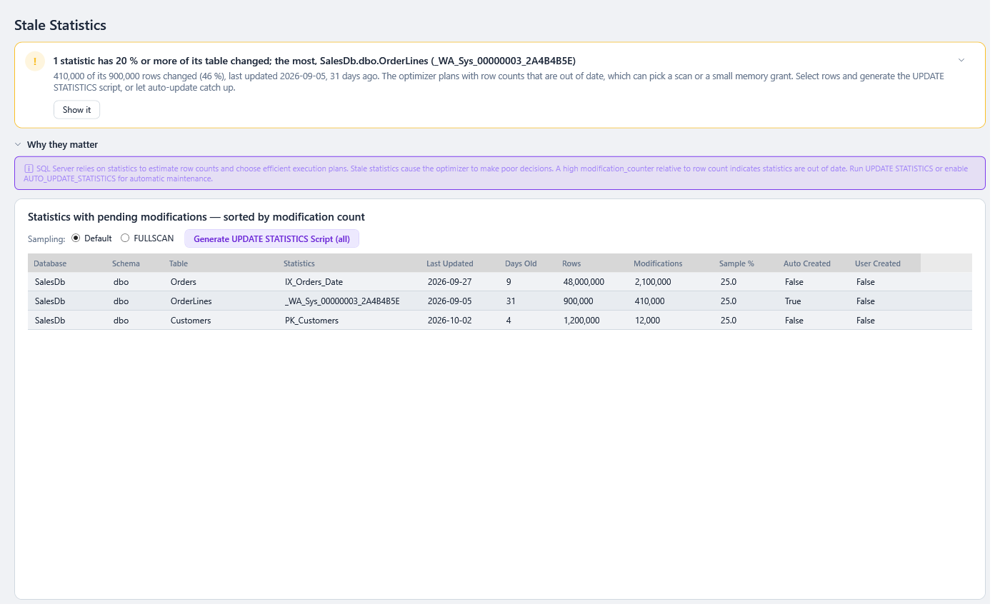

# Index and Statistics Maintenance

Two screens find index and statistics problems **and write the T-SQL to fix them**:

| Screen | Finds | Generates |
|---|---|---|
| [🔍 Index Health](#index-health) | Missing, unused and fragmented indexes | `CREATE INDEX`, `DROP INDEX`, `ALTER INDEX … REORGANIZE / REBUILD` |
| [📉 Stale Stats](#stale-statistics) | Out-of-date statistics | `UPDATE STATISTICS` |

> 🛡️ **SqlVitals never runs these scripts.** Each one opens in a preview window where you read it, then **Copy Script** or **Save as .sql**. You decide when and where to run it, ideally in a maintenance window, after testing.

## How the script buttons work (all of them)

- **Select rows** (Ctrl+click, Shift+click) to script just those. **Select nothing** to script every row shown.
- Rows are scripted **in the grid's current sort order**.
- If a [filter](Working-with-Grids.md) is on, only the rows it shows are scripted. The button then reads **(N shown)** instead of **(all)**.
- Every statement is **guarded** (`IF EXISTS` / `IF NOT EXISTS`), so a saved script stays safe to run later, even if things have changed.
- A header at the top explains what to check before running.

---

## Index Health

> **Where:** sidebar → 🔍 Index Health · **Use it when:** planning index tuning or routine maintenance

**The verdict** (from 0.66.0) names the most valuable missing index, critical ones first (*3 missing indexes suggested, 1 critical; the most valuable on SalesDb.dbo.Orders*), in amber when one is critical: how many seeks and scans it would serve, on which columns, and how many unused indexes only cost writes. **Show it** opens the Missing Indexes tab with it selected and its `CREATE` statement in the [details drawer](Working-with-Grids.md#details-beside-the-grid), with **Copy**; **Unused indexes** opens that tab. See [The page template](Getting-Started.md#verdict-first-then-the-detail).

Four tabs, which fill the page and are kept when you come back to it (from 0.66.0).

### Missing Indexes

Indexes SQL Server's optimizer wished it had, sorted by **Severity** then **Impact Score**.

| Column | Meaning |
|---|---|
| **Impact Score** | How much this index could help, combining cost, estimated improvement and how often it would be used |
| **Seeks / Scans** | How many times queries could have used it |
| **Equality Cols / Include Cols** | The suggested key and `INCLUDE` columns |
| **Severity** | **CRITICAL** ≥ 80 % estimated improvement · **WARNING** ≥ 50 % · **INFO** below |
| **CREATE Statement** | A ready-made statement for this row |

**Generate CREATE Script** builds one script with a generated name (`IX_<Table>_<key columns>`) and an `IF NOT EXISTS` guard per index.

> ⚠️ **Don't create them all.** Suggestions often overlap. Several may be served by one wider index. Each new index slows down inserts and updates. Review them against the existing indexes first.

### Unused Indexes

Indexes with **zero reads since the last restart**, which still cost writes (**User Updates**).

**Generate DROP Script** builds a `DROP INDEX` script. **Unique indexes are commented out**, because they may enforce a business rule even if nothing reads them.

> ⚠️ "Since the last restart" matters. If the server restarted yesterday, a month-end report's index will look unused. Check how long the server has been up before dropping anything.

### Index Usage

Seeks, scans, lookups and updates per index, with a **Health** assessment and when it was last sought and scanned. Use it to spot indexes that are written far more than read.

### Fragmentation

How fragmented each index is, filtered by:

- **Min Page Count** (default 1000). Small indexes don't benefit from maintenance.
- **Min Frag %** (default 10).

Change them and press **↻ Refresh** (or **Enter**). Only this tab reloads, and it keeps its sort.

**Maintenance Script** settings:

| Setting | Default | Meaning |
|---|---|---|
| **Reorganize from** | 5 % | From here up to the rebuild threshold → `REORGANIZE` (light, always online) |
| **Rebuild from** | 30 % | At or above this → `REBUILD` (thorough, heavier) |
| **ONLINE = ON** | On where supported | Rebuild without locking the table. Only enabled on editions that support it. |

**Generate Maintenance Script** writes one `ALTER INDEX` per index. Indexes below the page count, and heaps (tables without a clustered index), are skipped, with the reason written into the script.

---

## Stale Statistics

> **Where:** sidebar → 📉 Stale Stats · **Use it when:** queries got slower after lots of data changed, or plans look badly estimated

**Statistics** tell SQL Server's optimizer how data is distributed. When lots of rows change, they go out of date and the optimizer makes poor choices. This screen lists statistics with pending modifications, most-modified first.

**The verdict** (from 0.66.0) names the statistics with 20 % or more of their table's rows changed since they were updated, the largest share first (*1 statistic has 20 % or more of its table changed; the most, SalesDb.dbo.OrderLines (…)*), in amber, with how many rows changed and when it was last updated. With none that stale, it names the most changed one anyway. **Show it** selects it, so **Generate UPDATE STATISTICS Script** scripts just that one. What statistics are for folds to one line. See [The page template](Getting-Started.md#verdict-first-then-the-detail).

| Column | Meaning |
|---|---|
| **Last Updated**, **Days Old** | When the statistic was last rebuilt. Blank when it never has been: it was built on an empty table |
| **Rows**, **Modifications** | Table size when it was last rebuilt (blank if never), and rows changed since then |
| **Sample %** | How much of the table was read last time |
| **Auto Created / User Created** | Who created it |

**Sampling** for the script:

| Choice | Does | When |
|---|---|---|
| **Default** | SQL Server picks the sample size (or reuses a persisted sample percent). Fast. | Most of the time |
| **FULLSCAN** | Reads every row for the most accurate statistics. Heavy I/O. | Skewed data where sampled statistics gave bad plans. Run it off-peak. |

**Generate UPDATE STATISTICS Script** writes one `UPDATE STATISTICS <schema>.<table> (<statistic>)` per row, each guarded by `IF EXISTS`. The script warns you when:

- a statistic was last built with a **full scan** and you chose Default (a sampled update would make it *less* accurate);
- you chose **FULLSCAN** (it gives the approximate number of rows that will be read);
- a statistic is **incremental** (it suggests `WITH RESAMPLE ON PARTITIONS`).

---

### Under the hood

| | Source | Script generator |
|---|---|---|
| Missing indexes | `sys.dm_db_missing_index_details`, `_groups`, `_group_stats` | `Engine/Scripting/MissingIndexCreateScript.cs` |
| Unused / usage | `sys.dm_db_index_usage_stats` + `sys.indexes` | `Engine/Scripting/UnusedIndexDropScript.cs` |
| Fragmentation | `sys.dm_db_index_physical_stats` | `Engine/Scripting/IndexMaintenanceScript.cs` |
| Stale statistics | `sys.stats` + `sys.dm_db_stats_properties` | `Engine/Scripting/UpdateStatisticsScript.cs` |

- **Impact Score** = `(user_seeks + user_scans) × avg_total_user_cost × avg_user_impact / 100`.
- **Severity** for missing indexes is `avg_user_impact` ≥ 80 → CRITICAL, ≥ 50 → WARNING.
- **ONLINE = ON** is offered only when `SERVERPROPERTY('EngineEdition')` is 3 (Enterprise/Developer), 5 (Azure SQL Database) or 8 (Managed Instance). Even then it's left off index types that reject it (columnstore, XML, spatial), with a note in the script.
- `dm_db_index_physical_stats` returns one row per partition. The maintenance script **collapses** them into one statement per index.
- Script generators are pure functions (rows + options → text) with unit tests in `SqlVitals.Engine.Tests`. The preview is `Desktop/Windows/SqlScriptWindow`.
- Usage DMVs reset on restart, and on Azure SQL also on failover or scaling. That's why *unused* always means "since the last restart".
- Names from the server (tables, indexes, statistics, users) can hold line breaks. In a script's `--` comments a line break would end the comment and run the rest of the name, so every name in a comment is kept to one line (`Engine/Scripting/ScriptText`). In live statements a name stays inside `[...]` or `N'...'`, where a line break is part of it. Added in 0.44.1 (#109).
- A statistic that has never been updated has no `STATS_DATE` and no row counts in `sys.dm_db_stats_properties`; they read as blank. Before 0.44.1 such a statistic made the whole page fail. `sys.stats.is_incremental` is SQL Server 2014+, so it's only named where `sys.all_columns` says it exists.
- The **usage** tab takes the table's name from `sys.indexes`: before 0.44.1 it came from the usage row, which an index that was never used doesn't have, so exactly the *Unused* rows had no table name.
