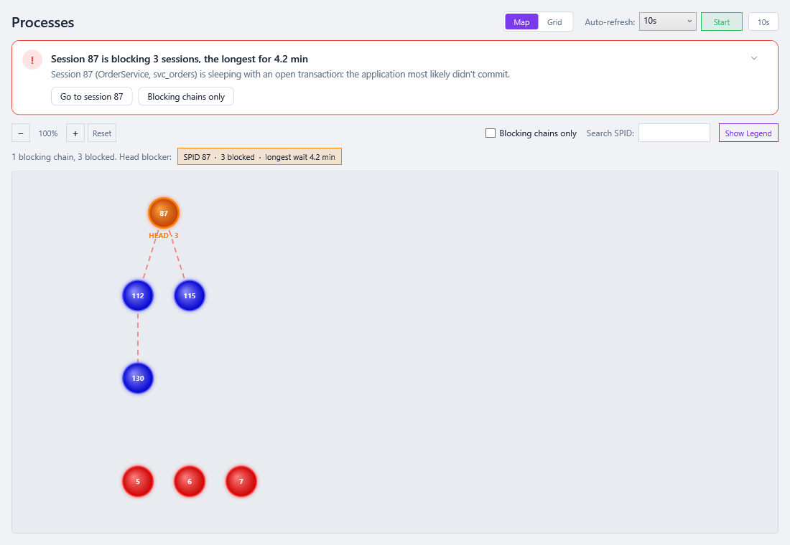
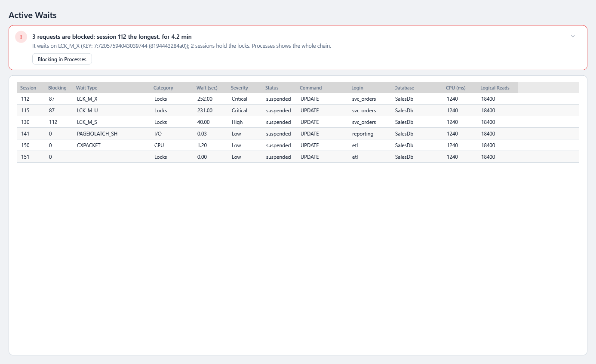

# Live Monitoring

Three screens show what the server is doing **right now**. For *is it OK, and if not, why?*, start on the server's [Overview](Your-Servers.md#a-servers-overview): its alerts, what is costing its score points, its headline numbers and the same charts, smaller.

| Screen | Answers |
|---|---|
| [💓 Live charts](#live-charts) | How busy is the server, and on what? |
| [🔗 Processes](#processes-blocking-chains) | Who is blocking whom, and who is at the head? Which login has the most sessions ([Grid view](#grid-view))? |
| [⚡ Active Waits](#active-waits) | Which sessions are waiting right now, and on what? |

---

## Live charts

> **Where:** sidebar → a server's **Overview** group → 💓 Live charts, or **Full-size live charts →** on its [Overview](Your-Servers.md#a-servers-overview) · **Use it when:** you want the charts full size, the baseline, the process map, or to change the sample interval · **Needs:** `VIEW SERVER STATE`

A dashboard of live charts, updated every 10 seconds by default. It was called **Live Metrics** and was the start page until 0.59.0, when the server's [Overview](Your-Servers.md#a-servers-overview) took its place and shows the same charts, smaller, with the alerts marked.

### How to use it

1. Open **💓 Live charts**. If the connection is already monitored, the charts show the last ~10 minutes.
2. If it says **Monitoring is off**, press **▶ Start monitoring** (in the banner or the toolbar). The first sample is taken straight away. **■ Stop monitoring** stops it again. Both last until SqlVitals exits; see [Starting and stopping monitoring](Health-Dot-and-Background-Monitoring.md#starting-and-stopping-monitoring).
3. **Sample every**, in the top bar: how often the connection is sampled, every 5 s to every 2 min. It applies in the background too, and is kept while monitoring is stopped.
4. **Charts**: tick or untick the charts you want to see.
5. **Range picker**, in the top bar: switch from **Live** to **1h**, **24h**, **7d** or **Custom…** to look back in time. **Compare to baseline** adds last week's line. See [History, Time Ranges and Baselines](History-Time-Ranges-and-Baselines.md).
6. **⏸ Pause** in the top bar freezes the charts so you can read them; monitoring and recording carry on, and **▶ Resume** catches the charts up. **F5** still takes one sample while paused.

### When monitoring is off

From 0.46.0 SqlVitals doesn't monitor anything until you ask, unless **⚙️ Settings → Monitoring & history → Start monitoring automatically** is on. Live charts says so in a banner: *"Monitoring is off. SqlVitals isn't collecting anything from this server."*, a **▶ Start monitoring** button, and a link to the setting.

- **Nothing is sent to the server** for this page: no live metrics query, no history snapshot, and no **Process Map** polling. The sidebar **Refresh** does nothing here either.
- The health score shows **—**: an old score would read as the server's health now.
- **Past ranges** (1h, 24h, 7d, Custom…) still show the history saved earlier.
- If you stopped it, the banner says when (*Stopped by you at 10:42*). If the connection can't be monitored yet (no saved password, Entra sign-in not done), **Start** is greyed out and says why.

### The charts

| Chart | Shows | What to look for |
|---|---|---|
| **Waits – Stack Area** | Wait time per second, stacked by category: CPU, I/O, Locks, Memory, Network, Other. *Other* starts unticked (from 0.54.1), so the catch-all band doesn't dwarf the rest; tick it to add it. | Which colour dominates. A tall *Locks* band means blocking; tall *I/O* means slow storage or big scans. See [Wait Statistics](Wait-Statistics.md#wait-categories). |
| **CPU Usage** | SQL Server's CPU % | Sustained high CPU. Check [Resource Queries](Query-Performance.md#resource-queries) for the cause. |
| **SQL Throughput** | Batch requests, compilations and transactions per second | Sudden drops (a stall) or spikes. Compilations close to batch requests suggests queries aren't being reused. |
| **Physical R/W** | Physical reads and writes per second | Read spikes mean data isn't in memory. |
| **Memory** | Page life expectancy, memory grants pending, buffer cache hit ratio | PLE falling steeply; memory grants pending above 0. |
| **Process Map** | A small version of the blocking chains, refreshed with each sample while monitoring runs | Orange head blockers, listed above the map. Open [Processes](#processes-blocking-chains) for the full view. |

---

## Processes (blocking chains)

> **Where:** sidebar → 🔗 Processes · **Use it when:** users say "it's hanging" or the health dot shows blocking

Live **blocking chains drawn as trees**. The head blocker is at the root and every session hangs under the one blocking it (`blocking_session_id`). Sessions not in a chain are shown below the chains.

The **Map | Grid** switch at the top right shows the same sessions as a [grid grouped by login](#grid-view) instead: better for scanning, sorting and comparing hundreds of sessions. **Map** is the default; the choice is remembered.

**The verdict** (from 0.62.0) says first, in words, whether anything is blocked, and is coloured by your [blocking threshold](Health-Dot-and-Background-Monitoring.md#what-is-checked): *No blocking · 214 sessions, none waiting on another*, or *Session 87 is blocking 3 sessions, the longest for 4.2 min*, with what the head blocker is doing (*sleeping with an open transaction: the application most likely didn't commit*). With several chains it counts them and names the one waiting longest. **Go to session 87** selects it and opens its details; **Blocking chains only** hides the rest. The **⌄** at its right folds it to its first line, and the page remembers that. See [The page template](Getting-Started.md#verdict-first-then-the-detail).

### How to use it

1. Open **🔗 Processes**. Pick an **Auto-refresh** interval (5 s to 2 min) and press **Start**. The interval and Start/Stop are remembered, so next time the page starts refreshing by itself.
2. **Look at the line above the map.** It says how many chains there are and lists each **head blocker**, largest chain first: `SPID 55 · 4 blocked · longest wait 12 s`. **Click one** to scroll to it and open its details. *No blocking* means nothing is blocked.
3. Read the tree. The head blocker is orange and labelled **HEAD · n** (n = sessions waiting behind it). **Show Legend** displays the key:

   | Colour key | Meaning |
   |---|---|
   | **Head Blocker** | At the root of a chain. It holds locks others are waiting for and waits on nothing itself. **Start here.** |
   | **Blocked** | Waiting for another session. It may block others too, further down the chain. |
   | **Active / Running** | Running normally |
   | **Sleeping** | Connected but idle |

4. **Hover a node** for login, host, program, status, open transactions, what blocks it, its wait and the start of its SQL.
5. **Click a node** to see the session in the [details drawer](Working-with-Grids.md#details-beside-the-grid) at the right (from 0.63.0; before, a Session Details panel over the map). The selected node gets a purple ring. The drawer shows its status and **open transactions**, what it **blocks** (how many sessions, the longest wait) or what **blocks it** (and the head of its chain), its wait type, time and resource, **how long its transaction has been open** (amber when it sleeps with one open for a minute or more), login, host, program, database, command, its last batch (and how long it has been idle), login time, CPU, I/O and memory. Then:
   - **Last statement**, with **Copy SQL** and **Active waits →** (Active Waits filtered to it and the sessions it blocks);
   - **Execution plan**: **Show the plan** draws what it runs, or its last statement's cached plan, with **Open in window**;
   - **KILL script (review)**: **Show the script** gives `KILL 87;` with what it blocks, when its transaction began and that the rollback can take as long as the work did, `DBCC INPUTBUFFER` to check first and `KILL … WITH STATUSONLY` to follow the rollback. **Copy** it, or **Open in window** to save it. SqlVitals never runs it.

   A refresh keeps the drawer on the same session; if the session has gone, it says so.
6. **Blocking chains only** hides every session that is neither blocking nor blocked. **Search SPID** shows matching sessions with their whole chain, so the head stays on screen. Zoom with **Ctrl + mouse wheel**; **Reset** returns to 100 %.

The **Process Map** chart on Live charts is the same view, smaller.

### Reading it

A head blocker is often a session that is **sleeping with an open transaction**: *status* is `sleeping` and *open_tran* is 1 or more. An application started a transaction and never committed it. It has no running request, so its query text is the **last batch it sent**, which usually tells you which part of the application to look at. Killing it (`KILL <spid>` in SSMS) is a decision for the DBA. SqlVitals never kills sessions.

Special cases:

- **Blocked by a negative number.** The blocker isn't a session. `blocked_by` says which kind: `-2` an orphaned distributed transaction, `-3` a deferred recovery transaction, `-4` / `-5` a latch whose owner SQL Server can't identify. The session is shown as blocked with nothing above it.
- **A session blocked by itself** (parallel queries on older builds report this) is not treated as blocking.
- **A circle of sessions blocking each other** is a deadlock the deadlock monitor hasn't resolved yet, usually within seconds. It is drawn from its lowest SPID and not listed as a head blocker. Once resolved, it appears on the [Deadlocks](Deadlocks.md) page with its victim.
- A blocker that isn't a user process (a system task) is still shown, so its chain has a head.

### Grid view

Press **Grid** to see one row per session, **grouped by [login](Glossary.md)**, so you can see at once which login has the most sessions, the blocked ones, or the heaviest load. It's the same snapshot as the map: switching doesn't query the server again, and **Auto-refresh**, the interval and the countdown drive both views.

**The group header** shows the login and a summary of its sessions, for example:

`CORP\svc-orders` · `142 sessions (3 running, 139 sleeping) · 2 blocked · 1 head blocker · CPU 12,340 ms · 5 open tran`

Parts that are zero are left out. *Running* counts sessions with a request (running, runnable, suspended); *open tran* counts sessions with an open transaction. A coloured bar on the left marks a group with a head blocker (orange) or a blocked session (blue). Groups are ordered **problems first**: groups with a head blocker, then groups with a blocked session, then the most sessions, then by name. Logins are grouped ignoring case; sessions without a login are under **(no login)**.

Click a header to collapse or expand the group, or use **Expand all** / **Collapse all**. Groups start expanded. An auto-refresh keeps which groups you collapsed, the sort, the selected row and the scroll position. A login whose sessions have all gone disappears; a new login appears as a new group. Untick **Group by login** for one flat list with a **Login** column (remembered too).

| Column | Meaning |
|---|---|
| **SPID** | The session ID |
| **State** | *Head blocker*, *Blocked*, *Active* or *Sleeping*, with a bar in the map's colour for it |
| **Blocked by** | The session blocking it, or SQL Server's negative code when the blocker isn't a session (hover for which kind) |
| **Blocking** | How many sessions it blocks **directly** |
| **Head of chain** | The head blocker at the top of its chain; empty for a session not in a chain |
| **Status**, **Host**, **Program**, **Database**, **Command** | What the session is doing and where it comes from |
| **Wait type**, **Wait (s)**, **Wait resource** | What it's waiting on now, and for how long |
| **CPU (ms)**, **Physical I/O**, **Memory (pages)**, **Open tran** | As `cpu`, `physical_io`, `memusage` (8-KB pages) and open transactions in the details drawer |
| **Login time**, **Last batch** | When the session logged in, and when its last batch ended |
| **Query text** | The first line of its current or last batch; hover for the whole text |

**Using it**

- **Click a column header** to sort. Rows are sorted inside each group; the groups keep their order.
- **Click a row** to see the session in the details drawer, as clicking a node on the map does; moving the selection with the arrow keys updates an open drawer.
- **Follow a chain across logins**: the **Blocked by** and **Head of chain** SPIDs are underlined. Click one to jump to that session's row, even in another login's group, which is expanded for you. A blocked `svc-orders` session whose head is in `report-job` takes you straight to the report job's session.
- **Ctrl+C** copies the selected rows with their headers (select several with Ctrl or Shift). Right-click for *Copy*, *Copy with headers* and *Export to CSV*.

**Filters.** They combine:

| Filter | What it does |
|---|---|
| **Show:** *Head blocker · Blocked · Active · Sleeping* | Each chip shows how many sessions are in that state; click it to hide or show them. Hide *Sleeping* to see only what's doing something. |
| **Filter rows…** | Shows only the rows containing every word typed, in any column **or the login**, like the filter box on other grids. `svc-orders` shows one login's sessions; `LCK_M` the sessions waiting on locks. The group headers then sum up only the rows shown. **Esc** clears it. |
| **Blocking chains only**, **Search SPID** | As on the map: only sessions in a chain, or the sessions whose SPID matches with their whole chain. |

Going to a session that a filter hides (from a head blocker chip, or a SPID link) clears the filters so its row can be shown.

The **Process Map** chart on Live charts is always the map.

---

## Active Waits

> **Where:** sidebar → ⚡ Active Waits · **Use it when:** you want a list, rather than a map, of sessions that are waiting

A grid of every user request currently waiting, one row per session.

**The verdict** (from 0.65.0) says first whether anything is blocked, coloured by your [blocking threshold](Health-Dot-and-Background-Monitoring.md#what-is-checked): *3 requests are blocked; session 112 the longest, for 4.2 min*, with what it waits on and who holds the lock, and **Blocking in Processes** to see the chain. With nothing blocked it says what most requests wait on (*4 requests are waiting, 2 on I/O waits*) and the longest wait, amber when one has waited over a minute; or *No request is waiting*. See [The page template](Getting-Started.md#verdict-first-then-the-detail).

| Column | Meaning |
|---|---|
| **Session** / **Blocking** | The session ID, and the session blocking it (0 = not blocked) |
| **Wait Type** / **Category** | What it's waiting on, and its [category](Wait-Statistics.md#wait-categories) |
| **Wait (sec)** | How long it has been waiting |
| **Severity** | **Low** ≤ 1 s · **Medium** > 1 s · **High** > 10 s · **Critical** > 60 s |
| **Status**, **Command**, **Login**, **Database** | What the session is doing and who it is |
| **CPU (ms)**, **Logical Reads** | Work done so far |

Press **↻ Refresh** for a new snapshot.

---

### Under the hood

- **Live charts** (and the Overview) read `sys.dm_os_performance_counters` and `sys.dm_os_ring_buffers` in one lightweight query per interval, with a count of the user tasks waiting now from `sys.dm_os_waiting_tasks` (from 0.59.0, for the Overview's *Waiting tasks*). On Azure SQL Database, CPU comes from `sys.dm_db_resource_stats` instead (the portal's *CPU percentage*, a share of the service tier's limit, per 15 seconds), so it can jump between 0 and a high figure where the portal's one-minute average looks smoother. Rates such as batch requests/sec are computed from the difference between two samples, so the first sample after a start has nothing to compare with.
- The collector belongs to the connection (`MonitoringSession`), not to the page. Leaving the page doesn't stop it. The page keeps the last 60 samples in memory, and every sample is also written to the [history database](Monitoring-History-Database.md) (table `metric_samples`).
- **Active Waits** reads `sys.dm_exec_requests` joined to `sys.dm_exec_sessions` and `sys.dm_exec_sql_text`, user sessions only, excluding SqlVitals' own session. Query text is cut to 500 characters.
- **Processes** uses `GetProcessesAsync`: `sys.dm_exec_sessions` joined to `sys.dm_exec_requests`, user sessions plus any session blocking one. A session without a request gets its text from `sys.dm_exec_connections.most_recent_sql_handle` and its open transactions from the session. `Engine/Monitoring/BlockingChains` marks head blockers and builds the trees; `Controls/ProcessMapControl` draws them. It runs only while the page (or the Live charts *Process Map*) is on screen. The grid view uses the same query, so it adds no load: `Engine/Monitoring/ProcessGroups` groups the sessions by login and sums up each group, and the grid draws only the rows on screen (rows are virtualised while grouped).
- All queries run under `READ UNCOMMITTED` so monitoring never waits on the locks it's reporting. See [Server Impact](Server-Impact-and-Permissions.md).
