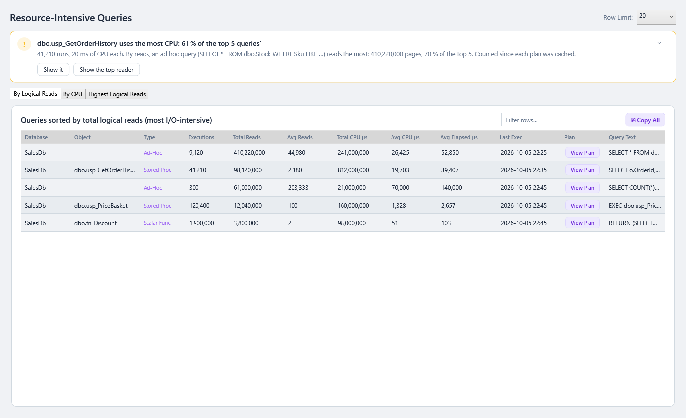
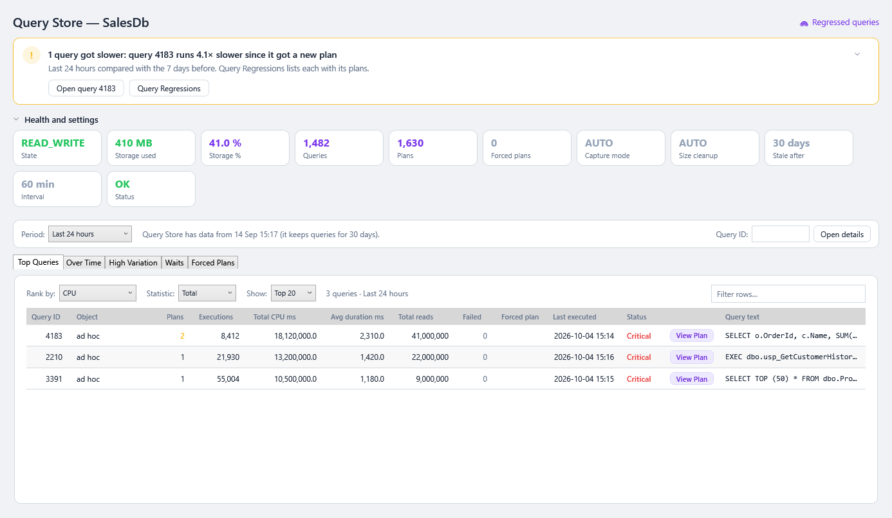
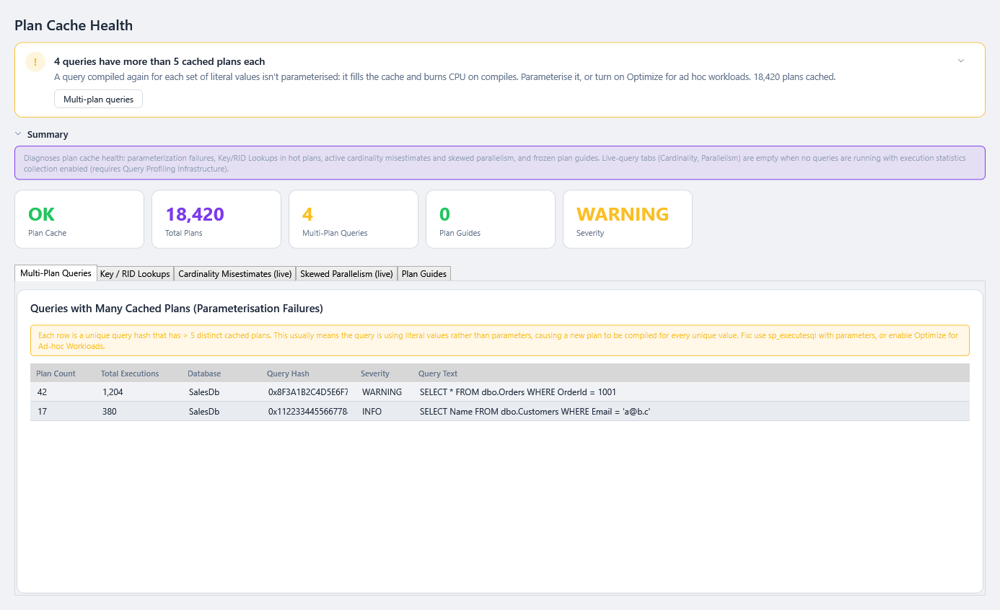
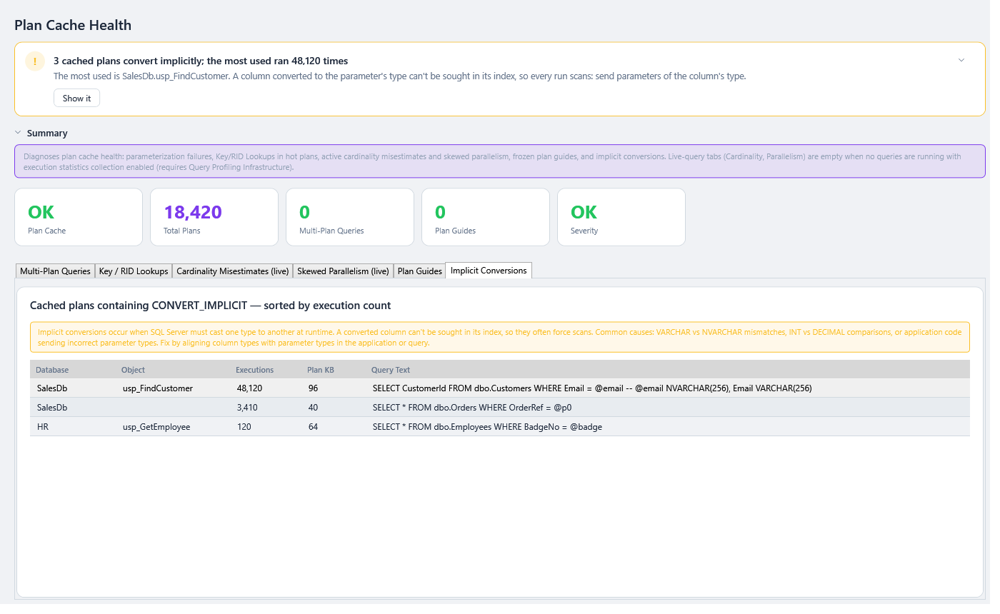

# Query Performance

Three screens find the queries that cost the most and the plan problems behind them.

| Screen | Answers |
|---|---|
| [🔥 Resource Queries](#resource-queries) | Which queries use the most CPU and I/O? |
| [📋 Query Store](#query-store) | Which queries cost most by any measure, how did the workload change, which vary, wait or have forced plans? |
| [🔎 Plan Cache Health](#plan-cache-health) | Are plans being reused, and are any badly estimated? Which queries lose index seeks to data-type mismatches ([implicit conversions](#implicit-conversions))? |

To find queries that **got slower**, see [Query Regressions](Query-Regressions.md). For **stored-procedure calls as they happen**, see [SP Trace](SP-Trace.md).

---

## Resource Queries

> **Where:** sidebar → 🔥 Resource Queries · **Use it when:** CPU is high, or I/O waits dominate

The most expensive queries currently in the **plan cache**, on three tabs:

| Tab | Sorted by | Best for |
|---|---|---|
| **By Logical Reads** | Total logical reads | Queries that read lots of data: usually missing indexes or scans |
| **By CPU** | Total CPU time | High-CPU servers |
| **Highest Logical Reads** | Total logical reads, with each query's **Last Reads** | Checking whether the latest run is still as heavy |

**The verdict** (from 0.65.0) names the query that used the most CPU and its share of the top queries' CPU (*dbo.usp_GetOrderHistory uses the most CPU: 61 % of the top 5 queries'*, amber over half), its runs and CPU per run, and the one that reads the most. **Show it** and **Show the top reader** open the tab with that query selected and in the drawer. See [The page template](Getting-Started.md#verdict-first-then-the-detail).

### How to use it

1. Pick a **Row Limit** (how many queries to load) beside the title. If reading them again fails, the top bar and the verdict say so (from 0.79.3; a message box before).
2. Choose a tab. Click a column header to sort, for example by **Avg CPU µs** to find queries that are expensive *per run*.
3. **View Plan** opens the query's execution plan. See [Execution plans](#execution-plans). From 0.65.0 a click on a row also opens it in the [details drawer](Working-with-Grids.md#details-beside-the-grid): its figures with their units, its text with **Copy**, and its plan, drawn there by **Show the plan** or in a window by **Open in window**. From 0.79.3 a plan still being read when you leave the page is dropped rather than opened over the next page, and the other rows' **View Plan** buttons stay usable meanwhile.
4. Type in **Filter rows…** to find a table, procedure or piece of text. See [Working with Grids](Working-with-Grids.md).
5. **⎘ Copy All** copies every row shown, with headers, in the current order. From 0.79.3 it copies the values as the grid shows them (*41,210*, *2026-10-13 16:57*), like **Copy with headers**, and leaves out the View Plan column. A refresh keeps the row you selected on each tab.

### Reading it

- **Total** columns find what costs the server most overall. **Avg** columns find what's slow per run. A cheap query that runs a million times can cost more than a slow one that runs once.
- CPU and elapsed times are in **microseconds** (µs). 1,000,000 µs = 1 second.
- The plan cache is cleared on restart and under memory pressure. A query that ran yesterday may no longer be listed. Use [Query Store](#query-store) or [history](History-Time-Ranges-and-Baselines.md) for older activity.

---

## Query Store

> **Where:** sidebar → 📋 Query Store · **Needs:** Query Store turned on for the database (SQL Server 2016+, Azure SQL Database and Managed Instance)

What SSMS's Query Store reports show, for the **connected database**, in one page titled **Query Store — *database***. Query Store keeps its data in the database itself, so this needs no background monitoring, survives restarts, and reaches back as far as Query Store keeps queries (`STALE_QUERY_THRESHOLD_DAYS`, 30 days by default).

| SSMS report | In SqlVitals |
|---|---|
| Regressed Queries | [🐢 Query Regressions](Query-Regressions.md): the **🐢 Regressed queries** link at the top right |
| Overall Resource Consumption | **Over Time** tab |
| Top Resource Consuming Queries | **Top Queries** tab |
| Queries With Forced Plans | **Forced Plans** tab |
| Queries With High Variation | **High Variation** tab |
| Query Wait Statistics | **Waits** tab |
| Tracked Queries | **Query details** window |

**The verdict** (from 0.62.0) says first whether any query got slower in the period than in the 7 days before it, as [Query Regressions](Query-Regressions.md) finds them with its saved threshold and minimum executions: *No query got slower*, or *1 query got slower: query 4183 runs 4.1× slower since it got a new plan* (the one costing the most extra time first). **Open query 4183** opens its details; **Query Regressions** opens that page. A custom period isn't compared (*Not compared with a baseline*), and with Query Store off it says so. See [The page template](Getting-Started.md#verdict-first-then-the-detail).

### Health and settings

**Health and settings** folds to one line, *READ_WRITE · 41.0 % of storage · settings OK*, when you click its header; the page remembers it. The cards show Query Store's **State**, **Storage used** and **Storage %**, the number of **Queries**, **Plans** and **Forced plans** (click it for the Forced Plans tab), the **Capture mode**, **Size cleanup**, **Stale after** (days), **Interval** (minutes), **Wait stats capture** (SQL Server 2017+) and a **Status**: the worst of the checks below them.

Each check gives a one-line reason and, with **⧉ Copy fix**, the `ALTER DATABASE … SET QUERY_STORE (…)` statement that fixes it. SqlVitals never changes a setting itself.

| Check | Level | Why |
|---|---|---|
| Query Store is off | Warning | It records nothing. The fix is `SET QUERY_STORE = ON`. |
| The actual state isn't the one set, e.g. *should be READ_WRITE but is READ_ONLY* | Warning | With the reason Query Store gives, e.g. *Query Store reached MAX_STORAGE_SIZE_MB*. The fix raises the size and sets it back to `READ_WRITE`. Read-only only because the database is read-only or a secondary replica is **Info**, with nothing to fix. An `ERROR` state gets the consistency check. |
| Storage over 90 % full | Warning | At 100 % it turns read-only. The fix doubles `MAX_STORAGE_SIZE_MB`. |
| Size-based cleanup is OFF | Warning | Query Store turns read-only when it fills up instead of removing its oldest, cheapest queries. |
| Capture mode is ALL | Info | AUTO, the default from SQL Server 2019, skips trivial ad hoc queries and saves space. |
| Wait stats capture is OFF (2017+) | Info | The Waits tab stays empty until it's on. |

### Period

**Period** picks what every tab but Forced Plans reads: *Last hour*, *Last 24 hours* (the default), *Last 7 days*, *Last 30 days* or *Custom* (a start and end on this PC's clock; **Show** or Enter applies it). Beside it the page says how far back Query Store's data goes, e.g. *Query Store has data from 2 Sep 14:00*. A period that starts earlier shows only what exists.

The tab on screen is read when the page opens. Another tab is read the first time you open it, and again after **Refresh** or a new period, so opening the page costs no more than before. While a tab is read, the loading bar at the top of the page says so (*Reading Top Queries…*, with **Stop**; from 0.80.0), and its status line keeps describing the rows on screen until the new ones arrive; the other tabs and the rest of the app stay usable.

If Query Store is off, every tab says *Query Store is off for **database*** with the `ALTER DATABASE … SET QUERY_STORE = ON;` statement to copy, instead of an empty grid.

**Query ID** (top right) opens the Query details window for any query ID, e.g. one from an SSMS report or a colleague's message.

### Top Queries

The top queries in the period, **one row per query** with its totals over all its plans, as in SSMS.

- **Rank by**: CPU (the default), Duration, Executions, Logical reads, Logical writes, Physical reads, Memory, Rows and, on SQL Server 2017+ and Azure SQL, Log used and TempDB used.
- **Statistic**: Total (the default), Average, Max or Std dev. Executions are always a count.
- **Show**: the top 20 (the default), 50 or 100.

| Column | Meaning |
|---|---|
| **Query ID** | Query Store's `query_id`, as in SSMS. Double-click a row for Query details. |
| **Object** | The procedure, function or trigger the statement is in, or *ad hoc* |
| **Plans** | Plans used in the period, highlighted when more than one |
| **Executions** | Executions in the period |
| *(the ranked metric)* | e.g. **Total Duration ms**, in bold |
| **Total CPU ms**, **Avg duration ms**, **Total reads** | As before; Total CPU is hidden when it's the ranked metric |
| **Failed** | *Aborted* (usually a client timeout) plus *Exception* executions |
| **Forced plan**, **Last executed** | The forced plan, if any; when it last ran, on this PC's clock |
| **Status** | Always by total CPU in the period: **Critical** > 60 s · **Warning** > 10 s · **Info** below |
| **View Plan** | The plan it used most in the period, in the graphical plan window |
| **Query text** | The statement on **one line**: line breaks and runs of spaces are collapsed, so a statement that starts `SELECT⏎  s.session_id` reads `SELECT s.session_id …` instead of just `SELECT`. Hover for all of it. |

### Over Time

The database's totals over the period, in stacked charts that share a time axis: **Duration**, **CPU**, **Logical reads** and **Executions** by default. Tick others above the charts; your choice is remembered. Each point covers one Query Store interval for periods up to 2 days, an hour up to 14 days and a day beyond that, and never less than one interval. A gap means Query Store recorded nothing then. **Click a point** to open Top Queries for its time slot.

### High Variation

Queries whose **Duration** (the default), CPU, Logical reads, Memory or Rows vary most between executions, ranked by **Std dev** as in SSMS, with **Avg**, **Min**, **Max**, **Variation** (std dev ÷ avg, e.g. *3.2×*), Plans, Executions and Object. Only queries with at least 10 executions in the period are listed: one that ran twice isn't "variable".

High variation with more than one plan often means the plan suits some parameter values and not others ([parameter sniffing](Glossary.md)). Compare the plans in Query details.

### Waits

SQL Server 2017+ and Azure SQL. A bar per [wait category](Glossary.md) (Lock, Buffer IO, CPU, Network IO, Parallelism, …) with its total wait time in the period, largest first; hover a category for what it means. **Click one** for its top queries: total and average wait per execution, Executions, % of the category, Query text and View Plan.

If wait stats capture is off, the tab says so and gives `ALTER DATABASE … SET QUERY_STORE (WAIT_STATS_CAPTURE_MODE = ON);` to copy. On SQL Server 2016 it says that version doesn't record waits.

### Forced Plans

Every [forced plan](Glossary.md) as it is now (the period only sets the executions and avg duration columns): Query ID, Plan ID, Object, **Forced by** (*Manual* or *Automatic plan correction*), **Failures** and **Last failure reason** (e.g. `NO_INDEX` when an index the plan uses was dropped), Last executed, the plan's executions and avg duration in the period, and View Plan. A plan whose forcing fails is a **Warning**: while it fails, the query runs with whatever plan the optimizer picks.

**Copy unforce** copies `EXEC sys.sp_query_store_unforce_plan @query_id = 12, @plan_id = 34;`. SqlVitals never forces or unforces a plan itself.

On SQL Server 2022+ and Azure SQL a second grid lists the **Query Store hints**: Query ID, hint, source, failures and last failure reason.

### Query details

**Click a row** on any tab to see the query in the [details drawer](Working-with-Grids.md#details-beside-the-grid) beside the grid (from 0.63.0): its figures from that tab (executions, plans, failures, duration, CPU, reads, forced plan, last executed; or its variation, waits or forcing), its text with **Copy**, and each plan that ran in the period with its runs, average duration and CPU and **Open in window**. **Query details in a window** opens the window below. It keeps the query while you sort, reload or change tab, so you can compare.

Double-click a row on any tab, or enter a **Query ID**, to open a window for one query (several can be open at once):

- the full query text with **Copy**, the object and the query ID;
- a chart of one metric per interval over the period, **one line per plan**, the forced plan thicker and marked *(forced)*. Avg Duration by default; any metric from Top Queries can be picked;
- the plans: Plan ID, first and last used in the period, Executions, avg Duration, avg CPU, avg Reads, Failed, Forced, Force failures and **View Plan**. A forced plan is listed even when it didn't run.

---

## Plan Cache Health

> **Where:** sidebar → 🔎 Plan Cache Health

Six tabs, each looking for a different plan problem:

| Tab | Finds | Usual fix |
|---|---|---|
| **Multi-Plan Queries** | The same query with many cached plans (**parameterisation failures**): usually literals in the SQL instead of parameters | Parameterise the query; consider *optimize for ad hoc workloads* or forced parameterisation |
| **Key / RID Lookups** | Plans that seek an index and then look up the rest of the row, in high-execution queries | Add the looked-up columns to the index as `INCLUDE` columns |
| **Cardinality Misestimates (live)** | Queries running **now** whose actual row counts are ≥ 1,000× off the estimate | Update statistics ([Stale Stats](Index-and-Statistics-Maintenance.md#stale-statistics)), simplify predicates |
| **Skewed Parallelism (live)** | Parallel queries running **now** whose threads have very uneven work (≥ 5×) | Often caused by skewed data or bad estimates; review the plan |
| **Plan Guides** | Plan guides: plans frozen by hand | Check they're still wanted, and not disabled or stale |
| **Implicit Conversions** | Cached plans that contain `CONVERT_IMPLICIT`, sorted by execution count (a page of its own until 0.79.0) | Make the parameter's type match the column. See [Implicit conversions](#implicit-conversions) |

*(live)* tabs show only queries running at that moment. Refresh while the problem is happening.

**The verdict** (from 0.65.0) says the worst of what the page found, coloured by the page's own severity: the plan cache emptied in the last 24 hours, else queries with more than 5 cached plans, else plan guides or a busy plan converting implicitly (1,000 runs or more), whichever is more serious, else busy plans doing key lookups, else any plan converting implicitly, or *The plan cache looks healthy*. Its button opens the tab concerned; for implicit conversions, **Show it** opens their tab with the most used plan selected. The explanation, the cache-erased banner and the cards fold to one line (*Plan cache OK · 18,420 plans · 4 multi-plan queries · 0 plan guides · WARNING*), and the tabs take the rest of the screen, each grid scrolling in it. From 0.79.2 a refresh keeps each grid's sort and filter, and the implicit conversion you selected. See [The page template](Getting-Started.md#verdict-first-then-the-detail).

### Implicit conversions

> **Where:** sidebar → 🔎 Plan Cache Health → **Implicit Conversions** tab · The Implicit Conv. page until 0.79.0 ([#178](https://github.com/aselasampath/sqlvitals/issues/178)); a link or a saved setting that names it opens this tab

**Why it matters:** when a query compares values of different data types, for example an `NVARCHAR` parameter against a `VARCHAR` column, SQL Server converts one side. If it has to convert the **column**, it often can't seek on that column's index and scans instead.

**Typical fix:** make the application's parameter type match the column, e.g. send `VARCHAR` for a `VARCHAR` column. In .NET, set the parameter's `SqlDbType` explicitly instead of passing a string.

When they are the worst the page found, the verdict counts the cached plans that convert and names the most used first: *3 cached plans convert implicitly; the most used ran 48,120 times* (amber from 1,000 runs; *At least 50* when the tab's limit is reached). **Show it** opens the tab with that plan selected.

The tab is read with the rest of the page, at the same time. If its search fails, for example a timeout on a very large plan cache, the tab says so (*Couldn't read the implicit conversions: …*) and the rest of the page still shows; raise **Command timeout** (Settings → Monitoring & history) and **Refresh**.

---

## Execution plans

**View Plan** (Resource Queries, Query Store, SP Trace) and the **Now / Before** buttons (Query Regressions) open the **Query Execution Plan** window. It draws the plan **graphically, like SSMS**:

- One diagram per statement, with its cost relative to the batch and any **missing-index** suggestion.
- Each operator's icon, object and **cost %**. Operators at 25 % or more are highlighted, arrows get thicker with the row count, and badges flag warnings (spills, missing statistics, implicit conversions…) and parallelism.
- In actual plans, elapsed time and actual vs. estimated rows, with estimates **10× off** in red.
- Hover for details, click an operator for **every property**, **Find**, zoom, pan, and **Export diagram as PNG**.
- The **XML** tab has the raw plan: **Copy XML**, or **Save as .sqlplan** for SSMS or Azure Data Studio.
- *"No execution plan available"* means SQL Server has already evicted the plan.

See [Execution Plans](Execution-Plans.md) for how to read the diagram.

---

### Under the hood

| Screen | Source |
|---|---|
| Resource Queries | `sys.dm_exec_query_stats` + `sys.dm_exec_sql_text` + `sys.dm_exec_query_plan` |
| Query Store | `sys.database_query_store_options` and `sys.query_store_query`, `_query_text`, `_plan`, `_runtime_stats`, `_runtime_stats_interval`, `_wait_stats` (2017+) and `_query_hints` (2022+), for the connected database |
| Plan Cache Health | `sys.dm_exec_cached_plans` / `sys.dm_exec_query_stats` grouped by `query_hash`; live tabs use `sys.dm_exec_query_profiles`; plan guides from `sys.plan_guides`; the Implicit Conversions tab searches cached plan XML (`sys.dm_exec_cached_plans` + `sys.dm_exec_query_plan`) for `CONVERT_IMPLICIT`, read with the rest of the page |

- These run **on demand** against the active connection only, never in the background. Plan-XML searches are the heaviest queries SqlVitals runs; on a server with a very large plan cache they may need a longer **Command timeout** (Settings → Monitoring & history).
- The live tabs depend on lightweight query profiling, which is on by default from SQL Server 2019 and in Azure SQL. On older versions they may be empty.
- The live tabs read `estimate_row_count` and `row_count` from `sys.dm_exec_query_profiles`. A parallel node has one row per thread: Cardinality Misestimates sums them into one row per node, and Skewed Parallelism compares the worker threads (thread 0, the coordinator, is left out). Before 0.43.2 both asked for `estimated_row_count` and `actual_row_count`, columns no version has, so the whole page failed with error 207. Before 0.69.1 Cardinality Misestimates could fail with *Divide by zero error encountered* (8134) while any query was running on SQL Server 2019 or later, which profiles every request, and the whole page failed with it.
- Only the summary and Multi-Plan Queries are required. If Key / RID Lookups, a live tab or Plan Guides hits a missing column or object (error 207 or 208), that tab is left empty and the rest of the page still loads. Query Store says so when its catalog views don't exist (SQL Server 2014 and earlier).
- **Query Store** (fixed in 0.44.1, #109): `readonly_reason` is a bit map (an `int`), turned into words; reading it as text failed the page. The plan type (`sys.query_store_plan.plan_type_desc`) is SQL Server 2022+, so it's named only where `sys.all_columns` says it exists; before that every plan is a compiled plan. `last_execution_time` is a `datetimeoffset` in UTC. Before 0.44.1 the top queries never loaded, on any version.
- **Multi-Plan Queries** shows the query hash as hex (`CONVERT(varchar(18), query_hash, 1)`, e.g. `0x1A2B…`), so it can be matched with the hash elsewhere. Before 0.44.1 it cast the 8 bytes to characters.
- **Query Store** (#111):
  - *Versions.* One `sys.all_columns` probe per connection says what the server has: `sys.query_store_wait_stats`, `wait_stats_capture_mode_desc`, `avg_log_bytes_used`, `avg_tempdb_space_used` and `plan_forcing_type_desc` are SQL Server 2017+; `plan_type_desc` and `sys.query_store_query_hints` are 2022+. Azure SQL has them all. A column is named only where it exists; SQL Server 2016 had no automatic plan correction, so every forced plan there is *Manual*. A missing view or column (error 207 or 208) leaves only that tab empty, with the reason.
  - *Period.* Filtered on `sys.query_store_runtime_stats_interval.start_time`, as on Query Regressions, so a period counts whole intervals; a preset ends at the server's now.
  - *Grouping.* Runtime stats have a row per plan, interval and execution type (*Regular*, *Aborted*, *Exception*). Every query sums them on the server and returns only its `TOP` rows. Totals are Σ(avg × `count_executions`); the "most-used plan" is the one with the most executions in the period.
  - *Units.* Duration and CPU are µs, shown as ms; reads, writes, memory and TempDB are 8 KB pages, shown as counts, with memory and TempDB in MB; log is bytes, shown as MB.
  - *Combined std dev.* High Variation and the Std dev statistic use the std dev of **all** the query's executions, not the average of each interval's: with nᵢ, μᵢ and σᵢ per row, N = Σnᵢ, μ = Σnᵢμᵢ / N and σ² = Σnᵢ(σᵢ² + μᵢ²) / N − μ², clamped at 0. That counts the difference between intervals too.
  - *Time slots.* Over Time's points are one interval (periods up to 2 days), an hour (up to 14 days) or a day, never less than one interval. Day slots start at local midnight.
  - The timeout for these reads is 2 minutes, as on Query Regressions: 30 days of a large Query Store can take a while.
- SQL lives in `Engine/Sql/ResourceQuery/`, `Sql/QueryStore/` and `Sql/PlanCacheHealth/`, one `.sql` file per query, run by `ResourceQueryRepository`, `QueryStoreRepository` and `PlanCacheHealthRepository`. See [Architecture](Architecture.md#where-the-sql-lives).
