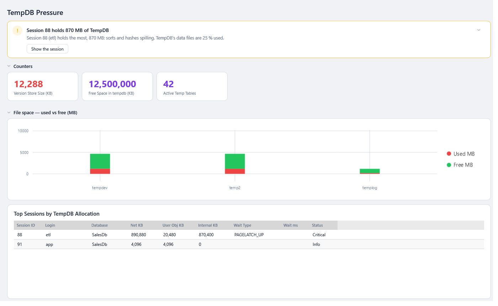
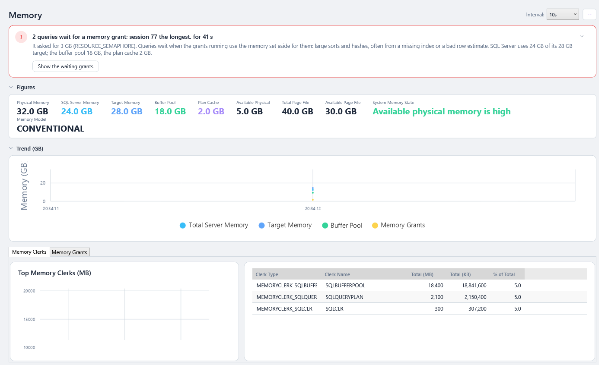
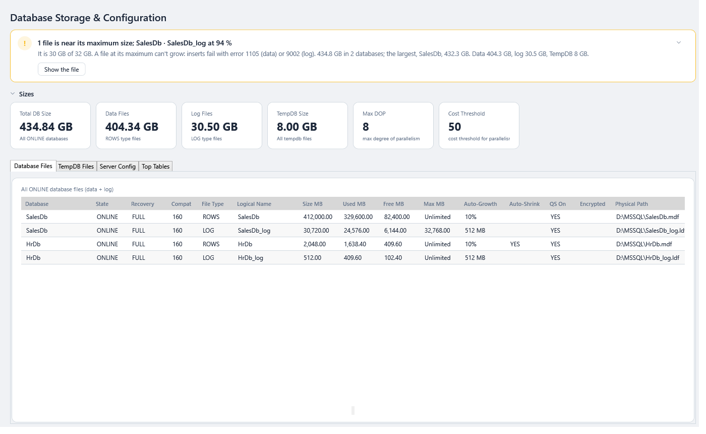
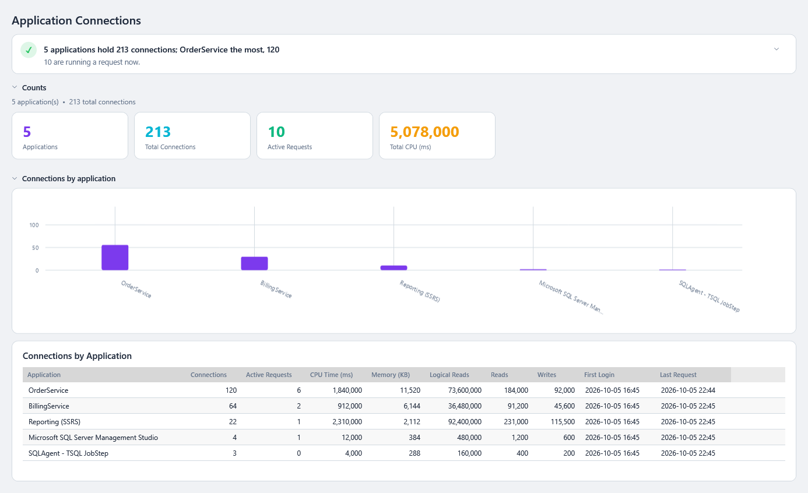
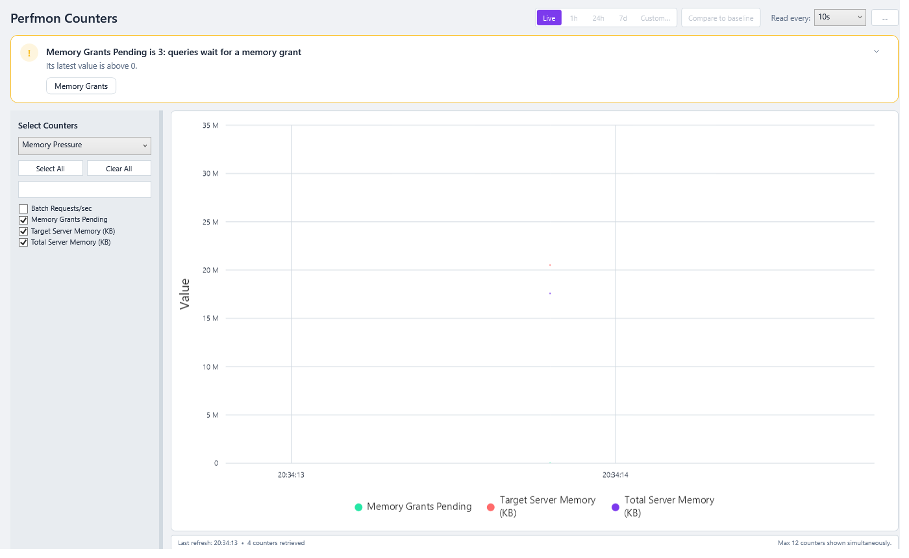

# Server Resources

Five screens show how the server's memory, TempDB, storage, configuration and connections are used.

| Screen | Answers |
|---|---|
| [🗄️ TempDB](#tempdb) | How full is TempDB, and who is filling it? |
| [🧠 Memory](#memory) | Where is memory going, and are queries waiting for it? |
| [📦 DB Storage](#db-storage) | How big are the databases and files, and how is the server configured? |
| [🔌 App Connections](#app-connections) | Which applications are connected, and what load do they create? |
| [⏱️ Perfmon](#perfmon) | Any SQL Server performance counter, charted |

---

## TempDB

> **Where:** sidebar → 🗄️ TempDB · **Use it when:** the health dot flags TempDB space, or you see `PAGELATCH` waits · **Not on:** Azure SQL Database, which doesn't expose `sys.master_files` (the button is marked **N/A**)

- **Cards:** the version store's size (red once it holds anything), free space in TempDB, transactions open in TempDB, active temp tables, and temp tables waiting to be dropped. How fast versions are generated and cleaned up is charted on [Perfmon](#perfmon), which shows per-second counters as rates.
- **TempDB File Space: Used vs Free (MB)**: a chart per TempDB file, at its size now.
- **Top Sessions by TempDB Allocation**: who is using TempDB now. **Net KB** is the total. **User Obj KB** covers temp tables and table variables. **Internal KB** covers sorts, hashes and spools, usually from big queries. Also shown: wait type, wait ms and status. **Wait ms**, how long the session's request has waited on its wait type, is filled from 0.79.1; before, the column stayed empty. Refresh keeps the session you selected selected, and the grid's sort.

| Severity | Net allocation |
|---|---|
| Info | ≤ 100 MB |
| Warning | > 100 MB |
| Critical | > 1 GB |

A session with large **Internal KB** is usually one query sorting or hashing a lot of data. Look at its plan for a missing index or a bad estimate.

**The verdict** (from 0.66.0) names, in amber, a session holding 500 MB or more of TempDB (*Session 88 holds 870 MB of TempDB*, and whether it's temp tables or sorts and hashes spilling), TempDB's data files 90 % used or more, or a version store of 1 GB or more, which a long-running transaction keeps alive. Otherwise it says how much room is left and who holds the most (*TempDB has room: 12 GB free of 16 GB*). **Show the session** selects the session holding the most. The cards and the file chart fold to one line each (*3 files · 4,450 MB used of 18,432 MB*), and the sessions take the room. See [The page template](Getting-Started.md#verdict-first-then-the-detail).

---

## Memory

> **Where:** sidebar → 🧠 Memory (called Memory Grants until 0.79.0, though it shows all of memory) · **Use it when:** you see `RESOURCE_SEMAPHORE` waits, or *memory grants pending* on the health dot

**Cards** at the top: Physical Memory, SQL Server Memory, Target Memory, Buffer Pool, Plan Cache, Available Physical, Page File, **System Memory State** and Memory Model.

**Memory Model** is how SQL Server allocates memory: `CONVENTIONAL`, `LOCK_PAGES` (the service account has *Lock pages in memory*) or `LARGE_PAGES`. It shows **N/A** on Azure SQL Database and on builds that don't report it, such as SQL Server 2016 RTM and 2012 before SP4.

Under the cards, a **Trend** chart of SQL Server memory, its target, the buffer pool and the memory granted to queries: pick an **Interval** (5s, 10s, 30s, 60s) and press **Resume (▶)** in the top bar; **Pause** stops it. From 0.66.0 these are the page's Start and Stop, which were the same switch. Then two tabs:

| Tab | Shows |
|---|---|
| **Memory Clerks** | The top consumers of SQL Server memory (buffer pool, plan cache, …) in MB and % of total, charted beside the grid |
| **Memory Grants** | Queries holding or **waiting for** workspace memory: requested, granted and used KB, wait ms, **Pending** |

| Severity | Rule |
|---|---|
| **Critical** | The query is **waiting** for its grant (pending) |
| **Warning** | Granted more than 1 GB |
| Info | Otherwise |

**Reading it:** a grant that's much bigger than what's **Used** means the optimizer over-estimated. That's often a stale-statistics or parameter-sniffing problem, and it starves other queries of memory.

**The verdict** (from 0.66.0) names the queries waiting for a memory grant, the longest first (*2 queries wait for a memory grant; session 77 the longest, for 41 s*), in red once one has waited 30 seconds, and how much it asked for. **Show the waiting grants** opens the Memory Grants tab with it selected. With nothing waiting it is red if Windows reports low physical memory, and otherwise says how SQL Server's memory is used (*SQL Server uses 24 GB of its 28 GB target; the buffer pool 18 GB, the plan cache 2 GB*), with **Memory clerks**. The cards and the trend fold to one line each. The verdict follows each trend reading. See [The page template](Getting-Started.md#verdict-first-then-the-detail).

---

## DB Storage

> **Where:** sidebar → 📦 DB Storage · **Use it when:** checking disk space, growth settings or basic configuration

**Cards:** Total DB Size, Data Files, Log Files, TempDB Size, **Max DOP** and **Cost Threshold** for parallelism.

| Tab | Shows | Look for |
|---|---|---|
| **Database Files** | Every data and log file of every online database: state, recovery model, compatibility level, size, used, free, max size, auto-growth, auto-shrink, Query Store on, encrypted, path. **Used** and **Free** are blank for a database your login can't open | Files close to **Max MB**; **percent** auto-growth on big files; **Auto-Shrink on** (almost always bad) |
| **TempDB Files** | TempDB data and log files | Data files of unequal size |
| **Server Config** | Key `sp_configure` settings, with min, max, whether dynamic, and a description | *max server memory* left at the default; *cost threshold for parallelism* at 5 |
| **Top Tables** | The 20 largest tables in the current database: rows, data, index and unused MB | Tables with more index than data |

On **Azure SQL Database**, server-level parts (TempDB files, `sp_configure`) aren't available and are skipped automatically.

**The verdict** (from 0.66.0) names, in amber, the files within 10 % of their **Max MB** (*1 file is near its maximum size; SalesDb · SalesDb_log at 94 %*): a file at its maximum can't grow, so inserts fail with error 1105, or 9002 for a log. Next it names the databases with auto-shrink on. Otherwise it gives the storage at a glance: the total, the largest database, data, log and TempDB. **Show the file** opens the Database Files tab with the file selected. The cards fold to one line, and from 0.66.0 the four views are tabs the page keeps when you come back to it, in the grids' usual style and [density](Working-with-Grids.md#grid-density). See [The page template](Getting-Started.md#verdict-first-then-the-detail).

> **Tip:** [Configuration Checks](Configuration-Checks.md) checks these settings for you: MAXDOP, cost threshold, max server memory, TempDB's files, auto-shrink, page verify and compatibility level, with the value recommended for this server.

---

## App Connections

> **Where:** sidebar → 🔌 App Connections · **Use it when:** you want to know which application causes the load, or you suspect a connection leak

Connections grouped **by application** (program name): number of connections, active requests, CPU time, memory, logical reads, reads, writes, first login and last request.

**Reading it:** hundreds of connections from one application with few active requests usually means a connection pool that's too big, or connections that aren't closed.

**The verdict** (from 0.65.0) says who holds the connections (*5 applications hold 213 connections; OrderService the most, 120*), or, in amber, names an application holding 200 or more connections with fewer than 5 % of them running a request: a likely leak or an oversized pool. The **Counts** cards and the **Connections by application** chart fold to one line each (*5 application(s) · 213 connections · 10 active requests*), and the grid takes the room. See [The page template](Getting-Started.md#verdict-first-then-the-detail).

---

## Perfmon

> **Where:** sidebar → ⏱️ Perfmon · **Use it when:** you need a specific SQL Server counter that the other screens don't show

1. Tick counters in **Select Counters** on the left (**Select All** / **Clear All**). Up to **12** are charted at once.
2. Set **Read every** and press **Resume (▶)** in the top bar; **Pause** stops it, and **Refresh** (F5) takes one reading. From 0.66.0 these are the page's Start and Stop, which were the same switch.
3. Use the **range picker** in the top bar (1h, 24h, 7d, Custom…) to chart recorded history, and **Compare to baseline** for last week. See [History, Time Ranges and Baselines](History-Time-Ranges-and-Baselines.md).

Counters include batch requests, compilations, lock waits and timeouts, log flushes, memory grants, page life expectancy and more. Per-second counters are shown as rates.

**The verdict** (from 0.66.0) reads the counters charted against the few with a well-known limit: *Memory Grants Pending*, *Processes blocked* or *Number of Deadlocks/sec* above 0, *Free list stalls/sec* above 2, *Lazy writes/sec* above 20. One past its limit is named in amber (*Memory Grants Pending is 3: queries wait for a memory grant*), with a button to the page that shows the cause: Memory Grants, Processes or Deadlocks. Counters have different units, so they aren't compared with each other; it names the ones **rising**, whose last readings are at least twice their first, and otherwise says none is past a limit. Before it has anything to judge it says so (*Not charting yet*, *Nothing recorded in this range*). See [The page template](Getting-Started.md#verdict-first-then-the-detail).

---

### Under the hood

| Screen | Source |
|---|---|
| TempDB | `sys.dm_db_session_space_usage` joined to `sys.dm_exec_sessions` / `_requests`; file sizes and space from `tempdb.sys.database_files`, and point-in-time TempDB performance counters (`TempDbRepository`) |
| Memory | `sys.dm_os_sys_info`, `sys.dm_os_sys_memory`, `sys.dm_os_process_memory`, `sys.dm_os_memory_clerks`, `sys.dm_exec_query_memory_grants`, memory manager counters |
| DB Storage | `sys.master_files`, `sys.databases`, each database's `sys.database_files`, `sys.configurations`, `sys.partitions` + `sys.allocation_units` (top tables) |
| App Connections | `sys.dm_exec_sessions` / `sys.dm_exec_requests` grouped by `program_name` |
| Perfmon | `sys.dm_os_performance_counters` |

- **Azure SQL Database** (`SERVERPROPERTY('EngineEdition') = 5`) blocks `sys.master_files`, cross-database `tempdb.sys.database_files` and `sys.configurations`. `GetDatabaseStorageAsync` detects the edition and switches to database-scoped queries (`sys.database_files`, `sys.database_scoped_configurations`), skipping TempDB files.
- **Memory model** is `sys.dm_os_sys_info.sql_memory_model_desc`, which arrived in a service pack (2012 SP4 and 2016 SP1, per Microsoft's docs), so the major version can't tell whether it exists. `GetMemorySnapshotAsync` first asks `sys.all_columns` whether the column is there and names it only if it is; naming a missing column fails the whole query with error 207. Before 0.43.1 it asked for `memory_model_desc`, a column no version has, and the page failed on every SQL Server 2016 or later.
- **Perfmon history** comes from the `counter_values` table, recorded from version 0.30. Per-second counters are stored as rates over the snapshot interval; zeros aren't stored.
- **Used space** comes from `FILEPROPERTY(name, 'SpaceUsed')`, which only sees the **current** database's files. So TempDB's files are read through `tempdb.sys.sp_executesql`, and DB Storage reads each database it can open (`HAS_DBACCESS`) through that database's `sys.sp_executesql`, collected in a temporary table in the same batch. `sys.master_files` holds TempDB's **startup** size, so TempDB's size is read from `tempdb.sys.database_files` too. Before 0.44.1 every file outside the connection's database showed 0 MB used, and TempDB showed its startup size (#109).
- **TempDB counters** are the point-in-time ones (`cntr_type` 65792). The version store counters have no instance, and *Active Transactions* is under the *Databases* object for instance `tempdb`; before 0.44.1 the query asked for the version store counters with instance `tempdb`, so their cards never appeared. The rate counters are totals since the server started, which only mean something as the difference between two readings, so they're left to Perfmon.
- **Top Tables** is one row per table: sizes add up every partition of every index, and **Rows** is the heap's or clustered index's, summed over its partitions. Before 0.44.1 a partitioned table, or one with a filtered index, was split over several rows.
- **App Connections** sums CPU time and memory as `bigint`: `SUM` of an `int` column stays `int`, and on a busy server it overflowed (error 8115).
- **Older versions:** `sys.databases.is_query_store_on` (SQL Server 2016+) is only named where `sys.all_columns` says it exists; before that Query Store is shown as off.
