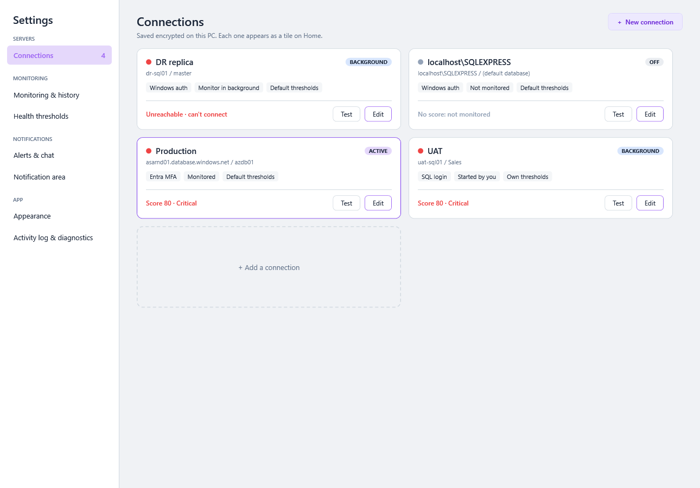
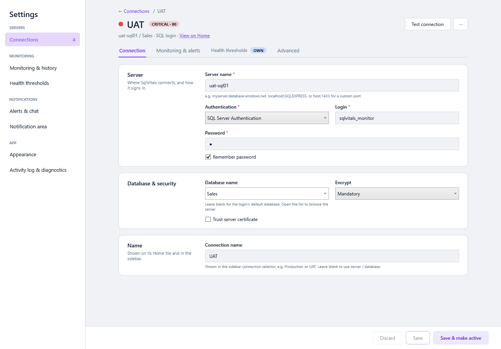
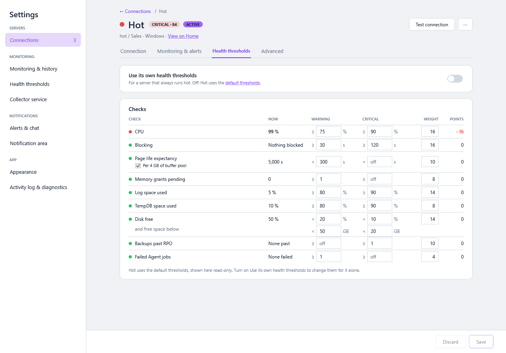
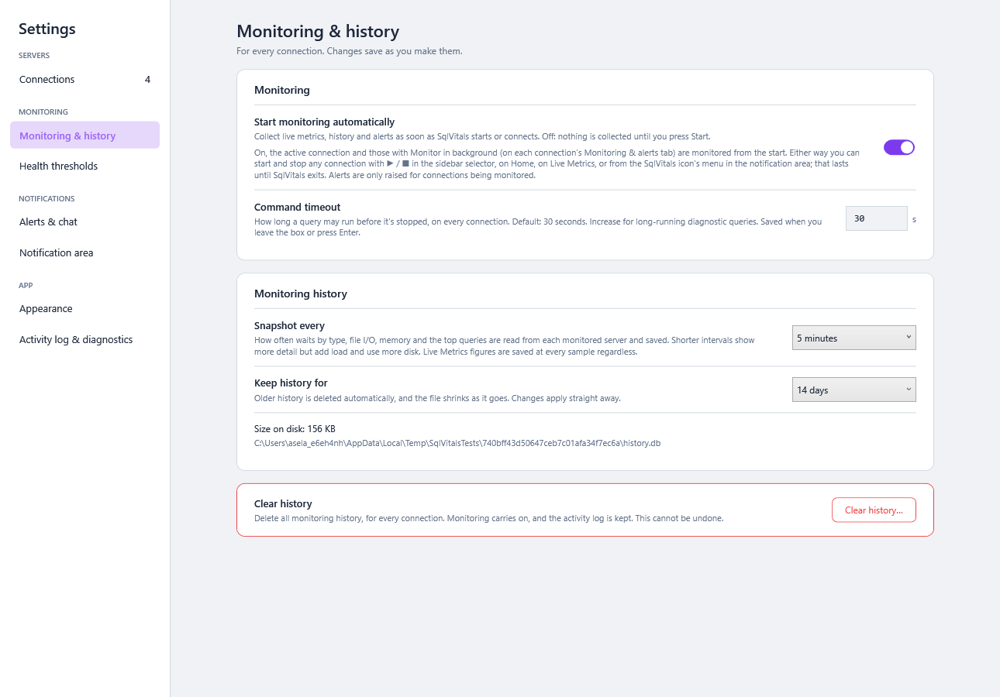
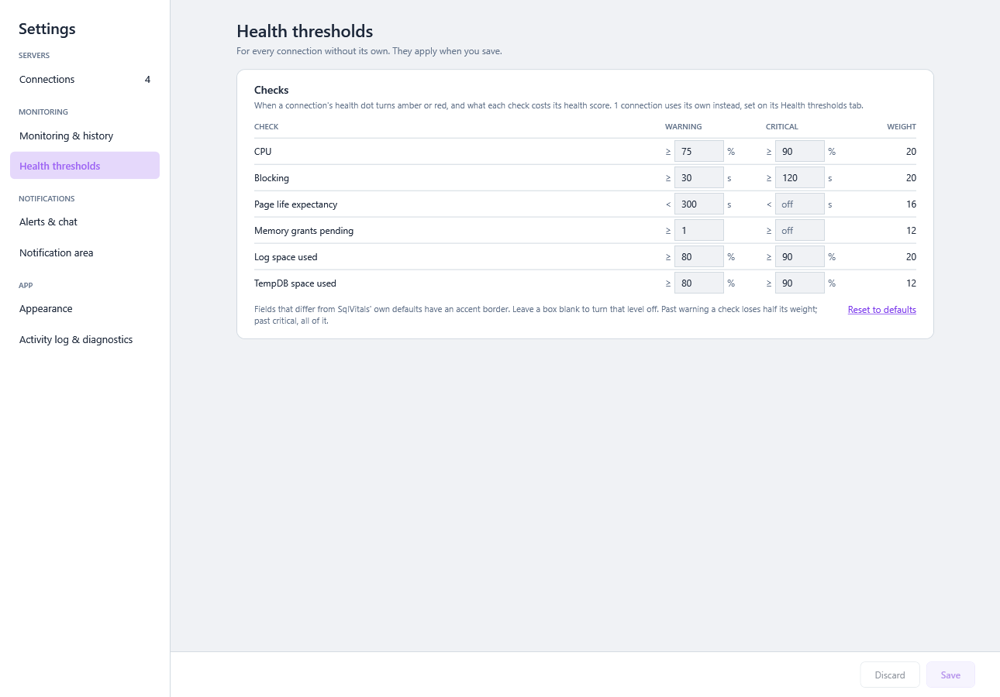
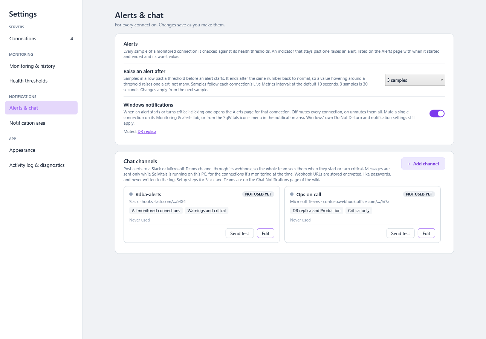

# Settings

**⚙️ Settings** holds everything you can configure. Changes apply straight away; no restart is needed.

> **Where:** sidebar → **Settings**, at the foot (opens automatically on first launch); a server's **⋯ → Edit connection…** on All servers opens its page · **Since:** categories and a page per connection from 0.54.0 ([#131](https://github.com/aselasampath/sqlvitals/issues/131))

Settings has its own side menu, next to the app's sidebar, with a category per kind of setting. It opens on **Connections**, or on the category you last used since SqlVitals started.

| Group | Category | What you set | Saved |
|---|---|---|---|
| Servers | [Connections](#connections) (with how many) | Saved servers: how to reach them, their monitoring and alerts, their own thresholds | With the page's **Save** |
| Monitoring | [Monitoring & history](#monitoring--history) | Start monitoring automatically, command timeout, snapshot interval, retention, clearing the history | As you change them |
| Monitoring | [Health thresholds](#health-thresholds) | The default thresholds: when the health dot turns 🟠 or 🔴, and so what lowers the health score | With **Save** |
| Notifications | [Alerts & chat](#alerts--chat) | How long a breach lasts before it's an alert, Windows notifications, Slack and Teams channels | As you change them (a channel with its own **Save channel**) |
| Notifications | [Notification area](#notification-area) | Whether minimizing or closing the window keeps SqlVitals running | As you change it |
| App | [Appearance](#appearance) | Light or dark theme, grid density | As you change it |
| App | [Activity log & diagnostics](#activity-log--diagnostics) | When monitoring started and stopped, every settings change, and the app's log files | — |

Categories for the whole app say *For every connection* under their title. A setting for **one** connection is only ever on that connection's page, so it's always clear which a change affects.

- The side menu works with the keyboard: **Tab** into it, **↑ / ↓** to move, **Space** or **Enter** to open. Screen readers announce the selected category.
- Other pages link straight to a category or a connection's tab: **Change** under a server's Checks table on [Home](Your-Servers.md) opens that connection's **Health thresholds** tab, **Edit connection** its **Connection** tab, and **+ Add a connection** a new connection's page.
- How settings are stored (`settings.dat`) and logged ([activity log](#activity-log)) didn't change in 0.54.0: an existing file loads as it was.

## Connections



A card per saved connection, by name as in the breadcrumb's server menu, two a row (one in a narrow window). Each card shows:

- the **health dot** and name, and a label: **ACTIVE** (the connection every page queries), **BACKGROUND** (monitored while another one is active) or **OFF** (neither);
- the server / database;
- tags for the sign-in type (*SQL login*, *Entra MFA*, *Windows auth*), the monitoring mode (*Monitored*, *Monitor in background*, *Started by you* or *Not monitored*) and *Default thresholds* or *Own thresholds*;
- its state now: *Score 70 · Critical*, *Unreachable · can't connect*, *Waiting for the first sample* or *No score: not monitored*, coloured like the dot;
- **Test**, which signs in with the saved details and shows the result on the card for half a minute; and **Edit**, which opens the connection's page.

The active connection has the accent border. **+ New connection** at the top and the **+ Add a connection** card at the end open an empty connection page. With no connections, the category says so and offers **+ New connection**. Every field is explained in [Connections](Connections.md).

### A connection's page



**← Connections** goes back to the cards. The header shows the dot, name, status and score (*CRITICAL · 70*), **ACTIVE** when it is, the server / database / sign-in, and **View on Home** for its [Overview](Your-Servers.md#a-servers-overview). **Test connection** signs in with what's typed, saved or not. **⋯ → Remove connection…** removes it after a confirmation.

| Tab | What's on it |
|---|---|
| **Connection** | *Server*: server name, authentication, login, password, remember password. *Database & security*: database (open the list to browse the server), encrypt, trust server certificate. *Name*: the connection name. |
| **Monitoring & alerts** | **Monitor in background**; **Windows notifications** for this connection (off mutes it); and which [chat channels](#chat-channels) post its alerts, read only, with a link to Alerts & chat. |
| **Health thresholds** | [Its own thresholds](#a-connections-own-thresholds). The tab shows an **OWN** tag when the connection uses them. |
| **Advanced** | Connection timeout, and additional connection-string parameters. |

A bar along the bottom saves **every tab at once**: **Discard**, **Save**, and **Save & make active** (save, then switch every page to it and open its Overview; not shown for the active connection). Moving between tabs keeps what you've typed, and the bar says where: *● Unsaved changes on Connection and Health thresholds*. Typing a value and putting it back leaves nothing unsaved.

- **Saving checks the server first** when anything about how SqlVitals connects changed (server, authentication, login, password, database, encryption, timeout, parameters), and saves nothing if it can't sign in, so the list only ever holds working connections. A new name, the monitoring and alert settings, or thresholds save **without** contacting the server, so a server that's down can still be renamed, muted or given its own thresholds.
- A connection's settings, its own thresholds and its Windows notifications are saved in **one** write, logged as one change per field in the [activity log](#activity-log).
- **Leaving with unsaved changes asks** first, whether you go back to the cards, open another category or another page in the sidebar: **Yes** saves (and stays if the save fails), **No** discards, **Cancel** stays.
- A new connection uses the same page, titled *New connection*. The first connection saved becomes the active one.
- Field help text and the required (*) markers are as before.

### A connection's own thresholds



**Use its own health thresholds** is a switch. Off, the table shows the [default thresholds](#health-thresholds) read-only, with a link to them; on, it starts from them and you can edit them for this connection alone, e.g. for a server that always runs hot.

The table is the same Checks table as the score's breakdown (click a server's score): **Check, Now, Warning, Critical, Weight, Points**. Under each check's name is the default, e.g. *Default: ≥ 75 % / ≥ 90 %*; a box that differs from it has an accent border. Leave a box blank to turn that level off. **Reset to defaults** puts the defaults back in the boxes.

While you type, **Now** and **Points** grade the connection's latest sample on what's in the boxes, and the header says what it would score: *On the latest sample, UAT would score 70 → 80*. It's graded by the same rules as the health dot, so saving shows the same. With no sample (the connection isn't monitored, or can't be reached) there's no preview.

## Monitoring & history



| Setting | Default | Effect |
|---|---|---|
| **Start monitoring automatically** | **Off** for a new installation; **on** for one upgraded from before 0.46.0 | *"Collect live metrics, history and alerts as soon as SqlVitals starts or connects. Off: nothing is collected until you press Start."* On, the active connection and those with **Monitor in background** (on each connection's Monitoring & alerts tab) are monitored from the start. Applied straight away: on starts them, off stops every connection (their active alerts end). |
| **Command timeout** | 30 s | The longest any single diagnostic query may run before it's cancelled, on **every** connection, monitoring included. Raise it if screens such as Index Health or Implicit Conversions time out on a very large server. Saved when you leave the box or press **Enter**; before 0.54.0 it was saved with a connection. It overrides `QuerySettings:CommandTimeoutSeconds` in `appsettings.json`. |
| **Snapshot every** | 5 minutes (1, 5, 15, 30) | How often waits per type, file I/O, memory, top queries and Perfmon counters are saved. Shorter = more detail, more load on the server and more disk. Live Metrics samples are saved at their own interval regardless. |
| **Keep history for** | 14 days (7, 14, 30, 90) | Older history is deleted automatically. **Shortening** it asks for confirmation, then deletes straight away. Use at least 14 days for week-over-week baselines. |

Either way you can start and stop any connection with **▶ / ■** in the sidebar's server header, on All servers, on a server's Overview or **💓 Live charts**, or from the notification-area icon's menu, until SqlVitals exits. See [Starting and stopping monitoring](Health-Dot-and-Background-Monitoring.md#starting-and-stopping-monitoring). **Alerts are only raised for connections being monitored.** The category also shows the **history file's size** on disk, updated while it's open.

**Clear history…**, in its own card, deletes all history, alerts included, for **every** connection, after a confirmation. Monitoring carries on, and new history is saved from the next sample. This can't be undone. The [activity log](#activity-log) is **kept**, and records that history was cleared, when and by whom.

See [History, Time Ranges and Baselines](History-Time-Ranges-and-Baselines.md) and the technical [Monitoring History Database](Monitoring-History-Database.md).

## Health thresholds



The thresholds every connection without [its own](#a-connections-own-thresholds) is graded on, in the same table: a **Warning** and **Critical** box per check, with its **Weight**. Leave a box blank to turn that level off; a box that differs from SqlVitals' own defaults has an accent border, and **Reset to defaults** puts those back.

This category keeps an explicit **Save** bar, so a half-typed threshold never grades a sample: **Save** checks every box and applies them to every connection without its own, straight away; **Discard** puts back what's saved. Leaving with unsaved thresholds asks first. See [Health Dot and Background Monitoring](Health-Dot-and-Background-Monitoring.md).

## Alerts & chat



| Setting | Choices | Default | Effect |
|---|---|---|---|
| **Raise an alert after** | 1, 2, 3, 5, 10 samples | 3 | Samples in a row past a health threshold before an [alert](Alerts.md) starts. The same number back to normal ends it, so a value hovering around a threshold raises one alert, not many. At the default 10-second Live Metrics interval, 3 samples is 30 seconds. Applied from the next sample. |
| **Windows notifications** | A switch | On | On while any connection raises a [Windows notification](Notifications-and-Tray.md#windows-notifications) when one of its alerts starts or turns critical. **Off mutes every connection; on unmutes them all.** The muted connections are listed under it, each a link to its **Monitoring & alerts** tab, where you mute or unmute one connection. Muted alerts are still recorded, listed and posted to chat channels. Also in the notification-area icon's menu (**Notifications**). |

What raises an alert is set by the [health thresholds](#health-thresholds).

### Chat channels

From 0.52.0, the Slack and Microsoft Teams channels alerts are posted to, as cards two a row. Each card shows:

- the name, the service and the webhook URL masked (`hooks.slack.com/…/x7Qa`);
- tags for its connections (*All monitored connections*, or their names) and severity (*Warnings and critical* or *Critical only*), and *No end messages* when it doesn't post ends;
- a label: **WORKING** (a message got through), **FAILING** (messages aren't getting through, [#122](Chat-Notifications.md#-failing)), **NOT USED YET** or **OFF** (paused), and under it *Last posted 10:42*, *Never used* or *⚠ Failing since 10:42: webhook not found (404)*;
- **Send test**, which posts a test message to the channel as saved and shows the result under the cards, and **Edit**.

**+ Add channel** and **Edit** open the channel form: **Name**, **Webhook URL** (masked once saved; **Show** reveals it), **Service** (picked from the URL), **Connections** (all monitored connections, or only the ones you tick), **Post** (warnings and critical, or critical only), **Also post when an alert ends** (on by default: *Back to normal* for the alerts the channel was told about; *Stopped monitoring* is posted either way) and **On** (off pauses the channel without removing it). **Save channel** checks the URL first and applies straight away; **Remove channel…** removes it after a confirmation.

The webhook URLs are stored encrypted and never logged. Setup steps for each service, what each test result means and the URL checks are on [Chat Notifications](Chat-Notifications.md).

## Notification area

| Setting | Default | Effect |
|---|---|---|
| **Keep SqlVitals running in the notification area** | On | Minimizing or closing hides the window to the notification area, and monitoring, history, alerts and notifications carry on. Click the icon to bring it back; right-click it → **Exit** to quit. Off: minimizing goes to the taskbar and closing the window exits. |

See [Notifications and Tray](Notifications-and-Tray.md).

## Appearance

**Theme**: switch between **Light** (default) and **Dark**. The choice isn't remembered yet, so the app starts in the light theme every time.

**Grid density** (from 0.64.0): **Comfortable** (the default, the look grids have always had) or **Compact**, which keeps the same 12 px text with less room around it, so rows are about 19 px instead of 27 and a screen shows about 40 % more of them. It applies to every grid at once, on every screen, in both themes, with no restart, and is remembered (and logged in the [activity log](#activity-log)). See [Working with Grids](Working-with-Grids.md#grid-density).

## Activity log & diagnostics

### Activity log

A record of what was done, kept in the history file (`history.db`, table `activity_log`) from 0.46.0. It explains a gap in the history, or an alert that never came, and who changed what, when. Newest first, with filters for **connection**, **event** and **period** (24 hours to 365 days), **↻ Refresh**, and **📤 Export CSV** (the rows shown, in their order; right-click the grid for Copy too).

| Event | Logged when |
|---|---|
| **Monitoring started** / **Monitoring stopped** | For each connection, with the source: you (on Live Metrics, on a server's Overview from 0.59.0, in the sidebar or on All servers, in the connection selector before 0.57.0, in the quick switcher from 0.60.0, in the tray menu, or in Settings), automatically at startup, because the setting changed, because the connection was edited or removed, or because the app exited |
| **App started** / **App exited** | Each run. A run that was killed, crashed or lost power has no *App exited*; the next start says *The previous run didn't exit cleanly* |
| **Setting changed** | Every setting on this page (and the ones saved on other pages: Backups RPO, File I/O, Processes, Query Store charts, Query Regressions), with the old and new value. The theme too. Not which sidebar groups you collapse or expand. |
| **Connection added** / **edited** / **removed** | Edited: one row per field that changed, with its old and new value |
| **History cleared** | **🗑 Clear history** |
| **Chat channel added** / **edited** / **removed** | From 0.52.0. The channel's name is in *Detail* (added, removed) or *Setting* (edited, e.g. *DBA team: On*). A new webhook URL only shows as *changed*. |

Each row also has the **Windows user** and **PC name**, so a shared or copied history file still says who did it.

- **Never logged:** passwords, connection strings (the connection's *Additional parameters* too), access tokens, webhook URLs or any other secret. For those the row only says *changed*.
- A value that didn't change isn't logged: saving without changing anything writes nothing.
- Logging never holds up the app or monitoring: rows are saved in the background with the rest of the history. If the file can't be written, the row goes to the [app log](#diagnostics) instead.
- **Kept for 365 days**, whatever **Keep history for** says; older rows are deleted with the rest of the old history. A damaged history file is renamed and a new one started, and the log starts again with it.
- It's a record, not a tamper-proof audit trail: it's a local file your Windows account can edit.

The table and example queries are in [Monitoring History Database](Monitoring-History-Database.md#activity_log).

### Diagnostics

SqlVitals writes errors and warnings to a daily log file. **Open log folder** opens it in Explorer. Attach the latest file when you [report a bug](https://github.com/aselasampath/sqlvitals/issues).

- Location: `%AppData%\SqlVitals\logs\SqlVitals-yyyyMMdd.log`, one file per day.
- Files older than **14 days** are deleted automatically.
- **Passwords and connection strings are removed** before anything is written.

---

### Under the hood: where settings live

| What | Where | Notes |
|---|---|---|
| Connections, chat channels (with their webhook URLs), command timeout (since 0.54.0 saved on its own), Start monitoring automatically, thresholds, alert samples, muted connections, notification-area choice, history settings, regression criteria, the Backups page's RPO ages, the File I/O page's latency thresholds and reading interval, the Processes page's auto-refresh interval and Start/Stop, its Map or Grid view and Group by login, the page last open, the sidebar's state, when each server's Overview was last opened (from 0.59.0) | `%AppData%\SqlVitals\settings.dat` | Per Windows user, DPAPI-encrypted. Roams with your profile. |
| Monitoring history and the activity log | `%LocalAppData%\SqlVitals\history.db` | Local, not roaming. See [Monitoring History Database](Monitoring-History-Database.md). |
| Logs | `%AppData%\SqlVitals\logs\` | 14-day retention (`Services/AppLog.cs`) |
| Defaults | `appsettings.json` in the install folder | `QuerySettings:CommandTimeoutSeconds` (30), `QuerySettings:UseNoLock` (true), fallback `ConnectionStrings:SqlServer`, `TraceSettings:SessionName` |

**`appsettings.json`** is for advanced use:

```json
{
  "ConnectionStrings": { "SqlServer": "" },
  "QuerySettings": {
    "CommandTimeoutSeconds": 30,
    "UseNoLock": true
  }
}
```

- `UseNoLock: true` runs every diagnostic query under `READ UNCOMMITTED`, so monitoring never waits behind the locks it's trying to report. Setting it to `false` is rarely a good idea.
- An upgrade keeps your edited copy and writes the new default as `appsettings.json.new`.
