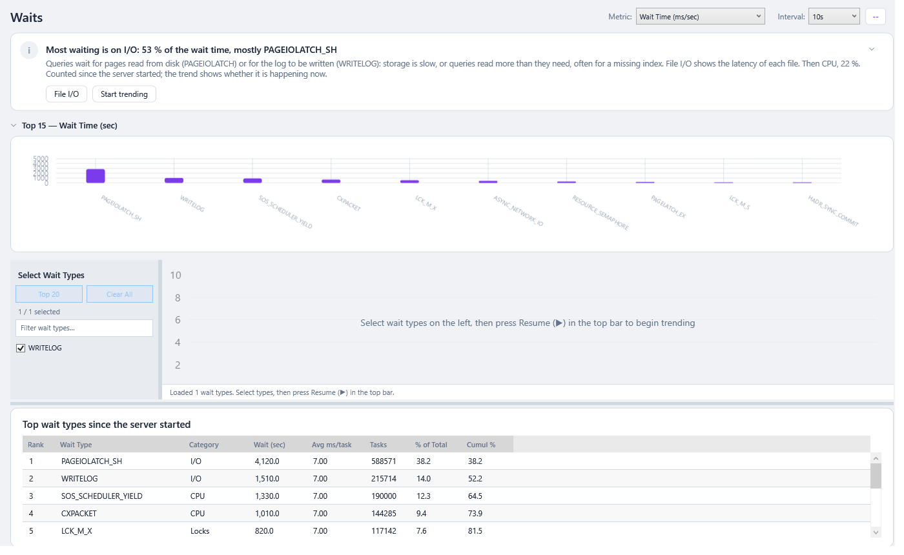

# Wait Statistics

Whenever a query can't continue, for example because it needs data from disk, a lock another query holds, or a free CPU, SQL Server records **what it waited for** and **for how long**. Adding those waits up is the fastest way to learn **why** a server is slow.

| Screen | Answers |
|---|---|
| [📊 Waits](#waits) | What has the server waited on most, since it started or over a range you pick, and how do selected waits change over time? |

> **From 0.79.0** Top Waits and Wait Trend are one page, **Waits**: the trend at the top, the top waits under it ([#178](https://github.com/aselasampath/sqlvitals/issues/178)). A link, a bookmark in your history or a saved setting that names either old page opens Waits.

---

## Waits

> **Where:** sidebar → 📊 Waits · **Use it when:** you're starting any "why is it slow?" investigation, or want to see *when* a wait rose

From the top:

1. **The verdict**: see [below](#the-verdict).
2. **Top 15 — Wait Time (sec)**: a bar chart of the top 15 wait types. It folds to one line (*PAGEIOLATCH_SH 38.2 % · WRITELOG 14.0 % · …*).
3. **The trend**: the wait types you pick, charted live or over a past range. See [The trend](#the-trend).
4. **The top waits**: the 25 wait types that waited most, ranked. Live, they are counted **since the server started**; on a past range, **over that range**, from the monitoring history. The heading above the table says which. See [The top waits](#the-top-waits).

Drag the bar between the trend and the table to give either more room.

### The verdict

The page has one verdict (see [The page template](Getting-Started.md#verdict-first-then-the-detail)):

- **While the trend draws lines**, it reads them: the wait type that waits the most on average over what is drawn (*CXPACKET waits the most: 2,485 ms/s on average over the last 4 min*), its share, the next one, and **and rising**, in amber, when its last readings are at least twice its first. **Chart the top 20** ticks the 20 wait types that waited most.
- **Otherwise** it reads the table: the [wait category](#wait-categories) with most of the wait time and what it usually means: *Most waiting is on I/O: 53 % of the wait time, mostly PAGEIOLATCH_SH*, then the next category. It is amber when **Locks** comes first. A button opens the page that shows the cause (File I/O, Resource Queries, Memory or Processes). While the trend hasn't started, **Start trending** starts it, as **Resume (▶)** in the top bar does.
- On a past range with nothing recorded it says so (*Nothing recorded in this range*).

### The trend

1. In **Select Wait Types** on the left, click the wait types to chart. **Filter wait types…** searches the list. **Top 20** ticks the 20 that waited most: since the server started while live, over the range on a past range. **Clear All** empties the selection.
2. Pick a **Metric**:
   - **Wait Time (ms/sec)**: milliseconds of waiting per second. The usual choice.
   - **Signal Wait (ms/sec)**: time spent waiting for a CPU *after* the resource became free. High values point to CPU pressure.
   - **Resource Wait (ms/sec)**: time spent waiting for the resource itself: disk, lock, memory.
   - **Waiting Tasks/sec**: how often the wait happens.
3. Choose an **Interval** (5s, 10s, 30s or 60s) and press **Resume (▶)** in the top bar; **Pause** stops it.
4. To look back instead, use the **range picker** in the top bar: **1h**, **24h**, **7d** or **Custom…**. The table follows the range. Add **Compare to baseline** to overlay the same time last week. See [History, Time Ranges and Baselines](History-Time-Ranges-and-Baselines.md).

### The top waits

| Column | Meaning |
|---|---|
| **Rank** | 1 = the most time spent waiting |
| **Wait Type** | SQL Server's name for the wait, e.g. `PAGEIOLATCH_SH` |
| **Category** | The group it belongs to. See [Wait categories](#wait-categories). |
| **Wait (sec)** | Total time spent on this wait, since the server last started or over the range |
| **Avg ms/task** | Average length of one wait. Long individual waits matter more than many tiny ones. |
| **Tasks** | How many times it happened |
| **% of Total** / **Cumul %** | Its share of all waits, and the running total down the list |

#### Reading it

- **Look at the top 3–5 rows.** They usually cover most of the waiting (watch *Cumul %*).
- Live, the numbers **accumulate since SQL Server last started**. On a server that has run for months, one bad night won't move them much. Pick a past range (**24h**, **Custom…**) to rank the waits of that night only, if the server was monitored then.
- Idle background waits, which are normal, are left out of the ranking.
- Live, the table is read when the page opens and on **Refresh**, at the same time as the trend, not on every tick of the trend. If it can't be read, the verdict says so and the trend still reads.

---

## Wait categories

SqlVitals sorts wait types into a few categories, used on Waits, in Processes' Waiting view, the Live charts stacked chart and the Overview's waits chart.

| Category | Usually means | Typical wait types | Where to look next |
|---|---|---|---|
| **CPU** | Queries are competing for processors, or running in parallel | `SOS_SCHEDULER_YIELD`, `CXPACKET`, `CXCONSUMER`, `THREADPOOL` | [Resource Queries](Query-Performance.md#resource-queries) by CPU; *MAXDOP* and *Cost threshold* on [Configuration Checks](Configuration-Checks.md) |
| **I/O** | Reading data from disk, or writing the transaction log | `PAGEIOLATCH_SH/EX`, `WRITELOG`, `IO_COMPLETION` | [Resource Queries](Query-Performance.md#resource-queries) by reads, [Missing Indexes](Index-and-Statistics-Maintenance.md#missing-indexes), storage latency per file on [File I/O](File-IO.md) |
| **Memory** | Waiting for memory, or for pages in memory (latches) | `RESOURCE_SEMAPHORE`, `PAGELATCH_*`, `LATCH_*` | [Memory](Server-Resources.md#memory), [TempDB](Server-Resources.md#tempdb) |
| **Locks** | Blocking: one query waits for another's lock | `LCK_M_S`, `LCK_M_X`, `LCK_M_U`, … | [Processes](Live-Monitoring.md#processes-blocking-chains) |
| **Network** | The client isn't reading results fast enough | `ASYNC_NETWORK_IO` | The application: it may be fetching huge result sets or processing rows one by one |
| **Benign/Idle** | Background tasks sleeping. **Normal; ignore.** | `SLEEP_TASK`, `WAITFOR`, `XE_TIMER_EVENT`, … | — |
| **Other** | Everything else | | Search the wait type name online |

### Signal vs resource waits

Each wait has two parts: the **resource** part (waiting for the disk, lock or memory) and the **signal** part (the resource is ready, but the task is waiting for a CPU). Across the whole server:

| Signal share of all waits | CPU pressure |
|---|---|
| ≤ 10 % | Normal |
| > 10 % | Moderate. Monitor it. |
| > 25 % | High. Threads are queuing for CPU. |

This figure appears in the [Export for AI](Export-for-AI.md) report (*Signal vs Resource Wait*).

---

### Under the hood

- **Source:** `sys.dm_os_wait_stats`, which is cumulative since the last restart or since someone cleared it with `DBCC SQLPERF('sys.dm_os_wait_stats', CLEAR)`.
- **Categories** are assigned in SQL by a `CASE` on `wait_type` in `Engine/Sql/Waits/TopWaitTypes.sql` (the table) and `Engine/Sql/Waits/CumulativeWaits.sql` (the trend's list). The Benign/Idle list is also excluded from the *% of Total* denominator. Category colours come from `WaitsRepository.CategoryColor()`.
- **The table on a past range** is built from the history's `wait_deltas` by `Engine/History/HistoryTopWaits`: each wait type's changes summed over the range, ranked, with the same categories (`WaitCategory.Of`, the same `CASE` in C#). The history keeps no maximum wait per type.
- **The trend live** computes per-second rates from the difference between successive reads. **The trend's history** reads the `wait_deltas` table, which holds per-type changes per detail snapshot (5 minutes by default). Idle waits are not stored there. For that reason, a past range starts on the range's own top waits if none of your selected types were recorded.
- The Live charts stacked chart (and the Overview's waits chart) plots per-category wait ms/sec from the live sample (`metric_samples`), not per type.
