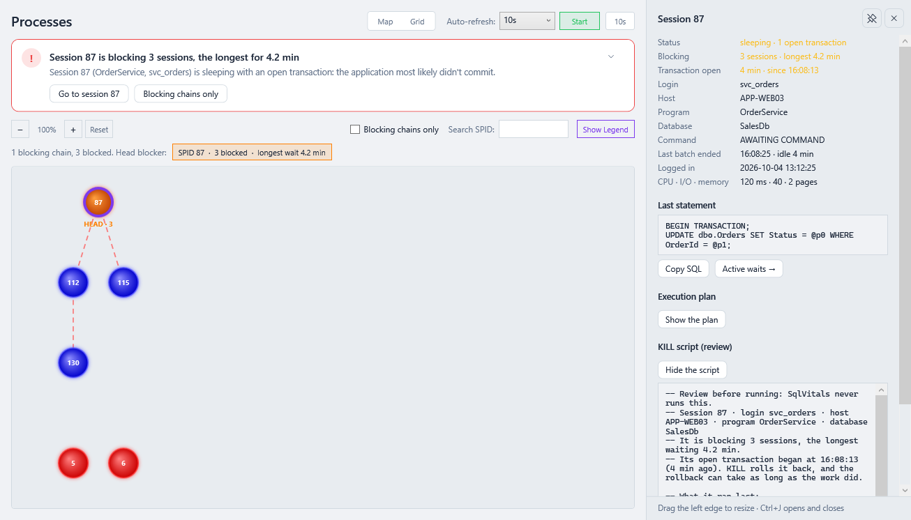
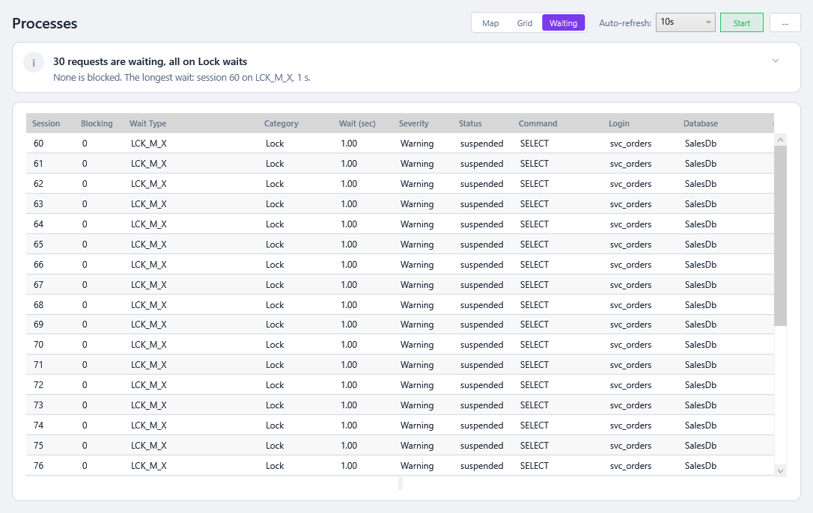
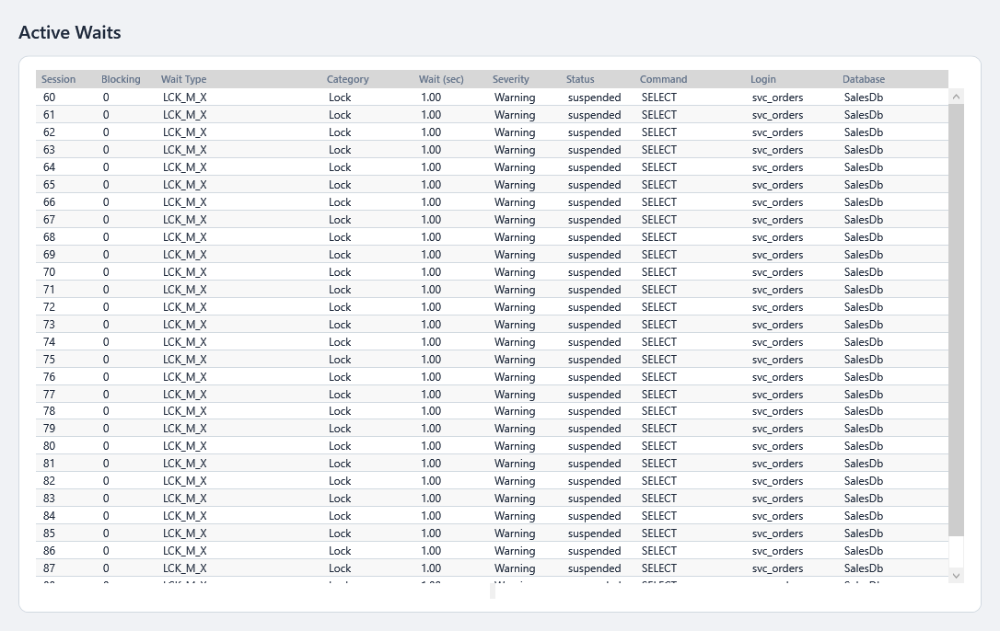

# Working with Grids

Most SqlVitals screens show results in grids (tables). They all work the same way.

## Details beside the grid

From 0.63.0 a row's details open in a **details drawer** at the right of the screen instead of a window or a panel over the grid, so you can go down a grid row by row and keep your place. **Processes** (a session) and **Query Store** (a query, from any tab) fill it; from 0.65.0 so do **Resource Queries** (a query, from any tab), **Query Regressions** (a regressed query, with its plans now and before) and **SP Trace** (a captured call, which replaced the statement pane under the calls); from 0.66.0 also **File I/O** (a file: why it's highlighted, its figures and path), **Index Health** (a missing index, with its `CREATE` statement), **Agent Jobs** (a job, and the message of the step selected under it), **Config Checks** and **Security Audit** (a check or finding, with the script that fixes it, which replaced the panel under the grid) and **Alerts** (an alert's figures and details). Each plan there is drawn in the drawer when you press **Show the plan**, and **Open in window** opens it in its own window as the grid's plan buttons do. On other screens it says there is nothing to show yet.

- **Click a row** (or a node on the Processes map) to open it with that row's details. Moving the selection with the keyboard updates an open drawer without opening a closed one. With nothing selected it says what to select.
- **Ctrl+J**, or the **details button** in the top bar, opens and closes it.
- It **floats** over the right of the grid, or is **pinned** beside it, which makes the grid narrower so nothing is hidden. The pin button at its top right switches between the two; **Esc** closes a floating drawer.
- **Drag its left edge** to make it 320 to 640 pixels wide.
- It opens pinned or floating, at the width you left it, the next time; whether it was open isn't kept.
- What it shows stays while you refresh, sort or filter the grid, and while you move to another tab of the same screen, until you select another row.
- A plan or a script in it opens in its own window with **Open in window**, for a second monitor.

## Grid density

**⚙️ Settings → Appearance → Grid density** (from 0.64.0): **Comfortable** or **Compact**. Compact keeps the 12 px text and takes the room from around it: every grid, at once, without a restart. The cells stay one line of text each, with the same names for screen readers and the same focus outline.

| Comfortable | Compact |
|---|---|
|  |  |

For the most rows of all, add [focus mode](Getting-Started.md#focus-mode) (**F11**): full screen, without the sidebar.

## Sort

Click a column header to sort, and click again to reverse. **Refresh keeps your sort**, so you can sort by *Avg CPU*, press Refresh, and still see the worst query at the top. From 0.55.0 it is also kept when you leave the page and come back to it (see [below](#coming-back-to-a-page)).

## Filter

**Resource Queries** (all tabs), **Index Health** (all tabs), **Query Store** and **Query Regressions** have a **Filter rows…** box above each grid.

| You type | Shows rows that… |
|---|---|
| `orders` | contain "orders" in any visible column |
| `orders customer` | contain **both** words, anywhere in the row |
| `"dbo.Orders"` | contain that exact phrase |
| `40000` or `40,000` | show 40,000: numbers match with or without separators |
| `2026-09-23 14:05` | match a date as the grid displays it |

- Matching ignores upper and lower case.
- While a filter is on, the box shows **N of M rows**.
- **Esc** or **✕** clears it.
- **Refresh keeps the filter**, and from 0.55.0 so does leaving the page and coming back.

## Coming back to a page

From 0.55.0, a screen you return to, from the sidebar or with **← Back** (**Alt+←**), opens as you left it, with fresh data:

- the **tab** you were on;
- each grid's **sort**, **filter** and **selected row**;
- how far the grid and the screen were **scrolled**.

Good to know:

- **Per server and per way in:** *Processes* on one server and on another remember their own; *Alerts* opened from a notification has its own, separate from *Alerts* opened from the sidebar.
- **The selected row** is found again by its text (database, table, statement, login…). If that text changed, no row is selected rather than the wrong one.
- **What you do while it loads wins:** if you sort, filter or select before the rows arrive, SqlVitals doesn't put back the old ones.
- **Choices that start something aren't brought back:** a trace, auto-refresh or *Start* stays as the screen sets it up when it opens. A tab and a selected row *are* brought back, so a screen that reads more when you open a tab or select a row (Query Store's tabs, Agent Jobs' and Backups' history) reads it again.
- The last 50 screens are remembered, until SqlVitals closes.

## Copy and export

**Right-click any grid**:

| Menu item | Copies |
|---|---|
| **Copy** | The selected rows, or **every row** if none are selected, tab-separated and ready to paste into Excel or an email |
| **Copy with headers** | The same, with the column names first |
| **Export to CSV…** | Every row shown, whatever is selected, saved as a UTF-8 CSV file. Text that Excel would run as a formula (starting with `=`, `+`, `-` or `@`) gets an apostrophe in front, so it opens as text |

On **Resource Queries**, **⎘ Copy All** copies every row shown, with headers.

## What you see is what you get

Copy, Export to CSV, Copy All and the **script buttons** on Index Health and Stale Stats all use **the rows the filter shows, in the current sort order**. For example, to script missing indexes for one table only, type the table name in the filter and click **Generate CREATE Script**. The button reads **(N shown)** while a filter is on.

---

### Under the hood

- **Filtering:** `SqlVitals/Engine/Filtering/RowFilter.cs` parses terms (words and quoted phrases) and matches each against the displayed text **and** the raw value of every visible column. The control is `Desktop/Controls/GridFilterBox`.
- **Keeping sort and filter on reload:** pages set rows through `Desktop/Helpers/DataGridRefresh.SetItemsSource`, which reapplies the `SortDescriptions` and the filter predicate.
- **Copy / CSV:** `Desktop/Helpers/DataGridExport` adds the context menu to every grid. Text is built by `Engine/Export/DelimitedText.cs`: tab-separated for the clipboard and CSV for files. Only visible columns are exported, in display order.
- **Formulas in CSV:** application names, host names and query text come from the server, and anyone who can connect chooses their own application name. Excel runs a cell that starts with `=`, `+`, `-`, `@`, a tab or a carriage return as a formula when it opens a CSV file, so such a **text** cell is written with a leading `'` (`DelimitedText.NeutralizeFormula`). Numbers and dates are written as they are: a negative number is not a formula. The clipboard copy is left exactly as shown, because query text copied from a grid is usually pasted into SSMS to run. Added in 0.44.1 (#109).
