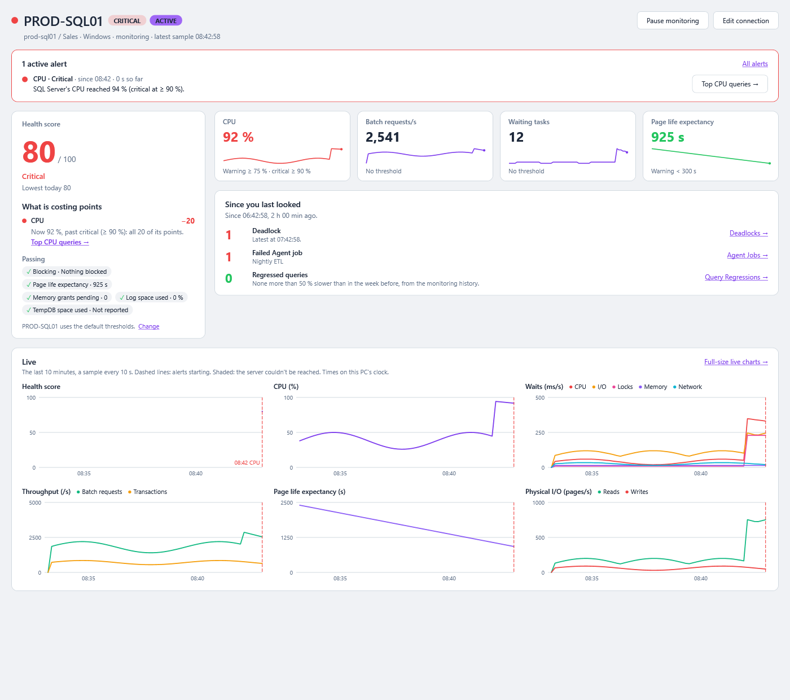
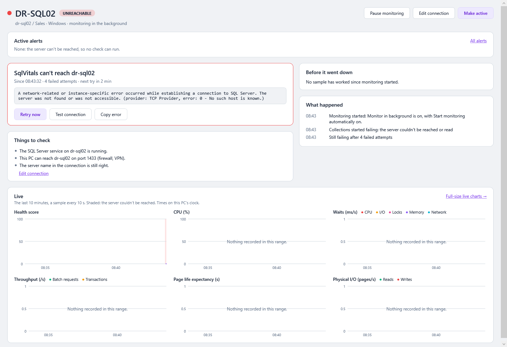
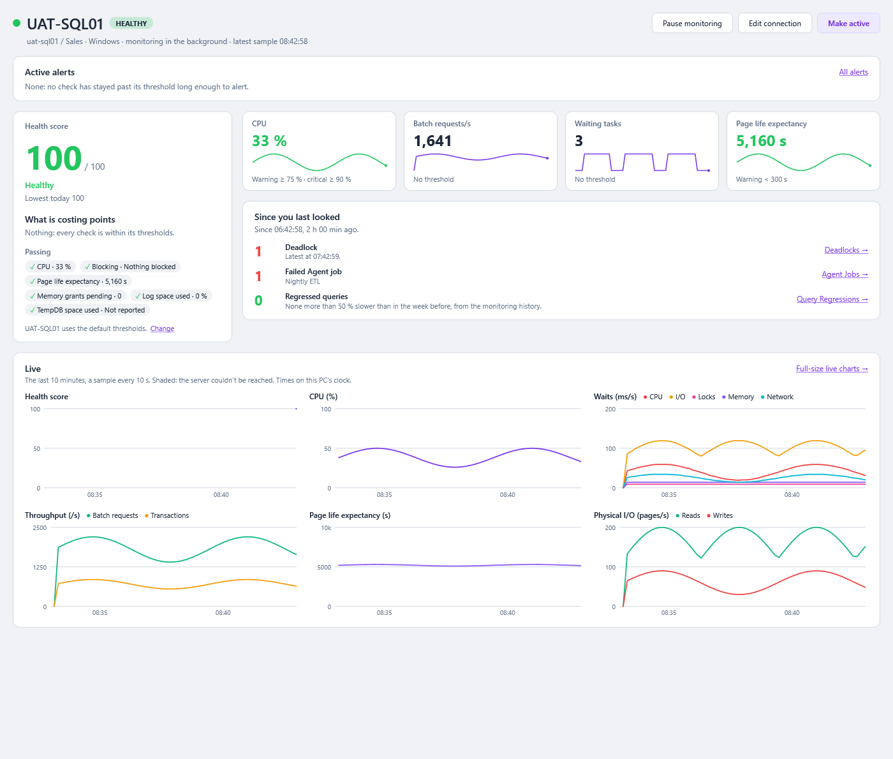

# Your Servers (All servers)

**All servers** (🏠 Home before 0.57.0) shows every saved connection as a tile with its [health score](Health-Dot-and-Background-Monitoring.md#health-score), the servers that need attention first. **Open** a tile for the server's [Overview](#a-servers-overview): is it OK, and if not, why? Its active alerts with the evidence for each, what is costing its score points, its headline numbers, what happened since you last looked, and its charts.

> **Where:** **All servers**, at the top of the sidebar, or the first part of the breadcrumb · **Since:** 0.53.0

From 0.57.0 SqlVitals opens on the screen you were on when you last closed it. Before that has happened, it opens on All servers when you have **two or more** saved connections, and on the server's Overview with one.

Home only uses what monitoring has already collected and the local [history](Monitoring-History-Database.md): opening it sends **no query to any server**. A server's Overview reads a little more from a monitored server (deadlocks, Agent jobs, and the blocking chain while there is one), and never contacts a server that isn't monitored. See [Load on the server](#load-on-the-server).

---

## The tiles

At the top, *Your servers* says how many connections there are and how many are monitored, with a count of each status that has any: *1 unreachable · 2 critical · 1 warning · 3 healthy*.

Each tile shows:

| | |
|---|---|
| **Name and status** | The health dot, the connection's name, and its status in words: **CRITICAL**, **WARNING**, **HEALTHY**, **UNREACHABLE**, **WAITING** or **OFF**. The active connection also says **ACTIVE** and has an accent border. |
| **Server / database** | The connection's server and database |
| **Score** | 0 to 100, in the dot's colour, with a sparkline of the **last hour**. |
| **Why** | What lowered it, in the words of the score's breakdown: *Lowered by Page life expectancy −8.* |
| **Six bars** | One per check (CPU, Blocking, PLE, Grants, Log, TempDB), each in its own colour. Point at a bar for its figure and thresholds. |
| **Footer** | When the last sample was taken, and whether it's the active connection or monitored in the background |
| **Button** | **Open** its Overview, **Retry** a server that can't be reached, or **▶ Start monitoring** one that isn't monitored |
| **⋯ menu** | From 0.57.0: **Open**, **Start monitoring** or **Stop monitoring**, **Why this score…** (the score's breakdown, beside the tile) and **Edit connection…**: what the sidebar's connection selector did for each server before |

The last tile, **+ Add a connection**, opens Settings on a new connection.

### Statuses

| Status | When | Score | Button |
|---|---|---|---|
| **Critical**, **Warning**, **Healthy** | Monitored; the dot's colour on the latest sample | The latest score | **Open** |
| **Unreachable** | Monitored, but the last collection failed: the server couldn't be reached, the login failed, a permission is missing… | **0**. The tile says since when, and the error is in the tooltip. The bars are grey. | **Retry**: tries straight away, and opens its Overview |
| **Waiting** | Monitored, before its first sample | — | **Open** |
| **Off** | Not monitored: *Not monitored, so there's no score yet*, and why (for example, the password isn't saved) | — | **▶ Start monitoring**, as **⋯ → Start monitoring** does. It's greyed out while it can't start, and its tooltip says why. |

### Order

The tiles are sorted by what needs attention most: **unreachable and critical** first, then **warning**, **healthy**, **waiting** and **off**, by name within each. The active connection is sorted like the others: it's marked, not moved.

The tiles update with every sample. A tile whose status changes moves to its new place, but not while the mouse is over the tiles, so one never moves from under a click.

---

## A server's Overview

**Open** on a tile opens that server's **Overview**, and with it the server's workspace: its screens in the sidebar, under its name (see [The server workspace](Getting-Started.md#the-server-workspace)). From 0.59.0 the Overview is the one page that answers *is this server OK, and if not, why?*: it replaces the server's Summary and takes the place of Live Metrics as the first page of the server. A Windows notification for an alert, **View on Home** in Settings, and **Save & make active** open it too.

At the top are the server's name, status, server / database, sign-in and whether it's monitored, and three buttons:

- **Make active**: makes this the connection the server's screens query, as opening one of them does. It's hidden when the connection is already active.
- **Pause monitoring** or **Start monitoring**: stops or starts it until SqlVitals exits, as ▶ / ■ in the sidebar's server header does.
- **Edit connection**: opens its page in ⚙️ Settings → Connections.

### Active alerts

First, the server's alerts that are active now, the critical ones first. Each says:

- **what and how bad**: *CPU · Critical*, and **since when**: *since 14:02 · 25 min so far*;
- **what is happening, in plain words**, with the worst figure and the threshold it crossed: *SQL Server's CPU reached 97 % (critical at ≥ 90 %).*, *Requests are blocked: the longest has waited 3.5 min (critical at ≥ 2 min).*, *Pages leave the buffer pool after only 120 s (warning at < 300 s): memory pressure.*;
- a button to its **evidence**: for now the page that explains the check (the same pages as [the checks' links](#what-is-costing-points)); a later version opens it at the alert's time.

With none: *None: no check has stayed past its threshold long enough to alert*, with how many ended earlier today. **All alerts** opens 🔔 Alerts filtered to this connection.

### Health score

The score, its status, and how it got there: *Was 100 at 21:45 · lowest today 70 at 21:52*.

### What is costing points

Each check that lowers the score, the costliest first, with:

- its **points**: half its weight past its warning threshold, all of it past critical, the same points as the [score's breakdown](Health-Dot-and-Background-Monitoring.md#health-score), so they always add up to what the score lost;
- **why**, in one line: *Now 82 %, past warning (≥ 75 %): half of its 20 points.*;
- a **link to the page that explains it**:

| Check | Link | Opens |
|---|---|---|
| Blocking | Blocking chain | 🔗 Processes |
| CPU | Top CPU queries | 🔥 Resource Queries |
| Page life expectancy | Memory | 🧠 Memory Grants |
| Memory grants pending | Memory grants | 🧠 Memory Grants |
| Log space used | Log space | 📦 DB Storage |
| TempDB space used | TempDB | 🗄️ TempDB |

Those pages show the active connection, so a link **makes this connection active first**. The checks that pass are listed below in one compact line each: *✓ Blocking · Nothing blocked*. A line says whether the connection uses the default thresholds or its own, with **Change**, which opens the connection's **Health thresholds** tab in Settings.

### Headline numbers

Four tiles, each with the latest figure and a sparkline of the samples SqlVitals keeps for the server (the last 10 minutes at the default interval):

| Tile | What | Colour |
|---|---|---|
| **CPU** | SQL Server's share of the CPU | By your CPU thresholds: green, amber or red |
| **Batch requests/s** | How busy the server is | None: busier isn't worse |
| **Waiting tasks** | User tasks waiting on a lock, I/O, memory or anything else right now (`sys.dm_os_waiting_tasks`) | None: there is no threshold for it |
| **Page life expectancy** | How long a page stays in memory | By your page life expectancy thresholds |

Each tile says the thresholds it's coloured by, or *No threshold*. A connection's own thresholds apply, as they do to its score.

### Blocking right now

Shown only while the **Blocking** check is past its warning threshold. It names the head blocker of the biggest blocking chain (its session, login, host and program), how many sessions wait behind it and on what, how long the longest has waited, and the head's statement on one line. **See the blocking chain →** opens 🔗 Processes. If there's more than one chain, it says how many more.

### Since you last looked

What happened on the server since you last opened its Overview: *Since 08:15, 6 h 05 min ago*. The first time, the last 24 hours; after more than a week away, the last 7 days.

| Row | From | Link |
|---|---|---|
| **Deadlocks** | The server's `system_health` session, as on [Deadlocks](Deadlocks.md), with the latest one's victim | 💥 Deadlocks |
| **Failed Agent jobs** | msdb: jobs whose last run failed in the period, by name | 🕒 Agent Jobs |
| **Regressed queries** | The monitoring history: queries more than your [regression threshold](Query-Regressions.md) slower than in the week before | 🐢 Query Regressions |

Deadlocks and jobs are read from the server when the Overview opens, only while the server is monitored and answering; otherwise the row says *Not checked* and why. Azure SQL Database has no Agent, so its jobs row says so. When the Overview was last opened is saved for each server in the settings file, but isn't in the [activity log](Settings.md#activity-log). Coming back within 15 minutes, from a page it linked to or with Back, carries on the same period, so the deadlock you just looked at is still counted. Refresh (F5) reads again for the same period.

### Charts

Six charts over the **time window in the top bar**: **Live** (the samples kept for the server, at least the last 10 minutes), or **1h**, **24h**, **7d** or **Custom…** from the [history](History-Time-Ranges-and-Baselines.md).

- **Health score**: the lowest score in each slice of time; **shading** marks when the server couldn't be reached.
- **CPU (%)**, **Waits (ms/s)** by category (CPU, I/O, locks, memory, network), **Throughput** (batch requests and transactions per second), **Page life expectancy** and **Physical I/O** (page reads and writes per second).
- **Dashed lines** mark where alerts started, on every chart, labelled with the time and the check on the health score: *21:52 Block*.
- The line breaks where monitoring was off. Times are on this PC's clock.

**Full-size live charts →** opens **Live charts** (Live Metrics before 0.59.0), in the same Overview group, for bigger charts, the baseline, the process map and the sample interval.

---

## When a server can't be reached

The Overview of an unreachable server replaces the score, the headline numbers and *Since you last looked* with:

- **SqlVitals can't reach *server***: since when, how many attempts have failed, and a countdown to the next one. Retries back off to once every five minutes. Below is the error in full, with:
  - **Retry now**, which tries straight away;
  - **Test connection**, which opens a connection with the saved details and closes it again;
  - **Copy error**.
- **Things to check**, for the way the server name is written:
  - the SQL Server service is running, or, for Azure SQL, the server's firewall allows this PC's IP address;
  - this PC can reach the server's port (firewall, VPN);
  - for a named instance without a port, the SQL Server Browser;
  - the login, when the error says the login failed;
  - the server name itself, with **Edit connection**.
- **Before it went down**: the last score taken while the server could be reached, and when.
- **What happened**: the last good sample, when collections started failing, monitoring starting and stopping, alerts starting and ending, and that it's still failing.

The charts stay below, with the time it couldn't be reached shaded.

A healthy server's Overview, for comparison:

---

## Load on the server

| What | Server queries |
|---|---|
| Home and its tiles | **None.** Scores, statuses and sparklines come from the running monitoring and the local history. |
| A server's Overview | Only while the server is monitored and answering: **Since you last looked** reads the deadlocks (as 💥 Deadlocks does) and the Agent jobs (as 🕒 Agent Jobs does) once when it opens and on Refresh; **Blocking right now** reads the sessions (the same query as 🔗 Processes) once per sample, only while blocking is past its warning threshold. Everything else comes from the running monitoring and the local history. |
| **Retry**, **Retry now** | One monitoring sample, as the next scheduled one would be |
| **Test connection** | Opens and closes a connection |
| **▶ Start monitoring** | Monitoring starts, as ▶ in the sidebar's server header does: see [Server Impact and Permissions](Server-Impact-and-Permissions.md) |

## Good to know

- A tile's score is the **latest** one, like the dot. Use the charts on the Overview for how it got there, and [Alerts](Alerts.md) for how long a problem lasted.
- A connection that isn't monitored never has a score on Home, not even an old one: an old score would read as the server's health now.
- The score's colour is the dot's colour, not a banding of the number: see [Health score](Health-Dot-and-Background-Monitoring.md#health-score).
- With many connections the grid scrolls. A list view for dozens of servers may come later.
